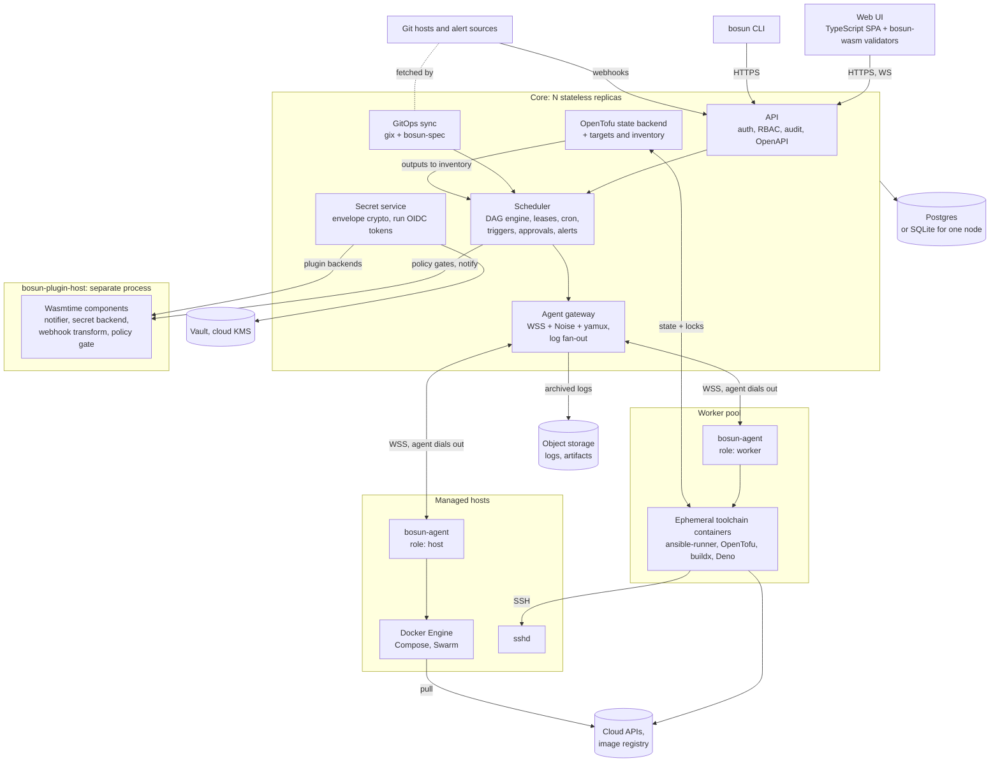
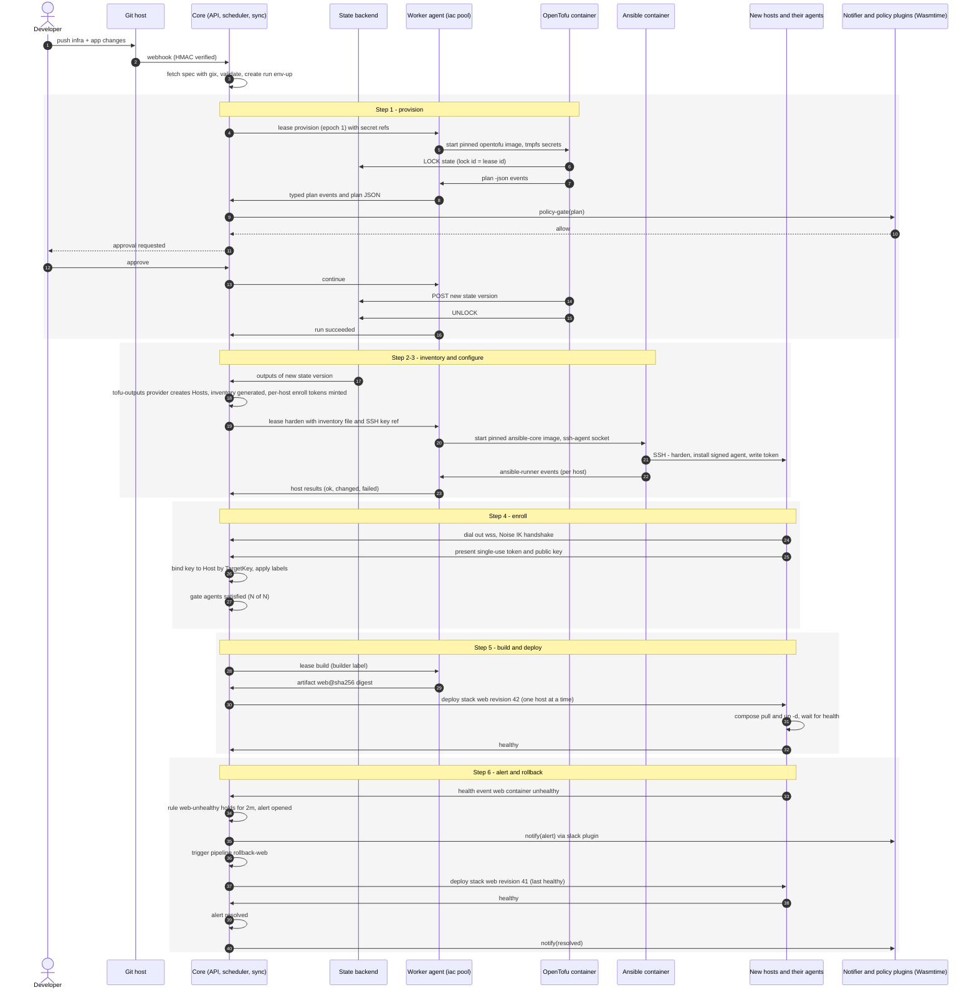

# Semaphore UI × Komodo as one Rust control plane — architecture exploration

Exploration, not a plan. Facts checked on 2026-10-21 against Semaphore at `2ae957f` (develop, past
2.19) and Komodo at `780ac68` (v2.3.3), crates.io, and upstream GitHub; anything seen only in a
search excerpt is marked as such in [Sources](#sources). Code references are `repo path:line` at
those commits.

## Verdict

1. **Build it, as a new product with import paths from both tools — not as a merge of their codebases — and only if you can fund ~6 engineers for 12–15 months to an MVP.** Otherwise ship a 2–4 week bridge to test demand and stop there.
2. **Strategy (b):** a new Rust engine under a licence you choose (Apache-2.0 core). Port Semaphore's MIT logic where it helps; take Komodo's concepts, not its GPL-3.0 code. Forking Komodo (a) saves ~3–4 months but locks in GPL, a model with no tenancy, and MongoDB.
3. **Decision 1 — one dial-out agent** with `host` and `worker` roles over WSS + yamux, per-agent keys enrolled by single-use tokens, Noise-authenticated and end-to-end encrypted; jobs run in ephemeral, digest-pinned toolchain containers. Ansible and OpenTofu are orchestrated, never rewritten.
4. **Decision 2 — Postgres (SQLite for one node) via `sqlx` as the only store:** queue, leases, state backend, audit. No MongoDB wire protocol; FerretDB has not released since November 2025.
5. **Decision 3 — WebAssembly at two seams only:** Wasmtime components (WIT, WASI 0.3) for sandboxed plugins, and shared validation crates in the browser. The UI is a TypeScript SPA; user scripts run in a separate, locked-down Deno process.
6. **What doesn't hold up:** Rust by itself buys little here — the jobs are Python and Go, and that is where the time goes. The case rests on one model, one agent and one audit trail, not on the language.

## What was checked, and where the brief was off

| Claim in the brief | Finding | Source |
| --- | --- | --- |
| Semaphore latest stable is 2.19.x | v2.19.17, 2026-10-20 | Semaphore releases |
| ⚠️ 2.20 pre-releases add workflows and an audit UI | **Workflows shipped in 2.19** (2026-08-06, Pro, beta) together with the Docker/Kubernetes executors, task OIDC tokens and keyring rotation. 2.20 (alpha1 → `v2.20.16-beta1` on 2026-10-20) adds the security audit log and its admin screen | v2.19.7 release; PR #4325 |
| MIT, open-core | Community is MIT; Pro/Enterprise is proprietary, in the private `semaphorepro-module`. Pro-gated: Terraform backend, external secret storages, Docker/K8s executors, workflows, HA, custom/global roles | `LICENSE`; `pro_interfaces/featues.go:4-23` |
| Remote runners poll | HTTP polling (5 s default), progress PUT every second, no websocket. Access keys are decrypted on the server and returned in the poll response; runner tokens are stored unhashed | `api/router.go:175-181`; `api/runners/runners.go:181-247`; `db/sql/global_runner.go:12-18` |
| SQL storage | SQLite / MySQL / Postgres; BoltDB removed in 2.19 | `db/factory/store.go:14-24` |
| Vue 2 + Vuetify 2 | Vue 2.7.16, Vuetify 2.7.2 (locked); CodeMirror 5, Drawflow | `web/package.json` |
| ⚠️ Komodo v2.x added dial-out, PKI, onboarding keys, Swarm, TOTP, OpenAPI, JSON schema, pagination, cancellable builds/actions | 2.0.0 (2026-03-24): dial-out, PKI with rotation, onboarding keys, Swarm, passkey/TOTP, OpenAPI. **JSON schema: 2.2.0. Pagination and cancellable actions/procedures: 2.3.0** (2026-07-29). **Cancellable builds predate v2.** Latest 2.3.3 (2026-09-01) | v2.0.0 / v2.3.0 notes; git history |
| PKI auth | Noise `XX` over X25519 (`snow`, via the MPL-2.0 `mogh_pki`) authenticates both ends, bound to the WebSocket by a prologue. **Authentication only** — confidentiality comes from TLS | komodo `lib/transport/src/auth.rs` |
| Actions run in Deno | `deno run --allow-all` inside the Core container, with a per-run API key for an admin user | komodo `bin/core/src/api/execute/action.rs:155-224` |
| MongoDB wire protocol | MongoDB or FerretDB v2 (on DocumentDB); no migration framework | komodo `lib/database`; `docsite/docs/setup/ferretdb.mdx` |
| GPL-3.0 | GPL-3.0-or-later; no CLA; `mongo_indexed` and `derive_default_builder` are GPL too, the twelve `mogh_*` crates are MPL-2.0 | `Cargo.toml`; crates.io |
| Kubernetes undecided | roadmap "Undecided", no code | komodo `roadmap.md:17` |
| WASI 0.3 ratified June 2026 | 0.3.0 released 2026-06-11; Wasmtime 46 (2026-06-22) enables it by default; `wasi:http` is at 0.3.2 | WASI releases; Wasmtime `RELEASES.md` |
| FerretDB maintenance uncertain | no release since v2.7.0 (2025-11-10); unanswered maintenance-status discussion (2026-06); MongoDB v. FerretDB patent suit pending | FerretDB releases, discussion #5651; D. Del. 1:25-cv-00641 |

## The system at a glance



The core never executes user code: Ansible, OpenTofu, builds and scripts run in containers on
workers, and third-party plugins run in a separate process. The core holds the database, the KEK and
the scheduling truth; agents hold only what a lease gives them.

## 1. Strategy and licensing

### 1.1 The three options

| | (a) Extend Komodo | (b) New Rust engine, concepts from both | (c) Thin bridge |
| --- | --- | --- | --- |
| Resulting licence | GPL-3.0-or-later for the whole product (Komodo's `Cargo.toml` declares it; `LICENSE` is GPL v3) | your choice; recommended Apache-2.0 core | unchanged: Semaphore MIT (+ Pro), Komodo GPL; the bridge can be anything |
| Semaphore code you can reuse | community code (MIT, keep the notice) | community code (MIT, keep the notice) | none needed |
| Komodo code you can reuse | all of it | none — not even translated; ideas, behaviour, file formats and API shapes only | none needed |
| Semaphore Pro (`pro_impl`, closed) | only if you own it — and then it becomes GPL when combined | only if you own it; can stay proprietary | n/a |
| Effort to an MVP (team of 6) | ~8–9 months: agent, auth, UI, sync exist; add tenancy, inventories, IaC jobs, state backend, credential store, run model | ~12 months (plan for 15) | 6–8 weeks for 2 engineers |
| Long-term maintenance | a hard fork of a fast-moving project (2.0 → 2.3.3 in six months) whose model you must change at the root | everything is yours; no upstream to track | two of everything: databases, auth, RBAC, agents per host, UIs, release trains |
| Meets "Rust is the engine" | yes | yes | no — half the engine stays Go |

### 1.2 What the licences actually allow

- **Semaphore community code is MIT** (`LICENSE:1-4`, © Denis Gukov / Castaway Labs). It can be
  ported into either a GPL or an Apache/MIT codebase; a Go→Rust port is a derivative, so keep the
  MIT notice in `THIRD-PARTY-LICENSES`/`NOTICE`.
- **The Semaphore parts you would most want are not MIT.** The Terraform HTTP state backend, the
  external secret storages (Vault, OpenBao, AWS SM, Azure KV, DVLS), the Docker and Kubernetes
  executors, workflows, custom/global roles and HA are Pro-gated
  (`pro_interfaces/featues.go:4-23`); the community tree contains stubs and the implementation sits
  in the closed `semaphorepro-module` submodule. If you own that code (the private `pro_impl`
  submodule in this checkout suggests you might), it is reusable under (b) and stays proprietary; under (a) it would have to
  become GPL to ship inside the same work.
- **Komodo is GPL-3.0-or-later**, not AGPL, so running it as a service imposes nothing, but every
  agent binary you ship to a customer's host is a distribution with source obligations. Under (b),
  copyright protects Komodo's expression, not its ideas: the resource model, the TOML sync format,
  the handshake *design* and API shapes are fair game for interoperability; code is not, and a
  line-by-line translation into another language is still a derivative.
- **Komodo's dependencies are mixed.** The twelve `mogh_*` crates (auth, PKI, config, …) are
  **MPL-2.0**, usable from an Apache-2.0 product with file-level copyleft on modified files. But
  `mongo_indexed` and `derive_default_builder` are **GPL-3.0-or-later**, so "just depend on the
  author's crates" is not a uniform escape hatch.
- **The tools you orchestrate do not infect the platform.** Ansible (GPL-3.0) and OpenTofu
  (MPL-2.0) run as separate processes in separate images; the FSF treats pipes, sockets and
  command-line arguments as communication between separate programs. A custom Ansible callback
  plugin *imports* Ansible and must be GPL — ship it as a separate file in the toolchain image.
- **Terraform is the exception.** Its BUSL forbids offering it "on a hosted or embedded basis" in
  competition with IBM's paid products, and defines embedded to include packaging an offering so
  that Terraform "must be accessed or downloaded for the competitive offering to operate". A paid
  IaC orchestration product is plausibly that. Ship OpenTofu images only, let users bring their own
  Terraform image, and get counsel's view before advertising Terraform support in a paid tier
  (Spacelift serves only MPL Terraform ≤ 1.5.7 plus OpenTofu).

**Clean-room, practically.** For (b) you do not need a formal two-team clean room to borrow
concepts at the level of "a Stack is a Compose project on a host". You do need one discipline: the
engineers who write the agent protocol, PKI and sync-reconciliation modules do not work from
Komodo's source for those modules. Write behavioural specs from Komodo's docs and black-box
behaviour, have the spec reviewed, and keep that trail. Interop with Komodo's TOML format is
allowed and wanted for the importer.

### 1.3 Recommendation: (b), with (c) only as a demand test

**Why not (a), even though it is the cheapest route to a working product.** Three structural
reasons, in order of weight:

1. **Licence fit.** GPL-3.0 rules out an open-core model with proprietary in-process modules. If
   the fused product is commercial open-core — and Semaphore's `pro/` + `pro_interfaces/` split
   says that model is in play — (a) is closed. Komodo has no CLA and 176 merged PRs including
   external contributors, so relicensing would need every contributor's consent, not just Mogh's.
2. **The model change is at the root.** Komodo has no tenancy: 11 resource types in one global
   namespace with tags, permissions granted per resource (`entities/mod.rs:1475-1488`,
   `permission.rs`). Semaphore users live in projects. Retrofitting projects into every query,
   permission check, sync file and UI route of a fork is most of a rewrite, without the freedom of
   one.
3. **Storage.** Komodo is MongoDB-wire only, with no migration framework (idempotent startup
   fix-ups plus `#[serde(default)]`). The fused product needs transactional job leases, a state
   backend with locks and an audit trail — Postgres work (§7). Swapping storage under a fork is the
   other half of the rewrite.

**Why not (c) as the product.** It works in weeks — Semaphore integrations call Komodo procedure
webhooks, Komodo Actions call the Semaphore API, a sync job copies Komodo servers into a Semaphore
inventory — and it proves whether users want the joined flow. But it leaves users with two logins,
two RBAC models, two audit trails and two agents per host, and it inherits both products' release
churn. Build it as a 2–4 week demo if demand is unproven; do not ship it as the platform.

**What would tip the balance.**

- *Toward (a):* the product does not need to be open-core (GPL is acceptable), **and** Mogh is a
  partner rather than an upstream you fork from. Then (a) saves ~3–4 months and gets an agent that
  already runs in production.
- *Toward (c):* you need something in users' hands this quarter, or the team is two people.
- *Further toward (b):* you own the Semaphore Pro code. Then the state backend, secret storages,
  executors and workflow semantics are yours to port, and (b) gets materially cheaper.

## 2. Unified domain model

Eight families. Tenancy is **Org → Project**; fleet objects (hosts, agents, pools, clusters) belong
to the org and are *granted* to projects, because a host is shared infrastructure while a template
belongs to a team.

| Family | Unified concept | Semaphore | Komodo | Merge |
| --- | --- | --- | --- | --- |
| **Targets** | `Host` — a machine the platform knows; optional agent, optional SSH address | a line in an Inventory; `HostConfig` per-host credentials | `Server` (a Periphery endpoint) | ⚠️ 1 |
| | `Inventory` — a selector over Hosts plus pass-through sources | `Inventory`: static, static-yaml, file, terraform/tofu/terragrunt workspace | tags on Servers | ⚠️ 1 |
| | `Agent` with roles `host` / `worker` | `Runner` (polling job worker; project runners are Pro) | Periphery | clean |
| | `Pool` — workers selected by labels | runner tags | `Builder` (Url / Server list / AWS EC2) | clean |
| | `Cluster` — Swarm now, Kubernetes later | — (the K8s executor runs tasks, it is not a target) | `Swarm` | clean |
| **Workloads** | `Service` — one container | — | `Deployment` | clean |
| | `Stack` — a Compose project, or a Swarm stack when bound to a Cluster | — | `Stack` (`swarm_id` switches to `docker stack deploy`) | clean |
| | `Artifact` + versions — what a build produced (image digest, file, version string) | Template type `build` (version counter) consumed by type `deploy` | `Build` output image + version | ⚠️ 8 |
| | `Repository` — git source + credentials | `Repository` (git/ssh/https/file/local) | git accounts; `Repo` is also an *executable* resource | ⚠️ 9 |
| **Jobs** | `Job` — a one-shot definition: `ansible`, `tofu`, `terraform`, `terragrunt`, `script` (bash/pwsh/python), `build` | `Template` (app: ansible, terraform, tofu, terragrunt, bash, powershell, python, pulumi) | `Build`, `Repo` build, `Action` | clean |
| | `Operation` — a built-in typed action on a workload or host (deploy, restart, prune, rotate keys) | — | the 82-variant `Execution` enum | clean |
| | `Run` — one execution with logs, structured events, outputs, artifacts | `Task` (+ `TaskOutput`, stages, `AnsibleTaskHost`/`Error`) | `Update` | ⚠️ 3 |
| | `Script` — control-plane automation against the API | — | `Action` (Deno) | ⚠️ 5 |
| **Pipelines** | `Pipeline` — a DAG of steps (job, operation, approval, wait, delay) with edge conditions | `Workflow` (Pro): task/approval/delay/note nodes, `on_success`/`on_failure`/`always` edges, all/any convergence | `Procedure`: ordered stages, parallel executions inside a stage | ⚠️ 4 |
| | `Approval` gate | workflow approval node; Terraform `waiting_confirmation` | — | clean |
| **Triggers** | `Schedule` | `Schedule` (cron or `run_at`, commit-hash trigger) | schedules on Procedures/Actions (cron or English) | clean |
| | `Webhook` with auth, matchers and a transform | `Integration` (none/github/token/hmac/bitbucket/basic; matchers; extract → env or params) | git-push webhooks per resource | clean |
| | `AlertTrigger` — an alert starts a pipeline | — | — | new |
| | `SyncSource` — GitOps of the platform's own config | — (Workflows-as-Code planned) | `ResourceSync` (TOML) | clean |
| **Secrets & variables** | `Credential` — typed secret (ssh-key, login, token, registry, cloud) | `AccessKey` (ssh, login_password, string, none) | git/registry accounts | clean |
| | `VariableSet` — scoped (org / project / environment) plain + secret vars | `Environment` (extra-vars JSON, env, secrets) | `Variable` (global, `is_secret`) | ⚠️ 6 |
| | `ParameterSchema` — typed run-time inputs | `SurveyVar` (int/enum/text/select/secret) | Action `ARGS` | clean |
| | `SecretBackend` — where a value lives (builtin, Vault, cloud SM, agent-local) | `SecretStorage` (local; Vault/OpenBao/DVLS/AWS SM/Azure KV are Pro) | Core `[secrets]`; **Periphery-local secrets** never sent to Core | clean |
| | `WorkloadIdentity` — a signed OIDC token per run | `TemplateJWTParams` (task JWT ID tokens) | — | clean |
| **Notifiers** | `Notifier` (endpoint plugin) + `Subscription` (event filter) | server-level channels: email, Telegram, Slack, Rocket.Chat, Teams, DingTalk, Gotify | `Alerter`: Custom, Slack, Discord, Ntfy, Pushover; type/resource filters; maintenance windows | clean |
| | `Alert` — stateful, deduplicated, resolvable | — (task-failure messages only) | `Alert`, 21 types, opened after two bad checks, resolved in place | ⚠️ 7 |
| **Permissions** | `Org`, `Project` | `Project` | — (global namespace + tags) | ⚠️ 2 |
| | `Role` — a bundle of (resource kind, action) plus capabilities | owner / manager / task_runner / guest; custom roles (Pro); global roles | `PermissionLevel` None < Read < Execute < Write + Terminal, Attach, Inspect, Logs, Processes | clean |
| | `Binding` — principal × role × scope (org, project, resource, label selector) | `ProjectUser`, `TemplateRolePerm`, group→role mappings (Pro) | `Permission` (user/group × resource), `UserGroup.all` | clean |
| | `ApiToken` | `APIToken` (stored as the row ID) | `ApiKey` (hashed secret, expiry) | clean |
| | `AuditEvent` | `AuditEvent` (structured) + legacy `Event` | — (`Update` doubles as history) | ⚠️ 3 |
| | `EnrollmentToken` | runner registration token (`smrs_`, SHA-256, 1 h) | `OnboardingKey` (keypair, expiry, tags, privileged) | clean |
| **IaC state** | `StateWorkspace` — versions, lock, outputs | `TerraformInventoryAlias` / `State` (backend is Pro) | — | clean |
| UI only | saved views, tags | `View` | tags | — |

### Concepts that don't merge cleanly

1. **Host vs inventory line.** An Ansible inventory host is an address plus vars and may never run
   an agent (a switch, a Windows box, a customer VM). A Komodo Server *is* an agent. Make `Host`
   canonical for machines the platform manages and give each a stable `TargetKey`
   (`hcloud:12345`, `tofu:shop/staging:module.web[0]`). Inventories become views — selectors over
   Hosts — plus opaque pass-through sources: an inventory file or cloud plugin in git is handed to
   Ansible unparsed. Do not try to model every Ansible inventory feature in the database.
2. **Tenancy.** The deepest conflict. Komodo resources are global and permissioned one by one;
   Semaphore isolates projects hard. Projects win, because multi-team RBAC needs a boundary. Fleet
   objects stay org-level and are granted to projects with capability scopes ("project `shop` may
   deploy stacks and open terminals on hosts labelled `team=shop`"). Komodo users who never wanted
   projects get one default project.
3. **Run vs Update.** Komodo's `Update` records both executions and configuration edits. Split them:
   `Run` is an execution with logs and events; `AuditEvent` is any change, including who started the
   run.
4. **Procedure vs Workflow.** A Procedure is a DAG where each stage depends on all of the previous
   one, with success edges only. Semaphore workflows add failure/always edges and any/all
   convergence. The unified `Pipeline` is the DAG; stages are syntax sugar. Procedures import
   losslessly; the reverse is not possible.
5. **Action vs script job.** Komodo Actions are control-plane scripts. They run in the Core
   container under `deno run --allow-all` with a per-run API key for an **admin** user
   (`bin/core/src/api/execute/action.rs:155-224`). Semaphore scripts are data-plane jobs on a
   runner. Keep both, as different trust tiers, and do not carry over the admin key: a `Script` runs
   with a token scoped to the triggering principal's permissions, or a role it declares.
6. **Variables and interpolation.** Komodo substitutes `[[VAR]]` text everywhere (variables first,
   then secrets, redacting secrets in logs). Semaphore hands variables to Ansible, which runs its own
   Jinja. A platform that renders `{{ }}` before Ansible sees the file double-renders and opens a
   template-injection hole. Rule: secrets and variables are **typed references in structured
   fields** (`{secret: deploy-ssh}`), text templating applies only to fields declared as templates,
   and the platform never renders inside Ansible or Compose content it does not own.
7. **Notifications vs alerts.** Semaphore sends a message when a task fails; Komodo has stateful
   alerts with open/resolved lifecycle and dedupe. Unify as events → alert rules (stateful, optional)
   → notifier subscriptions. "Task failed" is an event that may notify directly or open an alert.
8. **Build/deploy templates vs Build/Stack.** Semaphore's `build` template type is a version
   counter for any artifact; Komodo's Build is a Docker image. One `Artifact` with a kind and
   versions covers both; Komodo's shape wins for containers.
9. **Komodo `Repo`.** It is a repository *and* an executable resource (clone to a host, then run
   on-clone/on-pull commands). Import it as a `Repository` plus a `script` Job on that host.

## 3. Native Rust vs wrapped tool vs WebAssembly, per subsystem

Legend: **N** native Rust · **W** wrapped external tool/process · **A** WebAssembly. Versions and
maintenance status of every named crate are in [§3.5](#35-crate-health-checked-2026-10-21).

### 3.1 Core services

| Subsystem | Choice | Candidates | Reason |
| --- | --- | --- | --- |
| API server | N | `axum` + `tower-http`, `utoipa` (OpenAPI 3.1) | Nothing to decide. OpenAPI is the contract: the TS client, the CLI and third-party tools (a Terraform provider later) generate from it. |
| Scheduler / job queue | N, on Postgres | `sqlx`, `croner` + `chrono-tz` | The queue *is* the lease protocol with agents, so it belongs in your schema: `SELECT … FOR UPDATE SKIP LOCKED` to lease, a lease epoch as a fencing token, and cron fires deduplicated by a unique `(schedule_id, fire_at)` row, so every replica can tick and exactly one wins. No Redis, no leader election. Generic job crates (`apalis`) assume in-process workers and buy little. Semaphore today runs one in-memory cron table per node and leaves double-fire prevention to a Pro deduplicator (`services/schedules/SchedulePool.go:205-245`); this design makes HA the default rather than an add-on. |
| Event bus, log streaming | N | `tokio::sync::broadcast` in-process; `sqlx::PgListener` (`LISTEN/NOTIFY`) across replicas; `object_store` for archived logs; optional `async-nats` | NOTIFY carries pointers (≤ 8 KB payloads), never log bodies. Log chunks are batch-inserted and fanned out by the replica that owns the agent session. Add NATS JetStream only when measured log volume outgrows Postgres; don't start with two stateful systems. |
| Persistence | N | `sqlx` (Postgres + SQLite) | §7. |

### 3.2 Security

| Subsystem | Choice | Candidates | Reason |
| --- | --- | --- | --- |
| Authentication | N | `openidconnect`, `totp-rs`, `webauthn-rs` (passkeys), `argon2`, `ldap3`, `tower-sessions` | Komodo's MPL `mogh_auth_server` composes `openidconnect`, `totp-rs`, `webauthn-rs` and `tower-sessions` in production, which is useful evidence that the set is sufficient. Hash passwords with Argon2id from day one; Semaphore still uses bcrypt (`db/sql/user.go:43`). |
| Authorization (RBAC) | N, own model | later: `cedar-policy` | Evaluated on every request and every agent command: keep it a small in-process model (roles × scopes × capabilities, §8.4). Bring in Cedar only when customers need attribute conditions ("deploy to prod only in a change window"). Its value is analysable policies, not speed. |
| Secrets | N core; N Vault; long tail as A plugins | AEAD from `aws-lc-rs` or RustCrypto `chacha20poly1305`/`aes-gcm`; `vaultrs`; `secrecy` + `zeroize` | Envelope encryption and the Vault path are security-critical and on the hot path: native and audited. AWS SM, Azure KV, GCP SM, 1Password, CyberArk, DVLS each need only HTTPS to one host, which suits a capability-scoped plugin (§4.1). |

### 3.3 Integrations

| Subsystem | Choice | Candidates | Reason |
| --- | --- | --- | --- |
| Git | N in core (read-only fetch); W in jobs (`git` CLI inside the toolchain image) | `gix`; `git2` as fallback | The core only fetches GitOps sources and resolves refs for webhooks; `gix` does that without a C dependency or a `git` binary in the core image. Jobs need submodules, LFS, credential helpers and `ansible-galaxy` behaviour exactly as users expect, so they use the real CLI. |
| SSH | N for the platform's own SSH; W (OpenSSH) inside Ansible | `russh`, `ssh-key` | `russh` covers agent bootstrap over SSH, terminals to agentless hosts, and an in-memory SSH agent that serves keys to a job's socket without writing them to disk. Never replace OpenSSH under Ansible: ControlPersist, jump hosts and `ssh_config` semantics are the product. |
| Jinja-compatible templating | N, for platform-owned strings only | `minijinja` | Notification bodies, inventory mapping expressions, rendered config files. `minijinja` is by Jinja's author, has no ambient I/O and supports fuel limits. It must never render Ansible content (§2, item 6). |
| Docker | N for the Engine API; W for Compose | `bollard` | Containers, images, events, stats, logs, exec: the Engine API via `bollard`. **Compose semantics live in the Go `docker compose` plugin** (profiles, `extends`, interpolation, depends_on conditions); reimplementing them guarantees divergence. Komodo makes the same call: CLI for actions, `bollard` for queries. |
| Swarm | N for inspect; W for deploy | `bollard` | Services, nodes and tasks are in the Engine API; `docker stack deploy` (Compose file → services) is CLI-side logic. |
| Terraform/OpenTofu state backend | **N** | `axum`, `sqlx` | The HTTP backend protocol is small (GET/POST/DELETE state, LOCK/UNLOCK). Owning it gives versioned, encrypted state, lock ownership tied to runs (§5.5) and outputs that feed inventories (§6). Semaphore has the backend only in Pro, and its own runs pass `-lock=false` to init, plan and apply (`db_lib/TerraformApp.go:151,310,334`) — a fused platform should lock. |

### 3.4 Surfaces

| Subsystem | Choice | Candidates | Reason |
| --- | --- | --- | --- |
| Agent | N, static musl binary | `tokio`, `bollard`, `pty-process`, `yamux`, `snow`, `prost`, `landlock`, `rustix` | Raw syscalls, the Docker socket, PTYs, cgroups. Where a small footprint matters most: it runs on every host, including 512 MB VMs, next to the workloads it manages. |
| CLI | N | `clap`, shared `bosun-client` | Shares types and the client with the core; one static binary per platform. |
| User scripting | **W**: separate Deno process | pinned `deno` binary, generated TS client | §4.2. |
| Plugins | **A** | `wasmtime`, `wasmtime-wasi`, `wasmtime-wasi-http`, `wit-bindgen` | §4.1. |
| Policy checks | N built-in (Rego); A for custom gates | `regorus`; `cedar-policy` for authorization later | Plan-time policy (deny a public bucket in a tofu plan) is Rego territory; users already have Conftest/OPA policies. `regorus` evaluates Rego natively with no I/O. Custom gates in other languages use the `policy-gate` plugin world. |
| Web UI | TypeScript SPA + generated types; A only for shared validators | OpenAPI → `openapi-typescript`; `wasm-bindgen` | §4.3–4.4. |

### 3.4.1 Slices of Ansible and OpenTofu worth doing natively

| Slice | Do natively? | Why |
| --- | --- | --- |
| HTTP state backend | **Yes** | Small protocol, high leverage: locking tied to runs, versioned encrypted state, outputs as a first-class source. One caveat: with OpenTofu client-side state encryption (since 1.7) the backend stores an opaque envelope and cannot read outputs, so the provisioning job must publish `tofu output -json` as a run artifact instead. Support both paths. |
| Inventory generation | **Yes** | Pure data transformation at the seam between OpenTofu and Ansible: Hosts + outputs + labels → the dynamic-inventory JSON contract (`_meta.hostvars`). It must be correct, deterministic and testable, and written into the job as a static file, so no executable inventory script in the container. |
| Parsing JSON event output | **Yes** | OpenTofu `-json` UI events give per-resource progress and a change summary; `tofu show -json` gives the plan for diff rendering and policy. For Ansible, only one stdout callback can be active, so `ansible.posix.jsonl` would replace the human-readable log. Run playbooks under `ansible-runner` (Apache-2.0, AWX's event model) instead: each event carries structured data *and* its stdout fragment, so one stream yields both the log and per-host results (ok/changed/failed/unreachable). That is what lets the UI say "web-3 failed `harden : sshd`" instead of showing a log, and lets Host status update from a playbook. Semaphore today captures plain lines only. |
| `rash` for agent-local steps | **No** | It describes itself as local automation that does "not aim to implement Ansible inventories, remote fleet orchestration, or module parity", and it is GPL-3.0: linking it makes the agent GPL; invoking it as a separate binary is legal but adds a third configuration language. Agent-local work is a short list of typed native operations (write file, compose up/down, restart unit, prune) — Komodo's model. Anything beyond that is an Ansible job, run with `-c local` if needed. |

### 3.5 Crate health (checked 2026-10-21)

"Active" = a release in the last ~6 months. Only crates this design depends on, plus the ones it
rejects.

| Crate | Version (date) | Licence | Status | Note for this design |
| --- | --- | --- | --- | --- |
| `tokio` | 1.54.0 (2026-10-19) | MIT | active | LTS lines 1.51.x / 1.53.x |
| `axum` | 0.8.9 (2026-04-14) | MIT | active | weekly commits; no 0.9 in sight |
| `sqlx` | 0.9.0 (2026-05-21) | MIT/Apache | active | new major; compile-time checked queries per database |
| `utoipa` | 6.0.0 (2026-09-22) | MIT/Apache | active | Komodo is on 5.x |
| `russh` | 0.64.1 (2026-10-05) | Apache-2.0 | active | breaking minor almost monthly: wrap it |
| `gix` | 0.89.0 (2026-10-08) | MIT/Apache | active | no push support — fine for read-only fetch |
| `bollard` | 0.21.1 (2026-08-16) | Apache-2.0 | active | |
| `minijinja` | 3.0.1 (2026-10-15) | Apache-2.0 | active | 3.0 released 2026-10-08 |
| `croner` | 4.0.1 (2026-10-02) | MIT | active | |
| `wasmtime` | 50.0.0 (2026-10-20) | Apache-2.0 WITH LLVM-exception | active | monthly majors; **LTS = 36 and 48** (24 months); see §4.1 on advisories |
| `wit-bindgen` | 0.63.0 (2026-10-14) | Apache/MIT | active | breaks roughly monthly |
| `yamux` | 0.14.1 (2026-09-21) | MIT/Apache | active | |
| `snow` | 0.10.0 (2025-07-19) | MIT/Apache | slow, stable | Noise; also what Komodo's PKI wraps |
| `prost` | 0.14.4 (2026-06-07) | Apache-2.0 | active | |
| `landlock` | 0.4.7 (2026-07-27) | MIT/Apache | active | |
| `openidconnect` | 4.0.1 (2025-07-06) | MIT | slow | mature; watch it |
| `totp-rs` | 6.0.0 (2026-08-06) | MIT | active | |
| `webauthn-rs` | 0.5.5 (2026-04-30) | **MPL-2.0** | active | weak copyleft; fine as a dependency |
| `argon2` | 0.6.0 (2026-08-27) | MIT/Apache | active | |
| `vaultrs` | 0.8.0 (2026-03-17) | MIT | slow | small surface; vendoring is an option |
| `regorus` | 0.13.0 (2026-10-14) | MIT AND Apache AND BSD-3 | active | pre-1.0; missing some OPA builtins (JWT, `net.cidr*`) |
| `cedar-policy` | 4.14.0 (2026-10-17) | Apache-2.0 | active | later, for ABAC |
| `object_store` | 0.14.2 (2026-09-15) | MIT/Apache | active | |
| `async-nats` | 0.50.0 (2026-07-20) | Apache-2.0 | active | optional |
| `kube` | 4.2.0 (2026-07-22) | Apache-2.0 | active | Phase 3 |
| `tough` | 0.24.0 (2026-07-10) | MIT/Apache | active | TUF for agent updates |
| `sigstore-verify` | 0.15.0 (2026-10-13) | Apache-2.0 | active | prefer over `sigstore` 0.14, which calls itself experimental |
| `schemars` | 1.2.3 (2026-10-12) | MIT | active | JSON Schema for the spec |
| YAML: `serde-saphyr` | 2.0.0 (2026-10-13) | — | active | `serde_yaml` is deprecated; `serde_yaml_ng` sits on unmaintained `unsafe-libyaml`; avoid `serde_yml` (RUSTSEC-2025-0068) |
| PTY: `pty-process` | 0.5.4 (2026-10-19) | — | active | `portable-pty` (Komodo's choice) has had no release since 2025-02 |
| `extism` | 1.41.0 (2026-10-09) | BSD-3 | irregular | rejected, §4.1 |
| `deno_core` | 0.412.0 (2026-09-16) | MIT | breaks every release | rejected for embedding, §4.2 |
| `leptos` / `dioxus` | 0.8.22 / 0.7.10 | MIT / MIT-Apache | active, pre-1.0 | rejected for the UI, §4.3 |
| `typeshare` | 1.0.5 (2026-01-02) | MIT/Apache | **no commits since 2026-01** | Komodo's type bridge; use OpenAPI generation instead |

## 4. WebAssembly: where it pays and where it doesn't

### 4.1 Plugins: Wasmtime components (WIT), not Extism

| | Wasmtime + WIT components | Extism |
| --- | --- | --- |
| Interface | typed WIT: records, variants, resources, `async func` | bytes in, bytes out; JSON by convention |
| Async | native since WASI 0.3.0 (released 2026-06-11; on by default from Wasmtime 46) | host-function based, no async ABI |
| Outbound HTTP | standard `wasi:http/client` — guests use ordinary HTTP libraries; the host intercepts every `send` (`WasiHttpHooks::send_request`) | Extism's own `http_request` host function with `allowed_hosts` |
| Guest languages | Rust (`wit-bindgen`), JS/TS (`componentize-js`), Python (`componentize-py`), Go, C/C++, C# | PDKs for Rust, JS, Go, Python, C, Zig, .NET, Haskell |
| Sandbox controls | everything Wasmtime has: fuel, epoch deadlines, `StoreLimits`, pooling allocator, per-capability imports | manifest: memory pages, timeout, allowed hosts/paths |
| Engine currency | you choose the Wasmtime version and can stay on an LTS | Extism chooses; it runs core modules on WASI p1 and has pinned Wasmtime majors **already out of support** (1.30.0 required `^43` after 43 stopped receiving fixes) |
| Governance | Bytecode Alliance, standards track | one company (Dylibso); maintenance signals unclear |
| Composition | `wac` composes components (a transform + a notifier) | none |

**Choice: Wasmtime components.** The deciding row is engine currency: a plugin host is a security
boundary, and a wrapper that holds you on an unpatched Wasmtime is disqualifying, whatever its
ergonomics. Typed WIT is the second reason: plugin contracts version like APIs, not like JSON blobs.

**The honest cost.** The component-model-async path is young. In October 2026 alone, Wasmtime
patch releases fixed 19 advisories, many in component-model-async and WASIp3: host panics, handle
tables not charged to store limits, a symlink escape in WASI filesystem, and **wasi-http
absolute-form requests reaching hosts other than intended** — exactly the class of bug an
allow-list relies on not having. Mitigations, all cheap:

- Pin the **LTS line (48)** and take every patch; never track the monthly major.
- Enforce the host allow-list in your own `send_request` hook on the parsed authority, not by
  trusting the guest's request shape; resolve DNS on the host and refuse private ranges unless the
  plugin's grant allows them (SSRF).
- Run third-party plugins in a separate **`bosun-plugin-host` process** (seccomp, no secrets other
  than those resolved for the call, no DB credentials). First-party signed plugins may run
  in-process. A Wasmtime escape then lands in a process that holds nothing.
- Give pure plugins (webhook transforms, policy gates) **no imports at all**. A world without
  `wasi:http` cannot exfiltrate anything.

**Which plugin types fit**

| Plugin type | Fit | Shape |
| --- | --- | --- |
| Webhook transform | excellent | pure: request (headers, body) → accept/reject + typed params; no imports; fuel-metered |
| Policy gate | excellent | pure: plan JSON + context → decision + messages; deterministic |
| Notifier | good | formatting + one outbound HTTPS call to declared hosts |
| Secret backend | good, with care | HTTPS to one host; returns secret bytes; always out-of-process; the host owns caching and TTLs |
| Executor | poor (local) / later (remote) | local executors need processes, containers, PTYs: host-only. A plugin that *dispatches* to Nomad/ECS/Kubernetes APIs over `wasi:http` and streams status is plausible once the async path has a quieter advisory record — not before Phase 3 |

**Lifecycle limits per call:** fresh `Store` per invocation; epoch deadline (notifier 5 s, secret
backend 10 s, transform/gate 250 ms); fuel for pure plugins so a gate gives the same verdict
deterministically; `StoreLimits` memory cap (64 MiB default) with `trap_on_grow_failure`; per-plugin
concurrency limit; pooling allocator sized for the limit.

### 4.2 User scripting: a separate Deno process

| | WASM components (`componentize-js`) | Embedded `deno_core` | Separate Deno process |
| --- | --- | --- | --- |
| What users can write | TS/JS without Node/Deno APIs; most npm packages that touch I/O break | TS/JS; every API beyond ECMAScript you build yourself | full Deno, `npm:` imports |
| Isolation | strong (Wasm sandbox) | V8 isolate **inside the core's address space**; permissions are not in `deno_core` (they live in `deno_permissions` / `deno_runtime`) | OS process + Deno permissions + container/cgroup; killable |
| Operating cost | users need a build step | V8 in the core binary; `deno_core` breaks every release (0.412), `deno_runtime` warns of "rapid and breaking changes" | ship a pinned `deno` binary in a toolchain image |
| Debuggability | poor | moderate | good |

**Choice: separate process — but not the way Komodo does it.** Komodo runs `deno run --allow-all`
inside the Core container with an API key for an admin user (`action.rs:155-224`). A fused product
with production credentials cannot ship that. Run scripts as jobs on a worker agent, in a container,
with `--allow-net=<core API>` plus declared hosts, no `--allow-run`/`--allow-ffi` (Deno's own docs
say those escape the sandbox), write access to a scratch dir only, and a token scoped to the
triggering principal. Deno's permission audit log (`DENO_AUDIT_PERMISSIONS`) goes into the run's
events. The generated TS client is the scripting API.

**When WASM would win:** if scripts had to run *inside* the request path (a webhook transform
written in TS), but that is the plugin path in §4.1 and should use it.

### 4.3 Web UI: TypeScript SPA with generated types

| | Leptos 0.8 / Dioxus 0.7 | TypeScript SPA (React 19 or Vue 3) |
| --- | --- | --- |
| Monaco, xterm.js, DAG editor | no maintained wrappers (`monaco` crate is Yew-only; `xterm-js-rs` last released 2021): own JS shims for the three most complex widgets | first-class (Komodo already ships `@monaco-editor/react`, `monaco-yaml`, `@xterm/xterm`) |
| Framework stability | Leptos 0.9 RC has "many semver-breaking changes"; Dioxus 0.8 alphas rework rendering | stable |
| Shared types | native | generated from OpenAPI — good enough |
| First load | 1–3 MB Wasm + shims | smaller, mature code-splitting |
| Contributors | Rust-and-frontend people are rare | large pool |

**Choice: TypeScript SPA.** The UI's hardest parts are JS libraries; a Rust UI framework would spend
its advantage writing bindings to them. Both existing UIs are rewrites anyway: Semaphore's Vue 2.7 +
Vuetify 2.7 is end-of-life, and Komodo's React 19 + Mantine UI is GPL. Pick React or Vue 3 by team
skill; generate types and the client from the OpenAPI document (`openapi-typescript`), not
`typeshare`, which has had no commit since January 2026.

**What would tip it:** a team with no frontend engineers and a forms-only UI. This UI is not that.

### 4.4 Shared Rust in the browser: yes, narrowly

One `bosun-wasm` module (`wasm-bindgen`), lazy-loaded only on editor pages:

| Use | Worth it? | Why |
| --- | --- | --- |
| GitOps / resource-file validation | **yes — the main reason** | same parser, defaults, reference resolution, DAG cycle and label checks as the server; Monaco markers come from the code that will judge the file at apply time. Schema-only validation (`monaco-yaml` + `schemars` output) catches shape, not references |
| Cron preview | yes, because it is free once the module exists | next N fires with the server's `croner` + `chrono-tz` semantics (DST edges included) |
| Plan diffs | **no** | the server already parses `tofu show -json` for policy and notifications; send the computed diff as JSON and render it in TS |
| Inventory preview ("which hosts does this selector match") | no | needs live data; it is an API call |

Budget: under 1 MB gzipped. YAML parsing in Wasm needs a pure-Rust parser (`serde-saphyr`).

### 4.5 Where WebAssembly is the wrong tool

- **Running Ansible or OpenTofu.** Python and Go programs that fork SSH, load providers over
  gRPC and need real sockets and filesystems. Nothing compiles them to WASI usefully, and a Wasm
  wrapper adds nothing a container doesn't already give.
- **The host agent.** It needs the Docker socket, PTYs, cgroups, signals and namespaces — none of
  which WASI provides — and it *is* the component that enforces isolation for everything else.
- **The core server.** First-party code needs no sandbox; Wasm would add a boundary and cost.
- **Docker/Compose control, the state backend, the scheduler.** Native, for the same reason.
- **The UI framework** (§4.3) and **user scripts** for now (§4.2).
- **Stateful integrations** (a notifier that holds an MQTT session, a log shipper). Plugin
  instances are per call; make those native or external services.

## 5. Agent and execution model

One binary, `bosun-agent`, with two roles that can be enabled independently:

| Role | Replaces | Does | Typical install |
| --- | --- | --- | --- |
| `host` | Komodo Periphery | Docker/Compose/Swarm control, container logs/exec, host terminal, stats, health events, file writes for stacks | systemd unit on every managed host |
| `worker` | Semaphore runner, Komodo builder | Leases jobs (Ansible, OpenTofu, scripts, image builds) and runs them in ephemeral containers | dedicated worker hosts or a container; later a Kubernetes pod |

Splitting roles is the main blast-radius control (§8): the worker that holds cloud and SSH
credentials during a job should not be the agent on every application host. A homelab turns both
on in one process; a regulated shop runs workers in a separate, hardened pool.

### 5.1 Connection direction

**Dial-out from agent to core is the default; core-dials-agent stays as an option.**

| | Agent dials out (persistent) | Agent polls (Semaphore today) | Core dials agent (Komodo classic) |
| --- | --- | --- | --- |
| Inbound ports on hosts | none | none | one per host |
| Works behind NAT / egress-only networks | yes | yes | no |
| Latency of dispatch / cancel | push, ~RTT | poll interval | push |
| Terminals, exec, live logs | yes | no (needs a second channel) | yes |
| Core load with 5k agents | 5k idle sockets (cheap in tokio) | 5k req / interval | 5k outbound sockets |
| Core needs credentials to reach hosts | no | no | yes (address + key per host) |
| DMZ where hosts cannot reach core | no | no | **yes** |

Polling loses on everything that makes the "operate" half work. Keep core→agent dialing for the
one case dial-out cannot serve (core can reach hosts, hosts cannot reach core), using the same
protocol and handshake over a connection opened in the other direction.

### 5.2 Transport

| | WebSocket + stream multiplexing (yamux) | gRPC (HTTP/2, tonic) | QUIC (quinn) |
| --- | --- | --- | --- |
| Through corporate HTTP proxies | yes (CONNECT / Upgrade) | yes via CONNECT; breaks on HTTP/1.1-only L7 hops | UDP egress often blocked |
| Behind self-hoster reverse proxies (Traefik, Caddy, nginx) that terminate TLS | yes, trivially | yes, needs h2c/`grpc_pass` config | no |
| Per-stream flow control | yamux windows (256 KiB default) | HTTP/2 stream windows | native, no TCP head-of-line blocking |
| Core-initiated streams on an agent-initiated connection | natural (yamux is symmetric) | awkward: agent must open each RPC on request | natural |
| Schema / version skew | bring your own (protobuf messages per stream) | protobuf built in | bring your own |
| Prior art for dial-out agents | Rancher remotedialer, Portainer (chisel), Teleport (SSH-over-WS), Komodo v2 (WS with UUID-tagged frames, no per-stream flow control) | Argo CD agent, konnectivity | rare |

**Choice: WebSocket (`wss`) carrying yamux, with protobuf (`prost`) messages on each logical
stream.** One TCP+TLS connection per agent; each job, terminal, log follow and file transfer is its
own yamux stream, so a log flood cannot stall a terminal keystroke, and a slow UI consumer backs
pressure up to one stream, not the session. Protobuf over a hand-rolled serde enum because agents
lag the core by months in a real fleet, and field-numbered schemas make additive evolution
mechanical. The protocol version is negotiated in the handshake; the core supports N-1 agent
minor versions.

**What would tip it to gRPC:** an enterprise-only audience where TCP passthrough to the core is
normal and you want generated clients in other languages for third-party agents. **QUIC** only
pays for terminals over lossy links; revisit after the MVP, with a TCP fallback mandatory.

### 5.3 Identity, PKI and enrollment

Authenticate the agent at the application layer, not with mTLS. Self-hosters terminate TLS in a
reverse proxy; mTLS would force TCP passthrough for the agent endpoint and turn every proxy into a
support ticket. Komodo v2 reached the same conclusion: a Noise `XX` handshake (X25519, via `snow`
in the MPL-2.0 `mogh_pki` crate) authenticates both ends inside the WebSocket, with a prologue that
binds it to that connection — but it uses Noise for authentication only and leaves confidentiality
to TLS (komodo `lib/transport/src/auth.rs`). The design below goes one step further.

- **Keys.** The agent generates an X25519 static keypair — its Noise identity — on first start;
  the private key never leaves the host (`0600`, optional TPM/PKCS#11 later). The core has its own
  static key; its public key is pinned in the agent config at enrollment.
- **Handshake.** Noise `IK` (agent knows the core key) inside the WebSocket, via the `snow` crate.
  Unlike Komodo, keep Noise transport encryption on after the handshake: mutual authentication
  *and* end-to-end encryption that survive a TLS-terminating hop. That hop is often a third party
  (Cloudflare Tunnel is a common way to expose a self-hosted core), and it should see ciphertext,
  not the SSH keys and cloud credentials bound for a job. TLS stays on for the outer hop.
- **Enrollment.** An onboarding token is minted by the core: random 256-bit, stored as a SHA-256
  hash (it is high-entropy, so a slow hash adds nothing), single-use or N-use, TTL, and *scoped*: which
  project/pool, which labels it grants, which target key it may claim. The agent presents the token
  once with its public key; the core binds `agent_id ↔ public key ↔ target key` and the token is
  spent. From then on the key is the credential.
- **Labels are authoritative only when they come from the token or an admin.** Self-reported
  labels (OS, arch, Docker version) are facts for scheduling, never inputs to authorization.
- **Rotation.** Agent generates a new keypair, authenticates with the old one, submits the new
  public key; the core stores both with an overlap window and drops the old one after the first
  successful handshake with the new one. Scheduled (e.g. 90 days) and on demand. Core key rotation
  is the mirror image: the core announces its next public key over each live, already-authenticated
  session, agents pin it, and the core switches once every connected agent has acknowledged.
- **Revocation** is a row update: the key registry is the allow-list, there is no CRL. Every core
  replica re-checks the registry on handshake and receives a `revoked(agent_id)` event to tear down
  a live session.
- **Zero-token enrollment (later).** Accept cloud instance identity documents (AWS IID, GCP/Azure
  identity tokens) in place of a token, bound to the `TargetKey` that the provisioning run recorded.

### 5.4 Job isolation

| | Ephemeral container, digest-pinned toolchain image | Process sandbox (Landlock + seccomp + cgroup v2 via a transient systemd scope) |
| --- | --- | --- |
| Reproducibility | exact: image digest recorded on the run | depends on host packages |
| Dependency conflicts (Python collections, providers) | none across jobs | the long-standing Semaphore pain point |
| Cold start | 0.5–3 s warm, minutes on first pull | ~10 ms |
| Teardown and cancel | kill the container; nothing leaks | kill the cgroup; temp dirs to clean |
| Requires | Docker or rootless Podman on the worker | Linux ≥ 5.13 for Landlock; nothing else |
| Isolation strength | namespaces + seccomp + optional user namespaces; not a VM | weaker filesystem view, same kernel |

**Choice: containers by default, process mode as the fallback** for workers without a container
runtime and for agent-local operations (a `docker compose up` on the host is not a "job").
Toolchain images (`toolchain/ansible-core:2.21`, `toolchain/opentofu:1.13`) are built and signed by
the project, referenced by digest, and extended by users via `FROM`; a project-level allow-list
limits which images a job may request. Prefer rootless Podman when present: a worker with the Docker
socket is root on its host, and the worker is the agent that holds credentials.

Secrets reach a job as files on a per-job `tmpfs` and as an `ssh-agent` socket mounted into the
container — never as image layers, rarely as environment variables (they leak into `/proc` and crash
reports). The workspace is a fresh volume per run; git checkout happens inside the container with
the CLI, so submodules, LFS and credential helpers behave as users expect.

### 5.5 Cancellation

Two-phase and tool-aware, because a killed `tofu apply` leaves a held state lock and a half-applied
plan:

1. **Graceful:** `SIGINT` to the job's process group. OpenTofu stops after in-flight resource
   operations and releases its lock; Ansible stops scheduling new tasks.
2. **Grace period** per job kind (default 60 s for tofu, 15 s otherwise), extended on request.
3. **Force:** `SIGKILL` / container kill. If a state lock is still held, the state backend knows
   the holder is this run (the lock ID is the run's lease ID) and marks the lock *orphaned*; an
   operator can release it in one click instead of `force-unlock` by hand.

The core sends `cancel(run_id, mode, lease_epoch)` on the job's stream; the agent acknowledges and
the run reaches a terminal state only on the agent's final report or on lease expiry.

### 5.6 Log streaming

- The agent reads stdout/stderr through pipes (a PTY only for terminals), timestamps and
  sequence-numbers each chunk, **masks every secret value it injected** for that job, and appends to
  a per-run spool file before sending. Masking on the agent means the secret never crosses the wire
  in a log line; the core masks again as defence in depth.
- Structured events travel on a second stream: Ansible per-host results from `ansible-runner`
  events, OpenTofu UI events from `-json`. The agent parses them (native, §3) so the core receives typed
  events, not text to regex.
- The core acknowledges by sequence number; on reconnect the agent resends from the last ack, and
  the core dedupes on `(run_id, seq)`.
- The core writes chunks to Postgres in batches and moves completed logs to object storage
  (`object_store`) past a size threshold; UI followers subscribe through the event bus.

### 5.7 When the core is unreachable

| Concern | Behaviour |
| --- | --- |
| Running jobs | run to completion; logs and final status spool to disk (bounded, e.g. 1 GiB; oldest chunks dropped with an explicit gap marker) |
| New jobs | none; the agent never schedules on its own. Offline scheduling means split-brain when the link heals |
| Leases | the core marks the run `agent-lost` after the lease TTL but **does not re-dispatch non-idempotent jobs** (tofu apply, deploys). Idempotent kinds (plan, check-mode) may retry elsewhere |
| Fencing | every lease carries an epoch; reports with a stale epoch are recorded but cannot change state |
| Containers and stacks | keep running under Docker restart policies; the agent keeps collecting health events and stats at reduced resolution |
| Terminals, exec | unavailable |
| Reconnect | exponential backoff with jitter to any core replica; replay spool; reconcile runs (`agent-lost` → actual outcome) |

### 5.8 HA: routing to an agent

An agent holds one session with one core replica. The session registry (`agent_id → replica,
session epoch`) lives in Postgres. Commands for an agent are written to an `agent_commands` table and
announced with `NOTIFY`; the owning replica forwards them, so a command survives a replica restart.
Interactive streams (terminal, exec, log follow) are proxied replica-to-replica over an internal
authenticated channel, since a load balancer cannot know which replica owns the agent. Without
this piece, HA works for jobs and silently breaks terminals.

## 6. How it works end to end

### 6.1 The flow, step by step

The pipeline `env-up` from the GitOps file in §6.5, started by a push to the infra repo.

| # | Step | What happens | Responsible component |
| --- | --- | --- | --- |
| 0 | Trigger | Git webhook → `SyncSource` fetch (`gix`) → spec validated → `env-up` run created | Webhook ingress, GitOps sync, scheduler |
| 1 | **OpenTofu provisions VMs** | Scheduler leases step `provision` to a `worker` agent in pool `iac`. Agent pulls the digest-pinned `opentofu` image, clones the repo inside it, receives a short-lived cloud credential (Vault dynamic secret or a cloud token exchanged for the run's OIDC identity). `tofu init` points the HTTP backend at the core with a run-scoped token; `tofu plan -json -out` streams events; `tofu show -json` goes to policy gates; the run waits for approval; `tofu apply` | Scheduler/dispatcher, worker agent, container executor, secret service, state backend, policy gate, approvals |
| 2 | **Outputs become a dynamic inventory** | On the new state version the state backend extracts outputs (or reads the run's `tofu output -json` artifact if state is client-encrypted). The `tofu-outputs` TargetProvider maps the `hosts` output to `Host` records with `TargetKey`s and groups. The inventory generator renders Ansible JSON for the next step and adds per-host `bosun_enroll_token` hostvars | State backend, TargetProvider, Host registry, inventory generator, enrollment service |
| 3 | **Ansible hardens hosts and installs the agent** | Step `harden` leases to a worker; the `ansible-core` image runs the playbook with the generated inventory and an SSH key served from an in-memory agent socket. The `bosun.agent` role downloads the agent, **verifies its signature**, writes config (core URL, pinned core key, the per-host token under `no_log`) and starts the unit. `ansible-runner` events stream per-host results; failed hosts are marked on their `Host` record | Worker agent, credential store, Ansible event parser, Host registry |
| 4 | **Agents enroll** | Each agent generates its keypair, dials out, runs the Noise handshake, presents its single-use token. The core checks that the token may claim that `TargetKey`, binds key ↔ agent ↔ Host, applies the token's labels. Step `agents` is a wait gate: N agents matching the selector, or time out | Enrollment service, agent gateway, Host registry, scheduler (gate) |
| 5a | **Image is built** (in parallel with 1–4) | Step `build` leases to a `builder`-labelled worker: `docker buildx build`, push to the registry with a registry credential, record the image **digest** as an `Artifact` version | Worker agent, build executor, artifact registry |
| 5b | **Compose stack is deployed** | Step `deploy` renders the Compose file with images pinned to the digest, creates stack revision N, and rolls out per host (one at a time): agent writes files, `docker compose pull && up -d`, waits for container health, reports. A failed health check stops the rollout | Deploy controller, host agents, Docker (CLI + `bollard`) |
| 6 | **Alert fires; a procedure rolls back** | Host agents stream Docker health events. Rule `web-unhealthy` (container unhealthy for 2 min, stack `web`) opens an alert (deduped by key), notifies Slack through a notifier plugin, and its trigger starts pipeline `rollback-web` with the alert as context. The rollback deploys the last revision marked healthy; the alert resolves when health recovers | Host agents, alert engine, notifier plugin host, trigger engine, deploy controller |

### 6.2 Sequence



### 6.3 How it looks: UI

Seven areas, scoped by a project switcher in the header; fleet areas are org-wide with a project
filter.

| Area | What lives there | Borrowed from |
| --- | --- | --- |
| **Fleet** | Hosts and agents (status, labels, version, key age), live stats, containers, host terminal, enrollment tokens, pools, clusters | Komodo Servers, Semaphore Runners |
| **Workloads** | Stacks and services, revisions with health history, rollout progress, artifacts and builds, one-click rollback | Komodo Stacks/Deployments/Builds |
| **Automation** | Jobs (templates), pipelines with a DAG editor, runs with log + structured per-host/per-resource view, schedules, webhooks, approvals inbox | Semaphore Templates/Tasks/Workflows, Komodo Procedures |
| **Infrastructure** | Tofu workspaces: state versions with diffs, current lock and holder, outputs; plan diff viewer; inventories with resolved host lists | Semaphore Terraform inventories |
| **Config** | Credentials, variable sets, parameter schemas, secret backends, repositories | Semaphore Key Store/Environments, Komodo Variables |
| **Alerts** | Open/resolved alerts, rules, notifiers and subscriptions, maintenance windows | Komodo Alerters |
| **Admin** | Users, groups, roles, bindings, API tokens, plugins (with declared capabilities), audit log, GitOps sources with pending diff | both |

```
┌────────────────────────────────────────────────────────────────────────────────┐
│ ◆ bosun   [shop ▾]   Fleet  Workloads  Automation  Infrastructure  Config  …  ⌘K│
├──────────────────┬─────────────────────────────────────────────────────────────┤
│ Runs             │ env-up #1182 · running · triggered by push a1b2c3 (alice)   │
│ ● env-up #1182   │ ┌provision ✓┐──►┌harden ✓┐──►┌agents 3/3 ✓┐──►┌deploy ◐┐    │
│ ✓ nightly #1181  │ └───────────┘   └────────┘   └────────────┘ ┌─►└────────┘    │
│ ✗ rollback #1179 │ ┌build ✓ web@sha256:9f…┐───────────────────┘               │
│                  │─────────────────────────────────────────────────────────────│
│                  │ deploy · web rev 42 · host 2 of 3                           │
│                  │ web-1 ✓ healthy  web-2 ◐ waiting health (37s)  web-3 ·      │
│                  │ [Log] [Events] [Plan diff] [Artifacts]      [Cancel ▾]      │
└──────────────────┴─────────────────────────────────────────────────────────────┘
```

### 6.4 How it looks: CLI

```console
$ bosun login https://ops.example.com --sso
$ bosun sync plan ./platform                 # what would change in the platform's own config
~ pipeline env-up     step deploy: rollout one-at-a-time → batch(2)
+ alert-rule web-unhealthy
$ bosun sync apply ./platform
$ bosun run env-up -p shop --param env=staging --follow
provision  ✓ 3 to add, 0 to change, 0 to destroy (approved by bob)
harden     ✓ 3 ok, 3 changed, 0 failed
agents     ✓ 3/3 enrolled
build      ✓ ghcr.io/shop/web@sha256:9f2c…
deploy     ◐ web rev 42: web-1 ✓ web-2 ◐ web-3 ·
$ bosun hosts ls -l env=staging
NAME   AGENT  VERSION  KEY AGE  LOAD  CONTAINERS
web-1  ✓      0.4.2    2d       0.21  4/4
$ bosun state lock show shop/staging
$ bosun stack rollback web --to last-healthy
$ bosun exec web-2 -- docker ps              # audited terminal session
$ bosun agent token create --pool iac --labels role=iac --ttl 1h --uses 1
```

### 6.5 The whole flow as one declarative file

YAML, validated against a JSON Schema generated from the Rust types; TOML with the same model is
accepted so Komodo sync files can be imported. Secrets are **references**, never values or
interpolated strings.

```yaml
# platform/shop.yaml
version: bosun/v1
project: shop

credentials:
  - { name: hcloud,      type: token,    from: "vault://kv/shop/hcloud#token" }
  - { name: deploy-ssh,  type: ssh-key,  from: builtin }            # set via `bosun secret set`
  - { name: ghcr,        type: registry, from: "vault://kv/shop/ghcr" }
  - { name: slack-hook,  type: token,    from: "vault://kv/shop/slack#url" }

repositories:
  - { name: infra, url: "https://git.example.com/shop/infra.git", ref: main }
  - { name: app,   url: "https://git.example.com/shop/app.git",   ref: main }

state-workspaces:
  - name: staging
    repository: infra
    path: tofu/staging
    toolchain: opentofu@1.13          # resolved to a signed, digest-pinned image
    env: { HCLOUD_TOKEN: { secret: hcloud } }
    policy-gates: [no-public-ssh]

inventories:
  - name: staging-hosts
    from:
      state-output:
        workspace: staging
        output: hosts                 # [{ id, name, ipv4, groups }]
        target-key: "hcloud:{{ item.id }}"
        address: "{{ item.ipv4 }}"
        groups: "{{ item.groups }}"

jobs:
  - name: provision
    kind: tofu
    workspace: staging
    apply: on-approval
    runs-on: { pool: iac }
  - name: harden
    kind: ansible
    repository: infra
    playbook: ansible/harden.yml
    inventory: staging-hosts
    ssh-key: { secret: deploy-ssh }
    toolchain: ansible-core@2.21
    enroll-agents: { roles: [host], labels: { env: staging, role: web }, ttl: 1h }
    runs-on: { pool: iac }

builds:
  - name: web
    repository: app
    dockerfile: Dockerfile
    image: ghcr.io/shop/web
    registry: { secret: ghcr }
    runs-on: { labels: { role: builder } }

stacks:
  - name: web
    targets: { labels: { env: staging, role: web } }
    repository: app
    compose: deploy/compose.yaml
    images: { web: { build: web } }   # pinned to the digest this run produced
    rollout: { strategy: one-at-a-time, health-timeout: 120s }

pipelines:
  - name: env-up
    steps:
      - { id: provision, job: provision }
      - { id: harden,    job: harden, needs: [provision] }
      - id: agents
        needs: [harden]
        wait-for-agents: { selector: { env: staging, role: web }, count: { inventory: staging-hosts }, timeout: 10m }
      - { id: build,     build: web }                       # no needs: runs in parallel
      - { id: deploy,    deploy: web, needs: [agents, build] }
  - name: rollback-web
    steps:
      - { id: rollback, rollback: { stack: web, to: last-healthy } }

notifiers:
  - name: slack-ops
    plugin: "oci://ghcr.io/bosun-plugins/slack:1.2.0@sha256:…"
    allow-hosts: [hooks.slack.com]
    config: { webhook: { secret: slack-hook } }

alert-rules:
  - name: web-unhealthy
    when: { event: container.unhealthy, stack: web, for: 2m }
    notify: [slack-ops]
    run: rollback-web

triggers:
  - { on: { push: { repository: infra, paths: ["tofu/**", "ansible/**"] } }, run: env-up }
  - { on: { schedule: { cron: "0 6 * * 1", timezone: Europe/Berlin } }, run: env-up, enabled: false }
```

The three `{{ … }}` strings are *declared* template fields (minijinja over each output item). Everything else is data, which is what lets the browser validate the whole file — references,
DAG cycles, pool and label existence — with the same Rust code the server runs (§4.4).

## 7. Persistence

| | Postgres + SQLite via `sqlx` | MongoDB wire protocol (MongoDB or FerretDB) |
| --- | --- | --- |
| Fit to the data | relational: projects, bindings, runs ↔ jobs ↔ hosts, audit; `jsonb` for resource configs | documents; joins in application code (Komodo resolves them in Core) |
| Job queue and leases | `FOR UPDATE SKIP LOCKED`, advisory locks; enqueue + audit in one transaction | `findAndModify`; multi-document transactions need a replica set |
| Cross-replica events | `LISTEN/NOTIFY` | change streams (replica set; FerretDB v2 has no OpLog) |
| Migrations | `sqlx migrate`: versioned, checksummed, embedded; expand/contract for rolling upgrades | Komodo has none: idempotent startup fix-ups plus `#[serde(default)]` |
| HA | Patroni, CloudNativePG, every managed cloud Postgres | replica sets / Atlas; FerretDB HA is Postgres HA underneath anyway |
| Single node | SQLite (WAL), zero operations | a database container is mandatory |
| Licence | PostgreSQL licence, SQLite public domain | MongoDB is SSPL — not OSI-approved, dropped by Debian/Fedora/RHEL; bundling it in your images carries SSPL duties. FerretDB is Apache-2.0 |
| Maintenance risk | none | **FerretDB: no release since v2.7.0 (2025-11-10)**, a June 2026 "Project Maintenance Status" discussion with no maintainer reply, and a pending MongoDB, Inc. v. FerretDB patent suit (D. Del. 1:25-cv-00641). Its substrate, DocumentDB, is healthy (Linux Foundation, MIT, v1.0 on 2026-10-19, ships its own Rust gateway) |
| Importing Semaphore | same family (SQL) | foreign |
| Importing Komodo | through Komodo's export (TOML + API) | native |

**Choice: Postgres for every multi-node install, SQLite for single-node; nothing else.** The
queue, the leases, the state-backend locks and a tamper-evident audit log are transactional
problems, and Postgres solves them without a second stateful system. The MongoDB path's escape
hatch for self-hosters who avoid SSPL — FerretDB — is the shakiest component in either product
today. The only argument for staying Mongo-compatible is option (a); under (b) there is none.

**Details that matter:**

- **Drop MySQL.** Semaphore supports three dialects by writing migrations in SQLite syntax and
  regex-rewriting them for MySQL and Postgres (`db/sql/migration.go:127-171`), and SQLite runs a
  different migration chain (43 vs 113 steps). That tax buys nothing for a new product. The importer
  reads MySQL; the product does not run on it.
- **Two backends, two query sets.** `sqlx` checks queries at compile time *per database*; its `Any`
  driver gives that up. Keep a `Store` trait with Postgres and SQLite implementations, share SQL
  where it is identical, and run one conformance suite against both in CI.
- **SQLite means one core replica.** Say so in the product: HA requires Postgres.
- **Rolling upgrades.** Migrations run under an advisory lock at startup; schema changes follow
  expand → deploy → contract so replicas N and N-1 run side by side.
- **Growth.** Run logs and host stats dominate volume. Partition both by time with retention;
  move finished logs to object storage. Keep downsampled stats for the UI and expose Prometheus
  metrics rather than becoming a time-series database.

**Importing existing installations**

| Source | Path | Notes |
| --- | --- | --- |
| Semaphore 2.18–2.20 (SQLite, MySQL, Postgres) | read the database directly; detect the version from its `migrations` table | decrypt `AccessKey` secrets with the Semaphore keyring (`<keyid>:<b64>` AES-256-GCM; **plain base64 when no key was configured**) and re-encrypt; Templates → Jobs, static inventories → Hosts + Inventory, file inventories → pass-through, tofu-workspace inventories → StateWorkspaces, Environments → VariableSets, Surveys → ParameterSchemas, Integrations → Webhooks, Workflows → Pipelines, Schedules, Views. Task history: last N per job, logs optional. Runners re-enroll |
| Semaphore Terraform state (Pro) | `project__terraform_inventory_state` | becomes state versions |
| Komodo 2.x | Resource Sync TOML export + API (users, groups, permissions, variables) | Procedures → Pipelines (lossless), Stacks/Deployments/Builds/Builders/Alerters map directly, Actions → Scripts (manual port: new client, scoped token). Periphery-local secrets stay on hosts. Install the new agent beside Periphery, then remove Periphery. Update and alert history is not imported |

## 8. Security

### 8.1 Secrets at rest and in transit

- **At rest:** envelope encryption. Each secret has its own data key (XChaCha20-Poly1305 or
  AES-256-GCM), wrapped by a key-encryption key from KMS, Vault Transit or a file, with key IDs so
  the KEK rotates without downtime. The record ID and field name are AEAD associated data, so a
  ciphertext cannot be swapped between rows. Semaphore already has a keyring with key IDs and
  `vault rekey`; keep its rotation workflow, and never fall back to storing plaintext when no key is
  configured, as Semaphore does today (`util/encryption.go:20-21`).
- **API:** secrets are write-only. "Reveal" is a separate capability, audited, off by default.
- **To agents:** a secret leaves the core only for a run leased to a specific agent, only if the
  job references it, inside the Noise-encrypted session. Semaphore's runner protocol relies on TLS
  alone: the server decrypts the dispatched task's access keys and returns them as plain JSON in the
  poll response (`api/runners/runners.go:234-247`); the runners table has a `public_key` column, but
  the runner API does not use it.
- **On the agent:** per-run `tmpfs`, an in-memory SSH agent socket, zeroized buffers, masking in logs
  before they leave the host, nothing in environment variables unless the tool demands it.
- **Prefer no static secrets at all.** Each run gets a signed OIDC identity token (Semaphore already
  issues task JWT ID tokens); cloud providers exchange it for short-lived credentials
  (AWS `AssumeRoleWithWebIdentity`, GCP Workload Identity Federation, Azure federated credentials),
  and Vault's JWT auth issues dynamic secrets. Static cloud keys become the exception.

### 8.2 Plugin sandbox limits

| Control | Setting |
| --- | --- |
| Time | epoch interruption with a per-plugin-type deadline (§4.1); fuel for pure plugins, for determinism |
| Memory | `StoreLimits`: 64 MiB default, tables and instances capped, `trap_on_grow_failure` |
| Instances | fresh `Store` per call; pooling allocator sized to the limits; per-plugin concurrency cap |
| Capabilities | the world defines them: transforms and policy gates import nothing; notifiers get `wasi:http/client` only; no filesystem preopens, no env, no sockets |
| Network | host-side allow-list from the manifest, approved by an admin at install; DNS resolved by the host; private ranges refused unless granted; response size and time caps |
| Secrets | only the secrets bound to that plugin instance, resolved per call |
| Process | third-party plugins run in `bosun-plugin-host`: separate process, seccomp, no database or KEK access |
| Engine | Wasmtime LTS 48, every patch release |

### 8.3 Blast radius of a compromised agent

| An attacker who owns… | Can | Cannot | Because |
| --- | --- | --- | --- |
| a `host` agent | control containers on that host; read secrets of stacks deployed *to that host*; lie about its state | read other hosts' secrets; reach job credentials; impersonate another agent; create jobs | per-agent keys; secrets scoped to what is deployed there; the agent API has no job-creation call |
| a `worker` agent | read the credentials of jobs leased to it *while it holds them* | read credentials for other pools or projects; get long-lived cloud keys | pools segregated by project/environment; dynamic, short-lived credentials; secrets sent per lease |
| either | send malformed protocol frames to the core | escalate through the core | protobuf with size limits, fuzzed decoders (`cargo-fuzz`), agent reports treated as untrusted input |

Two more controls. **Agent-side local policy**: the agent's own config can disable terminals, exec
or job execution, and the core cannot override it, which limits what a compromised *core* can do to
a sensitive host. **Label authority**: only labels from enrollment tokens or admins grant access
(§5.3); an agent cannot widen its own scope by claiming `env=prod`.

The core is the crown jewel and stays so: a compromised core can deploy anything anywhere it is
allowed to. Harden it accordingly (separate KEK custody, admin MFA, audit export off-box).

### 8.4 RBAC across projects, and audit

- **Scopes:** org → project → resource, plus label-selector scopes for fleet grants ("project `shop`
  may `deploy` and `terminal` on hosts `team=shop`").
- **Roles:** bundles of `(resource kind, action)` plus capabilities that are not plain actions:
  `terminal`, `exec`, `logs`, `reveal-secret`, `approve`, `force-unlock-state`. Semaphore's project
  roles (owner/manager/task_runner/guest) become built-in role templates; Komodo's
  Read/Execute/Write + Terminal/Attach/Inspect/Logs/Processes map onto actions and capabilities.
- **Separation of duties:** an approval step can require an approver other than the requester.
- **Tokens:** API tokens scoped to a project, a role subset and an expiry, stored hashed — Semaphore
  stores API tokens as the row ID (`api/user.go:165-171`) and runner tokens in plaintext.
- **Audit:** every write, run, approval, secret reveal, terminal session (optionally recorded),
  enrollment and denied attempt goes into an append-only table, hash-chained per org for tamper
  evidence and exportable to syslog/OTLP. `AuditEvent` is separate from `Run` (§2, item 3).

### 8.5 Signed agent and plugin artifacts

- **Agent:** release binaries signed in CI with Sigstore keyless signing; an offline Ed25519 key
  for air-gapped installs. Self-update uses TUF metadata (`tough`) so a mirror cannot roll agents
  back or freeze them; the Ansible role in §6 verifies the signature before installing.
- **Plugins:** OCI artifacts, signed; the core verifies signature and identity
  (`sigstore-verify`) and pins the digest before loading. The manifest declares capabilities; the
  admin approves that exact set, and a new version asking for more needs approval again.
- **Toolchain images:** referenced by digest, signatures verified before a job starts, and limited
  by a per-project allow-list.

## 9. Cargo workspace layout

Working name `bosun` (a placeholder so crate names read naturally).

```text
bosun/
├── Cargo.toml                 workspace, edition 2024, one MSRV
├── crates/
│   ├── bosun-types/           domain types and IDs; serde + schemars; no I/O; builds for wasm32
│   ├── bosun-spec/            GitOps spec: parse YAML/TOML, defaults, reference + DAG validation, diff vs live; wasm32-safe
│   ├── bosun-proto/           agent⇄core protobuf messages (prost) and version negotiation
│   ├── bosun-transport/       WSS session, Noise IK (snow), yamux streams, reconnect and spool replay
│   ├── bosun-pki/             agent/core keys, enrollment tokens, rotation, revocation checks
│   ├── bosun-crypto/          envelope encryption, keysets, KMS / Vault Transit KEK providers
│   ├── bosun-store/           Store traits; Postgres and SQLite implementations (sqlx); migrations; conformance suite
│   ├── bosun-auth/            sessions, OIDC, LDAP, TOTP, WebAuthn, API tokens
│   ├── bosun-rbac/            roles, bindings, scope and capability evaluation
│   ├── bosun-audit/           append-only hash-chained audit log and exporters
│   ├── bosun-secrets/         SecretBackend trait; builtin, Vault, agent-local; resolution and leases
│   ├── bosun-sched/           queue, leases with fencing epochs, cron, triggers, pipeline DAG engine, approvals
│   ├── bosun-events/          event bus (in-process + Postgres NOTIFY), log ingestion, fan-out, archival
│   ├── bosun-targets/         TargetProvider trait, host registry, tofu-outputs provider, inventory generator
│   ├── bosun-iac/             OpenTofu HTTP state backend; `-json` event and `show -json` plan models
│   ├── bosun-ansible/         ansible-runner event model and parser; inventory and extra-vars files
│   ├── bosun-docker/          bollard wrappers, compose/stack CLI drivers, health events, stats
│   ├── bosun-exec/            Executor trait; container (Docker/Podman) and process (Landlock) executors; log masking
│   ├── bosun-git/             gix fetch for sync sources and webhook ref resolution
│   ├── bosun-alerts/          alert rules, dedupe, lifecycle, alert → pipeline triggers
│   ├── bosun-plugins/         Wasmtime host: worlds, limits, allow-lists, registry, signature checks
│   ├── bosun-client/          typed Rust API client for the CLI, agent bootstrap and tests
│   ├── bosun-wasm/            wasm-bindgen facade over bosun-spec for the browser
│   └── bosun-import/          Semaphore SQL and Komodo TOML/API importers
├── bins/
│   ├── bosun-core/            the server: API, agent gateway, scheduler, state backend
│   ├── bosun-agent/           host and worker roles
│   ├── bosun-plugin-host/     out-of-process Wasmtime host for third-party plugins
│   └── bosun/                 the CLI
├── wit/                       bosun:notifier, bosun:secret-backend, bosun:webhook-transform, bosun:policy-gate
├── plugins/                   first-party plugins, a separate workspace built as Wasm components
├── toolchains/                Dockerfiles for the signed toolchain images
├── ui/                        TypeScript SPA (its own package; client generated from OpenAPI)
└── xtask/                     codegen (OpenAPI, TS client, JSON Schema), release, signing
```

**Dependency rules, enforced in CI** (`cargo deny` + a layering check):

- `bosun-types`, `bosun-spec` and `bosun-proto` do no I/O, so they compile to wasm32 and stay
  testable.
- `bosun-agent` never depends on `bosun-store`, `bosun-auth`, `bosun-rbac` or `bosun-crypto`'s KEK
  providers. Code that holds the keys to the kingdom does not ship to every host.
- No GPL crate anywhere in the graph (`cargo deny` licence allow-list), which keeps the Apache-2.0
  option real.

## 10. Boundary code

Illustrative only. These traits are used as `dyn` (registries, per-pool executors), so they use
`async_trait`; native `async fn` in traits is not dyn-compatible, and the boxing cost is irrelevant
at these call rates.

```rust
// bosun-exec — runs on the agent.
#[async_trait]
pub trait Executor: Send + Sync + 'static {
    fn kind(&self) -> ExecutorKind;                          // Container, Process; later KubeJob
    /// Cheap fit check when the agent answers a lease offer.
    fn accepts(&self, req: &Requirements) -> Result<(), Unfit>;
    /// Pull the pinned image, create the workspace, mount secrets. No user code runs yet.
    async fn prepare(&self, job: &JobSpec, secrets: SecretMounts) -> Result<Prepared, ExecError>;
    /// Start user code. Output flows only through `io`; the handle is the only way to stop it.
    async fn start(&self, job: Prepared, io: JobIo) -> Result<Box<dyn JobHandle>, ExecError>;
}

#[async_trait]
pub trait JobHandle: Send {
    /// Graceful: SIGINT to the process group, then wait `grace`. Force: SIGKILL / container kill.
    async fn cancel(&mut self, mode: CancelMode) -> Result<(), ExecError>;
    async fn wait(self: Box<Self>) -> ExitReport;             // exit code, timings, image digest
}

pub struct JobIo {
    pub log: LogSink,             // seq-numbered, spooled, secret-masked before it leaves the host
    pub events: EventSink,        // typed ansible-runner and `tofu -json` events
    pub artifacts: ArtifactSink,  // plan files, `tofu output -json`, image digests
}
```

```rust
// bosun-targets — runs in the core.
#[async_trait]
pub trait TargetProvider: Send + Sync + 'static {
    fn id(&self) -> ProviderId;                              // "agents", "tofu-outputs", "static", …
    /// Snapshot of the provider's view. The registry diffs it against stored Hosts;
    /// providers never write Hosts themselves.
    async fn discover(&self, scope: &ProjectScope) -> Result<Discovery, ProviderError>;
}

pub struct Discovery {
    pub targets: Vec<TargetRecord>,
    pub groups: Vec<GroupRecord>,
    /// A discovery from an older state version must not overwrite a newer one.
    pub source_version: SourceVersion,
}

pub struct TargetRecord {
    /// Stable identity across providers: "hcloud:12345", "tofu:shop/staging:module.web[0]".
    /// Enrollment binds an agent to a Host through this key.
    pub key: TargetKey,
    pub name: String,
    pub address: Option<Address>,                            // what Ansible connects to
    pub labels: BTreeMap<String, String>,                    // grant access only from trusted providers
    pub vars: serde_json::Map<String, serde_json::Value>,    // become hostvars
}
```

```rust
// bosun-secrets — runs in the core, or in bosun-plugin-host for plugin-backed backends.
#[async_trait]
pub trait SecretBackend: Send + Sync + 'static {
    fn scheme(&self) -> &'static str;                        // "builtin", "vault", "agent-local", "plugin"
    async fn resolve(&self, r: &SecretRef, cx: &ResolveCtx) -> Result<SecretValue, SecretError>;
    /// Dynamic credentials (Vault leases, cloud STS). Unsupported by default.
    async fn lease(&self, _r: &SecretRef, _ttl: Duration, _cx: &ResolveCtx) -> Result<Leased, SecretError> {
        Err(SecretError::Unsupported)
    }
    async fn revoke(&self, _lease: &LeaseId) -> Result<(), SecretError> {
        Ok(())
    }
}

/// Zeroized on drop. No Debug, Display or Serialize: the compiler keeps it out of logs and API bodies.
pub struct SecretValue(secrecy::SecretBox<[u8]>);

pub struct ResolveCtx {
    pub project: ProjectId,
    pub run: Option<RunId>,   // set when resolving for a lease: audit entry + the run's masking list
    pub actor: Principal,     // RBAC is re-checked here, not only at the API edge
}
```

The notifier plugin contract, against WASI 0.3 (`wasi:http@0.3.2` is current):

```wit
// wit/notifier.wit
package bosun:notifier@0.1.0;

interface types {
  enum severity { info, warning, critical }

  record event {
    id: string,
    kind: string,                  // "alert.opened", "alert.resolved", "run.failed", …
    severity: severity,
    title: string,
    body-markdown: string,
    link: option<string>,
    labels: list<tuple<string, string>>,
  }

  variant notify-error {
    bad-config(string),            // shown when the notifier is saved and on the alert
    retryable(string),             // the host retries with backoff
    rejected(string),              // the endpoint refused; do not retry
  }
}

/// Implemented by the host. Only secrets bound to this plugin instance resolve.
interface secrets {
  resource secret {
    reveal: func() -> list<u8>;
  }
  get: func(name: string) -> option<secret>;
}

interface notifier {
  use types.{event, notify-error};

  /// Called when an admin saves the notifier, before any event is routed to it.
  validate-config: func(config: string) -> result<_, string>;

  notify: async func(config: string, event: event) -> result<_, notify-error>;
}

world notifier-plugin {
  include wasi:clocks/imports@0.3.2;
  /// Outbound HTTP only. The host checks every `send` against the manifest's allow-hosts.
  import wasi:http/client@0.3.2;
  import secrets;
  export notifier;
}
```

For contrast, a policy gate's world imports nothing at all, so it cannot exfiltrate the plan it
reads:

```wit
package bosun:policy-gate@0.1.0;

interface gate {
  record finding { rule: string, message: string, address: option<string> }
  variant decision { allow, warn(list<finding>), deny(list<finding>) }
  evaluate: func(plan-json: string, context-json: string) -> decision;
}

world policy-gate-plugin {
  export gate;
}
```

## 11. MVP and roadmap

**Team assumed:** 6 engineers experienced in Rust — 3 core/backend, 1 agent and systems, 1.5
frontend (TypeScript), 0.5 release and QA — with part-time product, design and docs. Effort in
engineer-months (em).

### 11.1 MVP

| In | Out (explicitly) |
| --- | --- |
| Core: API, local + OIDC + TOTP + passkey auth, projects, RBAC, audit log | Kubernetes in any form (§11.2) |
| Postgres (HA, N replicas) and SQLite (single node) | MySQL, MongoDB |
| Agent: host + worker roles, dial-out, enrollment tokens, key rotation, container and process executors; Linux amd64/arm64 | Windows and macOS agents |
| Jobs: OpenTofu, Ansible (via `ansible-runner`), shell; plan approval; signed toolchain images | Terragrunt, PowerShell, Pulumi; Terraform beyond "bring your own image" |
| State backend: locks, versions, outputs → Hosts → inventory | Policy-as-code gates (approval only in MVP) |
| Workloads: Compose stacks with revisions, rollouts, health-based rollback; image builds on workers; container logs and exec; host terminal; basic stats | Swarm (upstream is maintenance-only: Mirantis supports it through 2030 in MKE 3 only, MKE 4 drops it); ephemeral cloud builders |
| Pipelines (DAG), schedules, git and generic webhooks, alert rules → pipeline triggers | Third-party Wasm plugins and the public plugin ABI — a one-way door, opened once the internal traits stop moving |
| Built-in notifiers: Slack, email, generic webhook, Ntfy, written against the same trait the WIT world will expose | User TypeScript scripts |
| Secrets: builtin store, Vault (KV + JWT auth), per-run OIDC identity tokens for cloud federation | Other secret backends (AWS SM, Azure KV, …) |
| GitOps spec with `sync plan/apply`, Wasm validator in the editor | Komodo importer |
| Web UI, CLI, Semaphore importer (community schema) | Multi-org (the schema carries `org_id` from day one), session recording, SIEM export |

### 11.2 Where Kubernetes fits

Phase 3, in this order:

1. **As an executor:** a worker agent running as a Deployment that launches jobs as Pods (`kube`).
   This is cheap, and it is what Semaphore's Enterprise Kubernetes executor already sells.
2. **As a target:** a `Cluster` with an in-cluster agent for Helm/Kustomize deploys. Where Argo CD or
   Flux exists, hand off to it rather than building a reconciler. Competing with GitOps controllers
   is a losing fight.

If most of the intended users are Kubernetes-first, this product is the wrong bet: its advantage is
VMs and Docker fleets, the space AWX left when it paused releases (last release 24.6.1, July 2024).

### 11.3 Roadmap

| Phase | When | Scope | Effort |
| --- | --- | --- | --- |
| 0 — Spikes | weeks 1–8 | the spikes in §12.3; optionally the bridge demo (option c) to test demand | ~8 em (4 engineers) |
| 1 — MVP | months 3–14 | §11.1 | ~68 em |
| 2 — Parity | months 15–21 | Wasm plugins (notifier, webhook transform, secret backend, policy gate) with Rust and TS SDKs; policy gates via `regorus`; Deno scripts; Komodo importer; Swarm; Terragrunt/PowerShell/Pulumi jobs; external secret backends; SIEM export; agent self-update over TUF | ~40 em |
| 3 — Expand | months 22–30 | Kubernetes (executor, then target), multi-org, ephemeral cloud builders, Windows agent, terminal session recording, remote-dispatch executor plugins, Cedar-based ABAC | ~50 em |

MVP breakdown: core API, auth, RBAC, audit and store 12 em · agent (transport, PKI, executors,
Docker operations, terminal) 12 em · IaC (state backend, tofu and Ansible integration, inventory,
toolchain images) 9 em · scheduler, pipelines, triggers, alerts, notifiers 8 em · GitOps spec, sync
and Wasm validator 5 em · UI 14 em · CLI and importer 4 em · packaging, docs, CI, security review
4 em = **68 em, about 12 months for six people**. Plan for 15.

## 12. Risks, open questions and spikes

### 12.1 Risks

| Risk | Likelihood | Impact | Mitigation |
| --- | --- | --- | --- |
| Scope: two products' worth of surface; second-system effect | high | high | the MVP cuts above; importers instead of feature parity; demand test first |
| Existing users don't move (Semaphore on MySQL, Komodo on Mongo, Komodo's community attached to its GPL) | medium | high | importers, side-by-side agent install, keep Semaphore 2.x maintained through the transition |
| Clean-room contamination claim | low–medium | high | spec-writing discipline with records (§1.2); no Komodo code in the review trail |
| Component-model-async churn and advisories | medium | medium | Wasmtime LTS, out-of-process plugin host, no public ABI in the MVP |
| Toolchain image matrix explodes (ansible-core × Python × collections; tofu versions) | high | medium | a few blessed images, user extension via `FROM`, digest pins; ansible-core 2.22 (GA Nov 2026) moves the controller to Python ≥ 3.13 |
| Compose CLI behaviour drifts (v5 is still adding features, e.g. the Jobs section added 2026-10-14) | medium | medium | minimum Compose version per agent release; contract tests |
| HA routing for interactive streams | medium | medium | spike 1; replica-to-replica proxy (§5.8) |
| Market expects Kubernetes | medium | high | explicit positioning; executor in Phase 3 |
| Terraform BUSL exposure | medium | medium | OpenTofu by default, Terraform only as bring-your-own, counsel review |
| Rust hiring and velocity | medium | medium | small senior team; boring, maintained crates only |

### 12.2 Open questions

1. **Who buys it?** Homelab/SMB (single node, SQLite, Compose) or enterprise (HA, SSO, audit,
   approvals)? It changes the MVP order more than any technical choice.
2. **What is the business model,** and so the licence: Apache-2.0 open-core, or an AGPL core
   to discourage hosted resellers?
3. **Mogh: compete, partner or ignore?** A partnership reopens option (a).
4. **Is this Semaphore 3 or a new product?** It decides importer priority and how long 2.x lives.
5. **Does the agreed `semaphore/v1` Workflow YAML** (`RESEARCH@bc356e4b9b` in the research MCP)
   become the `pipelines` section of the spec? Unifying them avoids two formats; this study could not
   read it.
6. **Windows targets:** Ansible over WinRM from Linux workers only, or a Windows agent?
7. **Agentless hosts:** is "Ansible over SSH from a worker" enough, or do users need stats and
   terminals over SSH without an agent (`russh` makes that possible)?

### 12.3 Spikes

| # | Question | Exit criterion | Timebox |
| --- | --- | --- | --- |
| 1 | Does WSS + yamux hold up at fleet scale and behind real proxies? | 5k agents per replica on 2 vCPU / 4 GB; terminal keystroke p99 < 100 ms with 10 MB/s of logs on the same session; passes through Traefik, nginx, Caddy and Cloudflare Tunnel | 2 weeks |
| 2 | Noise IK enrollment, rotation and revocation across 3 replicas | revocation tears down sessions everywhere in < 5 s; rotation with overlap; tokens are single-use under races | 1 week |
| 3 | Are Wasm components ready for third-party authors? | notifier and policy gate in Rust, TS (`componentize-js`), Go and Python on Wasmtime 48 LTS with WASI 0.3: size, cold start, per-call latency, limit behaviour, and failed attempts to bypass the allow-list (absolute-form requests, DNS rebinding) | 2 weeks |
| 4 | Ansible and OpenTofu event pipeline | `ansible-runner` events parsed on the agent with < 5 % overhead; correct per-host status for unreachable and failed hosts; `tofu -json` progress | 1 week |
| 5 | Native state backend | passes OpenTofu's HTTP backend behaviour (409/423 lock contention, `?ID=` on updates); lock semantics under HA; encrypted-state path | 1 week |
| 6 | Postgres as queue and log store | 3 replicas, 2k concurrent runs, 20k log lines/s aggregate; `SKIP LOCKED` contention and NOTIFY fan-out measured; SQLite single-node equivalent | 2 weeks |
| 7 | Semaphore importer | real 2.18/2.19 databases (SQLite, MySQL, Postgres), including keys stored without encryption: dry-run report with zero unmapped required fields | 1 week |
| 8 | UI shell | TS SPA with generated client, Monaco, xterm.js and a DAG editor; `bosun-wasm` < 1 MB gzipped and < 50 ms to validate a 500-line spec | 1 week |
| 9 | Executor runtimes | rootless Podman vs Docker on Ubuntu 24.04, Debian 13, RHEL 9/10: cold start, cgroup limits, cancel semantics | 1 week |
| 10 | Legal | counsel's view on the clean-room process and the Terraform BUSL position | in parallel |

## Sources

Checked 2026-10-21. **[excerpt]** = seen only in a search-engine excerpt; the page itself could not
be fetched from the research environment.

**Repositories (local, read directly)**

- Semaphore UI at `2ae957f`: `LICENSE`, `pro_interfaces/featues.go`, `api/router.go`,
  `api/runners/runners.go`, `services/runners/job_pool.go`, `services/tasks/runner_reconciler.go`,
  `db_lib/TerraformApp.go`, `db_lib/AnsiblePlaybook.go`, `db/*.go`, `db/sql/migration.go`,
  `db/Migration.go`, `services/schedules/SchedulePool.go`, `util/encryption.go`, `util/config.go`,
  `web/package.json`.
- Komodo at `780ac68` (v2.3.3): `Cargo.toml`, `LICENSE`, `roadmap.md`, `lib/transport/src/auth.rs`,
  `lib/transport/src/websocket/`, `lib/database/src/lib.rs`, `bin/core/src/api/execute/action.rs`,
  `bin/core/src/helpers/procedure.rs`, `bin/core/src/connection/`, `bin/core/src/monitor/`,
  `client/core/rs/src/entities/`, `client/core/rs/src/api/execute/mod.rs`, `ui/package.json`,
  `docsite/docs/releases/v2.0.0.md`, `docsite/docs/setup/ferretdb.mdx`.

**Semaphore UI**

- Releases: https://github.com/semaphoreui/semaphore/releases — v2.19.17; v2.19.7 (2.19 GA):
  https://github.com/semaphoreui/semaphore/releases/tag/v2.19.7
- Audit-log admin screen: https://github.com/semaphoreui/semaphore/pull/4325
- Editions and licence: https://raw.githubusercontent.com/semaphoreui/semaphore-docs/main/docs/editions.md,
  https://raw.githubusercontent.com/semaphoreui/semaphore-docs/main/docs/admin-guide/license.md
- Runners: https://raw.githubusercontent.com/semaphoreui/semaphore-docs/main/docs/admin-guide/runners.md
- Pricing and terms [excerpt]: https://semaphoreui.com/pricing, https://semaphoreui.com/legal/terms-of-service

**Komodo**

- Releases: https://github.com/moghtech/komodo/releases/tag/v2.0.0,
  https://github.com/moghtech/komodo/releases/tag/v2.3.0
- Connecting servers: https://raw.githubusercontent.com/moghtech/komodo/main/docsite/docs/setup/connect-servers.mdx
- Database copy: https://raw.githubusercontent.com/moghtech/komodo/main/bin/cli/docs/copy-database.md
- Crate licences: https://crates.io/api/v1/crates/mogh_pki (and the other `mogh_*`,
  `mongo_indexed`, `derive_default_builder`)

**WebAssembly and Rust**

- WASI 0.3.0 release: https://github.com/WebAssembly/WASI/releases;
  `wasi:http@0.3.2` worlds: https://github.com/WebAssembly/WASI/blob/main/proposals/http/wit/worlds.wit
- Wasmtime 46 (WASI 0.3 on by default): https://github.com/bytecodealliance/wasmtime/blob/release-46.0.0/RELEASES.md
- Wasmtime support policy: https://github.com/bytecodealliance/wasmtime/blob/main/docs/stability-release.md
- Wasmtime advisories: https://github.com/bytecodealliance/wasmtime/security
- Extism runtime (core modules, WASI p1): https://github.com/extism/extism
- Deno security model: https://github.com/denoland/docs/blob/main/runtime/fundamentals/security.md
- rash: https://github.com/rash-sh/rash
- sigstore-rust: https://github.com/sigstore/sigstore-rust
- Cedar formal model: https://arxiv.org/abs/2407.01688
- Crate versions and licences: https://crates.io/api/v1/crates/{name}

**Storage**

- FerretDB releases and maintenance discussion: https://github.com/FerretDB/FerretDB/releases,
  https://github.com/FerretDB/FerretDB/discussions/5651
- MongoDB, Inc. v. FerretDB Inc. [excerpt]: https://dockets.justia.com/docket/delaware/dedce/1:25cv00641/89247
- DocumentDB: https://github.com/documentdb/documentdb/releases; Linux Foundation [excerpt]:
  https://www.linuxfoundation.org/press/linux-foundation-welcomes-documentdb-to-advance-open-developer-first-nosql-innovation
- SSPL FAQ and OSI position [excerpt]: https://www.mongodb.com/legal/licensing/server-side-public-license/faq,
  https://opensource.org/blog/the-sspl-is-not-an-open-source-license

**IaC and configuration tools**

- OpenTofu HTTP backend: https://github.com/opentofu/opentofu/blob/main/website/docs/language/settings/backends/http.mdx
- OpenTofu machine-readable UI and JSON plan: `website/docs/internals/machine-readable-ui.mdx`,
  `json-format.mdx` in https://github.com/opentofu/opentofu
- Terraform BUSL: https://github.com/hashicorp/terraform/blob/main/LICENSE
- ansible-runner events: https://github.com/ansible/ansible-runner/blob/devel/docs/intro.rst
- ansible.posix `json`/`jsonl` callbacks: https://github.com/ansible-collections/ansible.posix
- Dynamic inventory contract: https://github.com/ansible/ansible-documentation/blob/devel/docs/docsite/rst/dev_guide/developing_inventory.rst
- AWX release pause: https://github.com/ansible/awx; receptor: https://github.com/ansible/receptor

**Licensing**

- GPL FAQ (aggregation, static vs dynamic linking) [excerpt]: https://www.gnu.org/licenses/gpl-faq.html
- Licence compatibility list [excerpt]: https://www.gnu.org/licenses/license-list.html
- Google LLC v. Oracle America, 593 U.S. 1 (2021): https://www.supremecourt.gov/opinions/20pdf/18-956_d18f.pdf

**Containers**

- Mirantis Swarm support [excerpt]: https://www.mirantis.com/blog/mirantis-guarantees-long-term-support-for-swarm/
- swarmkit activity: https://github.com/moby/swarmkit/commits/master
- Compose spec: https://github.com/compose-spec/compose-spec
