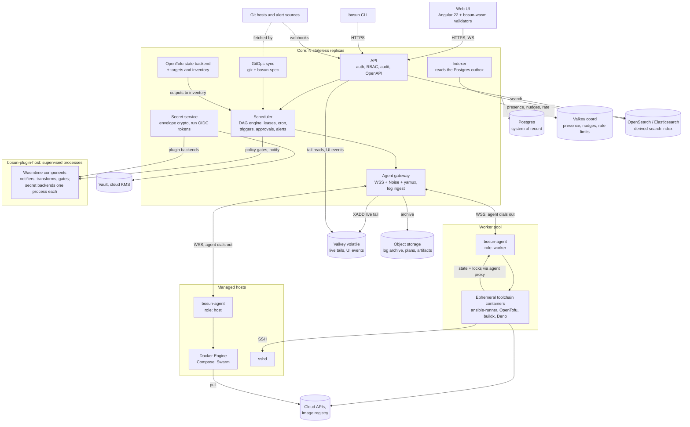
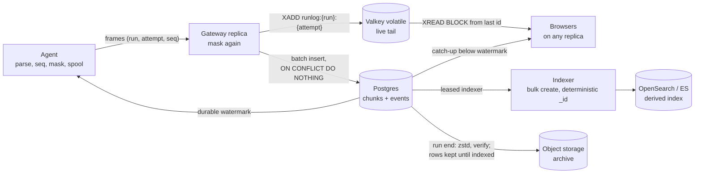
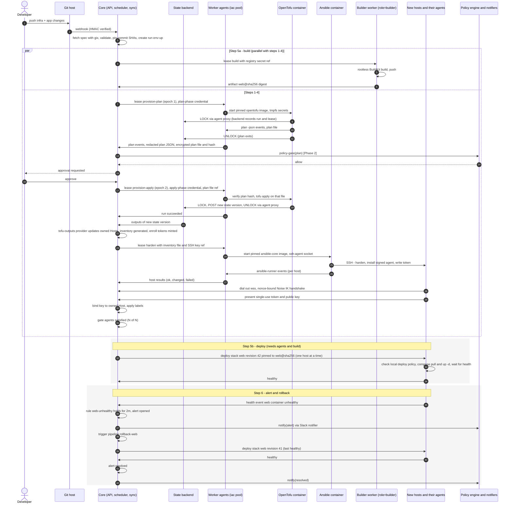

# A new Rust control plane inspired by Semaphore UI and Komodo — architecture exploration

Exploration, not a plan. **Version 2 (2026-10-21):** reframed from a fusion of the two products to a new
platform inspired by both, with Redis/Valkey and Elasticsearch/OpenSearch in the backend and Angular in
the frontend. Facts checked on 2026-10-21 against Semaphore at `2ae957f` (develop, past 2.19), Komodo at
`780ac68` (v2.3.3), crates.io, npm, and upstream repositories; anything seen only in a search excerpt is
marked as such in [Sources](#sources). Code references are `repo path:line` at those commits. Working name
for the platform: *bosun* (a placeholder so crate names read naturally).

## Verdict

1. **Build it — a new platform inspired by Semaphore and Komodo, owing code to neither — if you can fund about six engineers for 15–18 months to an MVP:** two months of spikes, then about 13 months of build, planned at 16. The niche: self-hosted control of VM and Docker fleets, with Ansible and OpenTofu runs and container operations under one RBAC, one audit trail, one agent and one search.
2. **Your stack fits, in specific roles:** Rust for the core and the agent; Valkey (Redis protocol) for coordination and live data — presence, routing nudges, live log tails, rate limits, caches; OpenSearch or Elasticsearch as a rebuildable search index over logs, events and audit; Angular 22 for the UI.
3. **Decision 1 — Postgres stays the system of record in every profile:** runs, leases, schedules, audit, secrets. Redis loses acknowledged writes on failover and Elasticsearch has no transactions, so neither may hold the only copy of anything; each of their roles sits behind a trait with an in-process or Postgres implementation.
4. **Decision 2 — ship permissive engines, accept the others:** Valkey (BSD-3) and OpenSearch (Apache-2.0) go in your images; Redis 8 (RSAL/SSPL/AGPL) and Elasticsearch 9 (ELv2 binaries) are bring-your-own. Three profiles: Minimal (core + Postgres), Standard (+ Valkey, HA), Scale (+ search cluster, zones).
5. **Decision 3 — one dial-out agent** (WSS + Noise + yamux), jobs in digest-pinned toolchain containers, logs sequenced, masked twice and acknowledged only after the Postgres commit. Ansible and OpenTofu are orchestrated, never rewritten; WebAssembly only for plugins and browser validation.
6. **Angular is a good fit** for a streaming-heavy, forms-heavy, role-driven UI. Spike the pipeline DAG editor and the `monaco-yaml` worker in week one; the editor is where React's ecosystem is most clearly stronger, and React also has the larger talent pool.

## What changed since version 1

| Topic | Version 1 | Version 2 |
| --- | --- | --- |
| Framing | fusion of the two products; options (a) fork / (b) new engine / (c) bridge; Semaphore importer in the MVP | a new platform inspired by both (§1); importers optional, Phase 2 |
| Data tier | Postgres only (SQLite for one node); `NOTIFY` for cross-replica events | Postgres in every profile + Valkey `coord`/`volatile` + OpenSearch/Elasticsearch as a derived index + object storage; three profiles (§3) |
| Live logs | Postgres chunks + `NOTIFY` pointers | per-run Valkey streams, durable watermark after the Postgres commit (§3.6) |
| Search | none | across runs, events and audit: OpenSearch by default, Elasticsearch 9.x bring-your-own, Postgres full-text fallback (§3.5) |
| Frontend | React 19 or Vue 3; `openapi-typescript` | Angular 22; `orval`; PrimeNG avoided (§7) |
| Security | v1 controls | + secure defaults, plan-file approval, Valkey and search hardening, a purge procedure (§9, §3.5) |
| Effort | 68 em, ~12 months for six people | ~8 em of spikes + 77 em of build: MVP around month 15, plan for month 18 (§12) |

## What was checked

| Claim or assumption | Finding | Source |
| --- | --- | --- |
| Semaphore latest stable is 2.19.x; 2.20 adds workflows and audit UI | v2.19.17 (2026-10-20). ⚠️ Workflows shipped in **2.19** (Pro, beta) with the Docker/K8s executors; 2.20 (beta since 2026-10-20) adds the security audit log | Semaphore releases; PR #4325 |
| Semaphore is MIT, open-core | community MIT; Pro adds the Terraform backend, Vault/OpenBao storages, the Docker executor and workflows; Enterprise adds HA, custom roles, group role mappings, the Kubernetes executor and the AWS SM/Azure KV/DVLS storages — all in the closed `semaphorepro-module` | `LICENSE`; `pro_interfaces/featues.go:4-23`; semaphore-docs `editions` |
| Semaphore weak points | runners poll every 5 s and receive decrypted keys in the poll response; API and runner tokens stored unhashed; secrets stored as base64 when no key is set; tofu runs `-lock=false` and approval triggers a fresh `apply -auto-approve`; one log row per line | `api/runners/runners.go:234-247`; `db/sql/global_runner.go:12-18`; `util/encryption.go:19-22`; `db_lib/TerraformApp.go:151,309-335` |
| ⚠️ Komodo v2 added dial-out, PKI, onboarding keys, Swarm, TOTP, OpenAPI, JSON schema, pagination, cancellation | 2.0.0 (2026-03-24) added the first six; the JSON schema came in 2.2.0, pagination and cancellable actions in 2.3.0; cancellable builds predate v2. Latest 2.3.3 | v2.0.0 / v2.3.0 notes |
| Komodo weak points | Noise authenticates but TLS alone encrypts; Deno actions run `--allow-all` with an admin key; secret variables unencrypted; the shipped placeholder JWT secret is accepted (issue #1676: instances taken over to mine crypto); command output buffered until exit; process-wide statics, so one Core | `lib/transport/src/auth.rs`; `action.rs:155-224`; `variable.rs:24-32`; `auth/mod.rs:50-57`; `lib/command/src/lib.rs`; `state.rs` |
| Komodo is GPL-3.0 | GPL-3.0-or-later, no CLA; `mogh_*` crates MPL-2.0, `mongo_indexed` GPL | `Cargo.toml`; crates.io |
| Redis licence | 7.4: RSALv2/SSPLv1; 8.0+: RSALv2/SSPLv1/AGPLv3 (since 2025-05-01); ≤ 7.2 BSD-3. Latest 8.10.2 | redis/redis `README.md`, PR #13997 |
| Valkey | BSD-3, Linux Foundation, no company over ⅓ of the TSC; 9.1.2 (2026-08-31); official Helm chart | valkey-io `COPYING`, `GOVERNANCE.md`, `valkey-helm` |
| Redis/Valkey semantics | asynchronous replication; Sentinel can lose acknowledged writes; `WAIT` is not CP; AOF off by default; pub/sub at-most-once, slow subscribers cut at 32 MB | redis/docs `sentinel.md`, `replication.md`, `pubsub`; `valkey.conf` |
| Elasticsearch licence and tiers | AGPL added as a source option at 8.16; default binaries and `x-pack` (security, ILM, logsdb) ELv2; document-level security Platinum, audit logging Gold, synthetic `_source` Enterprise. Latest 9.5.5 | elastic/elasticsearch `LICENSE.txt`, `x-pack` licence gates |
| OpenSearch | Apache-2.0 under the Linux Foundation; document-level security, audit logging and ISM free; 3.9.0 (2026-09-29) | opensearch-project repos and releases |
| Rust clients | `redis` 1.7.1 active; `fred` dormant since 2025-02; `elasticsearch` alpha-only (9.1.0-alpha.1, 2025-08-08); `opensearch` 2.4.0 with a breaking 3.0 pending | crates.io |
| Angular | 22.0.0 on 2026-06-03 (22.2.3 current): zoneless default, OnPush default, Signal Forms stable; a major every 12 months, 24 months support | angular `releases.md`, `CHANGELOG.md`; npm |
| UI licences | PrimeNG 22 / PrimeVue 5 moved to a commercial licence on 2026-07-15 | npm tarballs |
| MinIO as bundled object storage | community edition source-only since October 2025; repository since archived | minio README; ragflow issue #13840 (excerpt) |
| WASI 0.3 ratified June 2026 | 0.3.0 released 2026-06-11; on by default from Wasmtime 46; `wasi:http` at 0.3.2 | WASI releases; Wasmtime `RELEASES.md` |
| FerretDB | no release since v2.7.0 (2025-11-10); MongoDB patent suit pending — irrelevant now that MongoDB is out | FerretDB releases; D. Del. 1:25-cv-00641 |

## The system at a glance



The core never executes user code: Ansible, OpenTofu, builds and scripts run in containers on workers,
behind a default-deny egress policy, and third-party plugins run in supervised separate processes. Even
OpenTofu's state traffic goes through the worker agent's encrypted session, not straight to the core. Postgres holds everything that must survive; Valkey holds
what is hot and can be rebuilt within a heartbeat; the search index holds what can be replayed from
Postgres and object storage. Agents hold only what a lease gives them.

## 1. Strategy and licensing

### 1.1 Inspired by, not derived from

The direction is a new platform: its own codebase, data model, agent protocol and UI. No fork of
Komodo, no bridge between the two products, no compatibility promise with either. That was option
(b) in the first version of this study, and it remains the right call for the reasons given there —
a Komodo fork would inherit GPL-3.0, a model without tenancy and MongoDB; a bridge would keep two of
everything. Importers from Semaphore or Komodo become optional adoption tools for later, not
architecture.

What "inspired by" means in practice:

- **Semaphore community code is MIT** (`LICENSE:1-4`). Ideas, and even ported logic, are free to use;
  a Go→Rust port is a derivative, so keep the MIT notice in `THIRD-PARTY-LICENSES`. Its paid features
  (Pro: Terraform backend, Vault/OpenBao storages, Docker executor, workflows; Enterprise: HA, custom
  roles, group role mappings, Kubernetes executor, AWS SM/Azure KV/DVLS storages) live in the closed
  `semaphorepro-module`: reusable only if you own that code.
- **Komodo is GPL-3.0-or-later with no CLA.** Its ideas, resource model, file formats and documented
  behaviour are fair game; its code is not, and a line-by-line translation into another language is
  still a derivative. The one discipline that matters: engineers writing the agent protocol, PKI and
  GitOps reconciliation don't work from Komodo's source for those modules. Write behavioural specs from
  its docs and observed behaviour, review them, and keep that trail. Komodo's `mogh_*` crates are
  MPL-2.0 (usable as dependencies), but `mongo_indexed` and `derive_default_builder` are GPL — the plan
  below needs none of them.
- **The platform's own licence** is a business decision (§13.2): Apache-2.0 for the core keeps an
  open-core model with proprietary modules possible and carries a patent grant; an AGPL core
  discourages hosted resellers at the cost of enterprise adoption friction.

### 1.2 What you ship versus what customers bring

Your stack choices pull in licences that matter the moment you ship container images or a Helm chart.
The rule below keeps everything you distribute permissive and lets customers plug in what they already
run.

| Component | Licence | Ship it in your images/charts? | Why |
| --- | --- | --- | --- |
| **Valkey** 9.x | BSD-3 (Linux Foundation; no company may hold more than a third of the TSC) | **yes — default** | drop-in Redis protocol; Fedora and Arch replaced Redis with it; ElastiCache and Memorystore offer it |
| Redis 8.x | RSALv2 / SSPLv1 / AGPLv3 (since 2025-05-01) | no — customer brings it | fine to run, awkward to redistribute; RSALv2 forbids products whose value "primarily derives" from Redis. Redis ≤ 7.2 is still BSD-3 |
| **OpenSearch** 3.x | Apache-2.0 (OpenSearch Software Foundation, Linux Foundation) | **yes — default** | document-level security, audit logging, ISM and searchable snapshots are free |
| Elasticsearch 9.x | source AGPLv3/SSPL/ELv2 since 8.16; default binaries ELv2; security, ILM, logsdb in ELv2-only `x-pack` | no — customer brings a cluster | ELv2 forbids offering it as a managed service; the free tier lacks document-level security, SAML/OIDC and audit logging |
| **Postgres** | PostgreSQL licence | yes | — |
| **SeaweedFS** | Apache-2.0 | yes — default S3-compatible store | MinIO's community edition went source-only in October 2025 and its repository has since been archived; it is AGPL anyway |
| Ansible (in toolchain images) | GPL-3.0 | yes, as a separate program | invoked as a process; a custom callback plugin imports Ansible and must itself be GPL |
| OpenTofu (in toolchain images) | MPL-2.0 | yes | — |
| Terraform | BUSL-1.1 | no — customer brings the image | BUSL forbids competitive offerings "on a hosted or embedded basis"; a paid IaC orchestrator plausibly is one. Get counsel's view before advertising Terraform support in a paid tier |
| Angular, Material, CDK, Aria | MIT | yes | — |
| PrimeNG 22 / PrimeVue 5 | commercial PrimeUI licence since 2026-07-15 | **avoid** | licence key, revenue and headcount limits |
| AG Grid Community / ECharts | MIT / Apache-2.0 | yes | AG Grid Enterprise and ApexCharts (OEM) are commercial |

The same logic is why Semaphore's own third-party licence policy (`.claude/skills/semaphore-third-party-licenses/references/license_policy.md`)
bans AGPL, SSPL and RSALv2 dependencies: customer agreements. A `cargo deny` allow-list and an npm
licence check in CI keep the shipped artefacts clean (§10).

### 1.3 Keep, change, add

Checked in both codebases and against what their users ask for (issue and discussion trackers sorted
by reactions).

| | From Semaphore | From Komodo |
| --- | --- | --- |
| **Keep** | typed surveys with secret inputs; task/build/deploy templates with version promotion; webhook integrations (auth method + matchers + extractors); the workflow DAG with edge conditions, approvals and delays; per-run OIDC JWTs with a JWKS endpoint; a keyring tagged with key IDs, hot-reloaded, with a `rekey` command; projects as the tenancy boundary | GitOps sync with a generated JSON Schema, pending diffs, the commit hash on every change and managed/delete modes; one typed `Execution` enum shared by API, CLI, procedures and schedules; stateful alerts (open/resolve, two bad polls before opening, maintenance windows); onboarding keys that store only the public half; dial-out agents with mutual Noise authentication; hashed API secrets; per-action permissions (Terminal, Logs, Inspect); terminals that an agent can disable |
| **Change** | hash API and runner tokens (stored in plaintext today); never fall back to base64 when no key is set; plan with `-out` and apply that file, with locking on (today `-lock=false`, and approval triggers a fresh `apply -auto-approve`); one SQL dialect instead of three; stream logs in chunks instead of one row per line; leave Vue 2/Vuetify 2 (end-of-life) | refuse placeholder secrets (issue #1676: instances taken over through the shipped JWT secret); encrypt secret variables (stored in clear today); sandbox scripts (Deno `--allow-all` with an admin key today); stream command output live (buffered until exit today); first-class tenancy and namespaced names (#234); a migration framework; no MongoDB (#637, #1591); HA instead of process-wide statics |

**Add — missing from both, or only in Semaphore's paid editions:**

- search across runs (Komodo greps the last 5,000 lines of `docker logs`; Semaphore has no output search);
- live tail across replicas;
- SSO group-to-role mapping in the open core (Semaphore has it only in its paid Enterprise edition, Komodo not at all; Semaphore #1499, #2483);
- external secret stores in the open core (Komodo has none: #677 asks for Doppler/Infisical injection, discussion #934 for SOPS-encrypted `.env` files; Semaphore's Vault/OpenBao, DVLS, AWS Secrets Manager and Azure Key Vault storages work only in Pro/Enterprise);
- outbound event webhooks (Semaphore #1825); Prometheus metrics per run, per host and per agent (Semaphore's opt-in `/api/metrics` exports Go runtime metrics plus `semaphore_tasks_running` and `semaphore_tasks_total`, and #2523 is still open; Komodo has none);
- time-based, per-project retention for runs, logs and audit (Semaphore only caps the task count per template with `max_tasks_per_template`; Komodo ages out only stats and alerts — Semaphore discussion #709);
- container operations at Komodo's level (ports, networks, image-pull progress) next to IaC runs.

Two "keeps" matter more than any framework choice: the single typed `Execution` enum with generated
clients, and GitOps sync as the primary configuration path. Semaphore has neither (its config-as-code
is backup JSON plus a community Terraform provider), and both shape the API, the CLI and the UI.

### 1.4 Should it be built?

Yes, under two conditions. First, a team that can carry it: about six engineers for 15–18 months to an
MVP, spikes included (§12). Second, a clear niche: **self-hosted control of VM and Docker fleets — Ansible and OpenTofu runs
plus container operations under one RBAC, one audit trail, one agent and one search** — for teams that
are not Kubernetes-first.

| Adjacent product | Licence | Where the new platform differs |
| --- | --- | --- |
| AWX (AAP upstream) | Apache-2.0 | releases paused since 2024-07-02; Ansible only, no container operations |
| Semaphore UI | MIT core, Pro/Enterprise proprietary | no persistent agent or container operations; HA, executors and workflows are paid |
| Komodo | GPL-3.0 | containers only; no IaC jobs, tenancy or HA |
| Rundeck | Apache-2.0 (PagerDuty) | runbook automation; no IaC state or container fleet model |
| Terrakube, Atlantis | Apache-2.0 | OpenTofu/Terraform only |
| Spacelift, env0 | commercial SaaS | full self-hosting is Enterprise-only |
| Kestra | Apache-2.0 | data/workflow orchestration; its Kafka + Elasticsearch backend is Enterprise-only |
| Portainer, Coolify, Dokploy, Dokku | zlib CE / commercial BE; various | PaaS-style deploys; no Ansible/OpenTofu or inventories |

If the goal is only a better Semaphore, evolving Semaphore's Go codebase is far cheaper;
Rust by itself buys little, because the jobs are Python and Go and that is where time goes. The case
rests on one model, one agent, one audit trail and one search across all of it.

## 2. Domain model

The platform's own model, not a merge of two schemas. The table shows where each concept comes from,
so the lineage is explicit and the places where the two inspirations disagree are decided once.
Nine families (plus UI-only saved views and tags). Tenancy is **Org → Project**; fleet objects (hosts, agents, pools, clusters) belong
to the org and are *granted* to projects, because a host is shared infrastructure while a template
belongs to a team.

| Family | Concept | Lineage: Semaphore | Lineage: Komodo | Design call |
| --- | --- | --- | --- | --- |
| **Targets** | `Host` — a machine the platform knows; optional agent, optional SSH address | a line in an Inventory; `HostConfig` per-host credentials | `Server` (a Periphery endpoint) | ⚠️ 1 |
| | `Inventory` — a selector over Hosts plus pass-through sources | `Inventory`: static, static-yaml, file, terraform/tofu/terragrunt workspace | tags on Servers | ⚠️ 1 |
| | `Agent` with roles `host` / `worker` | `Runner` (polling job worker; project runners are Pro) | Periphery | no conflict |
| | `Pool` — workers selected by labels | runner tags | `Builder` (Url / Server list / AWS EC2) | no conflict |
| | `Cluster` — Docker Swarm in Phase 2, Kubernetes in Phase 3 (not in the MVP) | — (the K8s executor runs tasks, it is not a target) | `Swarm` | no conflict |
| **Workloads** | `Service` — one container | — | `Deployment` | no conflict |
| | `Stack` — a Compose project, or (from Phase 2) a Swarm stack when bound to a Cluster | — | `Stack` (`swarm_id` switches to `docker stack deploy`) | no conflict |
| | `Artifact` + versions — what a build produced (image digest, file, version string) | Template type `build` (version counter) consumed by type `deploy` | `Build` output image + version | ⚠️ 8 |
| | `Repository` — git source + credentials | `Repository` (git/ssh/https/file/local) | git accounts; `Repo` is also an *executable* resource | ⚠️ 9 |
| **Jobs** | `Job` — a one-shot definition: `ansible`, `tofu`, `terraform`, `terragrunt` (Phase 2), `pulumi` (Phase 2), `script` (bash/pwsh/python), `build` | `Template` (app: ansible, terraform, tofu, terragrunt, bash, powershell, python, pulumi) | `Build`, `Repo` build, `Action` | no conflict |
| | `Operation` — a built-in typed action on a workload or host (deploy, restart, prune, rotate keys) | — | the 82-variant `Execution` enum | no conflict |
| | `Run` — one execution with logs, structured events, outputs, artifacts | `Task` (+ `TaskOutput`, stages, `AnsibleTaskHost`/`Error`) | `Update` | ⚠️ 3 |
| | `Script` — control-plane automation against the API | — | `Action` (Deno) | ⚠️ 5 |
| **Pipelines** | `Pipeline` — a DAG of steps (job, operation, approval, wait, delay) with edge conditions | `Workflow` (Pro): task/approval/delay/note nodes, `on_success`/`on_failure`/`always` edges, all/any convergence | `Procedure`: ordered stages, parallel executions inside a stage | ⚠️ 4 |
| | `Approval` gate | workflow approval node; Terraform `waiting_confirmation` | — | no conflict |
| | `Policy` — a named plan-time gate: Rego from a Repository, evaluated by `regorus`, or a `policy-gate` Wasm plugin (Phase 2) | — | — | new |
| **Triggers** | `Schedule` | `Schedule` (cron or `run_at`, commit-hash trigger) | schedules on Procedures/Actions (cron or English) | no conflict |
| | `Webhook` with auth, matchers and a transform | `Integration` (none/github/token/hmac/bitbucket/basic; matchers; extract → env or params) | git-push webhooks per resource | no conflict |
| | `AlertTrigger` — an alert starts a pipeline | — | — | new |
| | `SyncSource` — GitOps of the platform's own config | — (Workflows-as-Code planned) | `ResourceSync` (TOML) | YAML spec, JSON Schema (§8.5) |
| **Secrets & variables** | `Credential` — typed secret (ssh-key, login, token, registry, cloud) | `AccessKey` (ssh, login_password, string, none) | git/registry accounts | no conflict |
| | `VariableSet` — scoped (org / project / environment) plain + secret vars | `Environment` (extra-vars JSON, env, secrets) | `Variable` (global, `is_secret`) | ⚠️ 6 |
| | `ParameterSchema` — typed run-time inputs | `SurveyVar` (int/enum/text/select/secret) | Action `ARGS` | no conflict |
| | `SecretBackend` — where a value lives (builtin, Vault, cloud SM), bound to an org or project with an allowed path scope; agent-local values are resolved on the agent only | `SecretStorage` (local; Vault/OpenBao are Pro; AWS SM/Azure KV/DVLS are Enterprise) | Core `[secrets]`; **Periphery-local secrets** never sent to Core | no conflict |
| | `WorkloadIdentity` — a signed OIDC token per run | `TemplateJWTParams` (task JWT ID tokens) | — | no conflict |
| **Notifiers** | `Notifier` (endpoint plugin) + `Subscription` (event filter) | server-level channels: email, Telegram, Slack, Rocket.Chat, Teams, DingTalk, Gotify | `Alerter`: Custom, Slack, Discord, Ntfy, Pushover; type/resource filters; maintenance windows | no conflict |
| | `Alert` — stateful, deduplicated, resolvable | — (stateless messages: chat channels on success, failure and awaiting confirmation; email on failure only) | `Alert`, 21 types, opened after two bad checks, resolved in place | ⚠️ 7 |
| **Permissions** | `Org`, `Project` | `Project` | — (global namespace + tags) | ⚠️ 2 |
| | `Role` — a bundle of (resource kind, action) plus capabilities | owner / manager / task_runner / guest; custom roles (Enterprise); global roles | `PermissionLevel` None < Read < Execute < Write + Terminal, Attach, Inspect, Logs, Processes | no conflict |
| | `Binding` — principal × role × scope (org, project, resource, label selector) | `ProjectUser`, `TemplateRolePerm`, group→role mappings (Enterprise) | `Permission` (user/group × resource), `UserGroup.all` | no conflict |
| | `ApiToken` | `APIToken` (stored as the row ID) | `ApiKey` (hashed secret, expiry) | no conflict |
| | `AuditEvent` | `AuditEvent` (structured) + legacy `Event` | — (`Update` doubles as history) | ⚠️ 3 |
| | `EnrollmentToken` | runner registration token (`smrs_`, SHA-256, 1 h) | `OnboardingKey` (keypair, expiry, tags, privileged) | no conflict |
| **IaC state** | `StateWorkspace` — versions, lock, outputs | `TerraformInventoryAlias` / `State` (backend is Pro) | — | no conflict |
| UI only | saved views, tags | `View` | tags | — |

### Where the two inspirations disagree, and what the new model does

1. **Host vs inventory line.** An Ansible inventory host is an address plus vars and may never run
   an agent (a switch, a Windows box, a customer VM). A Komodo Server *is* an agent. Make `Host`
   canonical for machines the platform manages and give each a stable, owner-namespaced `TargetKey`
   (`tofu:shop/staging:module.web[0]`; a global cloud key such as `hcloud:12345` only after a verified
   claim, §6.3). Inventories become views — selectors over
   Hosts — plus opaque pass-through sources: an inventory file or cloud plugin in git is handed to
   Ansible unparsed. Do not try to model every Ansible inventory feature in the database.
2. **Tenancy.** The deepest conflict. Komodo resources are global and permissioned one by one;
   Semaphore isolates projects hard. Projects win, because multi-team RBAC needs a boundary. Fleet
   objects stay org-level and are granted to projects with capability scopes ("project `shop` may
   deploy stacks and open terminals on hosts labelled `team=shop`"). A single-team install simply
   lives in one default project.
3. **Run vs Update.** Komodo's `Update` records both executions and configuration edits. Split them:
   `Run` is an execution with logs and events; `AuditEvent` is any change, including who started the
   run.
4. **Procedure vs Workflow.** A Procedure is a DAG where each stage depends on all of the previous
   one, with success edges only. Semaphore workflows add failure/always edges and any/all
   convergence. The `Pipeline` is the DAG; stages are syntax sugar, so both styles are expressible.
5. **Action vs script job.** Komodo Actions are control-plane scripts. They run in the Core
   container under `deno run --allow-all` with a per-run API key for an **admin** user
   (`bin/core/src/api/execute/action.rs:155-224`). Semaphore scripts are data-plane jobs on a
   runner. Keep both, as different trust tiers, and do not carry over the admin key. A `Script` runs as
   its own service principal with a role bound to it. Only someone who already holds every permission
   in that role may bind it or change the script's code, in the UI or through a GitOps sync (the check
   Kubernetes makes with `escalate`/`bind`, and AWS with `iam:PassRole`); a sync that would raise a
   script above the committer's grants waits as a pending diff for a holder to approve. A manual run
   gets the intersection of the bound role and the trigger's permissions; scheduled, webhook and alert
   runs get the bound role alone. Running with the *triggering* user's token, or a role the script
   declares for itself, would make scripts a privilege-escalation path.
6. **Variables and interpolation.** Komodo substitutes `[[VAR]]` text everywhere (variables first,
   then secrets, redacting secrets in logs). Semaphore hands variables to Ansible, which runs its own
   Jinja. A platform that renders `{{ }}` before Ansible sees the file double-renders and opens a
   template-injection hole. Rule: secrets and variables are **typed references in structured
   fields** (`{secret: deploy-ssh}`), text templating applies only to fields declared as templates,
   and the platform never renders inside Ansible or Compose content it does not own.
7. **Notifications vs alerts.** Semaphore sends stateless messages when a task succeeds, fails or waits
   for confirmation (email only on failure); Komodo has stateful
   alerts with open/resolved lifecycle and dedupe. Unify as events → alert rules (stateful, optional)
   → notifier subscriptions. "Task failed" is an event that may notify directly or open an alert.
8. **Build/deploy templates vs Build/Stack.** Semaphore's `build` template type is a version
   counter for any artifact; Komodo's Build is a Docker image. One `Artifact` with a kind and
   versions covers both; Komodo's shape wins for containers.
9. **Komodo `Repo`.** It is a repository *and* an executable resource (clone to a host, then run
   on-clone/on-pull commands). The new model keeps those apart: a `Repository` is a source, and
   "clone and run something on a host" is a `script` Job targeting that host.

## 3. Data tier: Postgres, Valkey/Redis, OpenSearch/Elasticsearch, object storage

Redis and Elasticsearch both earn a place in this platform, in roles where either can fail without
losing a run, an audit entry or a secret. The rule: **one transactional system of record; everything
else is derived or ephemeral, and never holds the only copy of anything.**

### 3.1 Roles

| Store | Role | Never used for | Profiles |
| --- | --- | --- | --- |
| **Postgres** | System of record: configuration, RBAC, runs and their state machine, leases with fencing epochs, agent session epochs, the command outbox, schedules, approvals, idempotency keys, sessions, the hash-chained audit log, envelope-encrypted secrets and hashed tokens, OpenTofu state and locks, structured run events, masked log chunks for the search retention window | — | all |
| **Valkey** (or any Redis 7.2+) | Coordination and hot state, in two roles. `coord`: agent presence, routing nudges, rate limits, efficiency locks, session and RBAC caches. `volatile`: per-run live-tail streams, "X changed" UI events, caches | the only copy of anything; run state, the queue, leases, schedule fires, OpenTofu locks, approvals, audit, monotonic counters; secrets or raw tokens, even cached | standard, scale (in-process in minimal) |
| **OpenSearch** (or Elasticsearch 9.x) | Derived, rebuildable search index: log blocks and structured events across runs, audit-event search, entity search for the command palette | system of record; live tail; the tenant boundary; anything that can't be replayed from Postgres and object storage | optional in standard, default in scale |
| **Object storage** (any S3-compatible service; SeaweedFS bundled; a directory in minimal) | Archive: one seekable zstd log file per run attempt with a `seq → offset` index; plan files and run artifacts, envelope-encrypted before upload; the bucket is private to the core | anything that needs transactions | all |

**Why a relational system of record is still required.** The queue is the lease protocol with agents,
and leases need `SELECT … FOR UPDATE SKIP LOCKED`, a fencing epoch checked in the same transaction as
every state change, and uniqueness constraints (cron fires, idempotency keys, command IDs). Redis
replication is asynchronous; its docs say Sentinel "does not guarantee that acknowledged writes are
retained during failures" and that `WAIT` does not make it CP. A lease or counter held in Redis can be
granted twice after a failover. Elasticsearch is near-real-time (1 s refresh, skipped on idle shards)
and has no transactions. Semaphore's HA mode keeps its task queue in Redis and relies on Redis for exclusive task
claims (`TaskStateStore.ClaimAndDequeue`/`TryClaim`, SETNX-style finalize locks in
`services/tasks/task_state_store.go`); only its workflow-run progression lock is documented as "an
optimization, not a correctness guarantee — conditional DB updates remain the source of truth"
(`WorkflowRunLocker`). AWX keeps Redis node-local and uses Postgres as the cluster bus. This design makes the split
explicit.

**Postgres in every profile, SQLite deferred.** The design leans on `SKIP LOCKED`, time partitions,
full-text search with `pg_trgm`, and synchronous replication; SQLite would need its own queue, search and
retention code, and every extra dialect is a permanent tax (Semaphore runs three — MySQL, Postgres and
SQLite — and branches on the dialect in its connection, migration and query code: `db/sql/SqlDb.go`,
`db/sql/migration.go`). The minimal profile is one core binary next to one Postgres container. **What would tip
it:** a homelab-first go-to-market, where "one binary, no database container" sells (Komodo users asked
for exactly this in #637); then ship SQLite behind the `Store` trait with a conformance suite.

### 3.2 Data item → store → behaviour when that store is down

| Data item | Store | Why | When that store is down |
| --- | --- | --- | --- |
| Orgs, projects, RBAC, resource specs | Postgres | relational, migrations | platform down; agents finish their jobs and spool |
| Secrets (envelope), hashed tokens, OpenTofu state and locks | Postgres + KMS/Vault KEK | transactional; never cached elsewhere | no dispatch |
| Runs, queue, leases + `lease_epoch`, schedule fires, approvals, idempotency keys | Postgres | `SKIP LOCKED`, fencing, `UNIQUE` | no new dispatch; running jobs finish |
| Agent `session_epoch` and owner; command outbox and acks | Postgres | the authority for fencing | as above |
| Sessions (row + per-user generation), login lockout counters | Postgres, Valkey as read-through cache keyed by a hash of the session ID | a failover must not undo a revocation | logins fail |
| Hash-chained audit log | Postgres → search index → SIEM | tamper evidence needs the change's own transaction | audited writes are refused |
| Log chunks (masked text blocks) and structured events | Postgres, partitioned by run creation time, kept for the search retention window | the agent is acknowledged only after commit | agents spool (bounded, with a gap marker) |
| Finished logs, plan files, artifacts | object storage (encrypted) | one object per run attempt | archive reads fail; **apply refuses to run without the approved plan file** |
| Presence `agent:{id}` (TTL), nudges, rate limits, efficiency locks, session cache | Valkey `coord` | cheap TTL writes; fan-out | owner read from Postgres; outbox poll; in-process `governor`; reads go to Postgres |
| Live-tail streams, UI change events, caches | Valkey `volatile` | bounded and evictable | clients catch up from Postgres by `seq`, then poll |
| Search over logs, events, audit, entities | OpenSearch/Elasticsearch | full text across runs | banner "indexed up to T"; Postgres full-text + `pg_trgm` within retention; the indexer resumes from its watermark, and archiving and partition drops wait for it |
| Host stats | Postgres (downsampled) + Prometheus | metrics, not logs | gaps in charts |

The pattern that makes this work: **every Valkey role is a Rust trait with two implementations** —
in-process for a single replica, Valkey for N > 1 — so losing Valkey costs latency and live-UI freshness,
never a run, and never a double run. Semaphore uses the same shape (`TaskStateStore` with a memory
implementation).

### 3.3 What never goes where

**Never in Valkey/Redis:** secrets, decrypted credentials or raw tokens, not even cached (RDB and AOF
files and replicas copy everything); run state, the queue, leases, schedule fires, OpenTofu locks,
approvals, audit, monotonic counters; terminal keystrokes; the only copy of any log.

**Never in OpenSearch/Elasticsearch:** unmasked bytes; plan JSON, environment dumps, uncapped Ansible
`res` payloads, OpenTofu output values; the record of runs or audit; the live tail; the tenant boundary
(Elasticsearch's free tier has no document-level security, and Elastic's docs warn that filtered aliases
are not a substitute); anything a browser queries directly. Mappings are `dynamic: strict` with an
allow-list of fields.

### 3.4 Valkey/Redis: the coordination design

- **Engine and compatibility.** Ship and test against **Valkey** (BSD-3, Linux Foundation; 9.1.2 as of
  2026-08-31) using the official `valkey-helm` chart rather than Bitnami's. Document "any RESP server
  from 7.2: Valkey, Redis 7.2/8.x, ElastiCache, Memorystore, Azure Managed Redis". Use only commands both
  engines have had since 7.2, plus Lua: the engines are diverging (Redis 8.4's `DELEX` vs Valkey 9.0's
  `DELIFEQ`; Redis-only `XREADGROUP … CLAIM` and idempotent `XADD`). CI runs on Valkey 9.1.x and Redis
  8.10.x.
- **Two roles from the first multi-replica install.** `coord` runs `noeviction` with AOF `everysec`;
  `volatile` runs `allkeys-lru` without persistence and holds the live tails. They must be separate: at
  `maxmemory` under `noeviction` the server returns errors on writes, so a log burst in a shared instance
  would fail heartbeats and nudges.
- **Topology.** Standard: one `coord` node and one `volatile` node — no correctness property depends on
  Valkey, so Sentinel would buy only live-UI availability. Scale: `coord` becomes a primary with **two**
  replicas and three Sentinels, `min-replicas-to-write 1` (with a single replica that setting stops all
  writes whenever the replica is lost). No Redis Cluster — GitLab and Sidekiq don't support it either —
  but hash-tag keys (`{agent:ID}`, `{run:ID}`) and use sharded pub/sub (`SPUBLISH`) from day one so Cluster
  stays possible.
- **Session registry.** Once the agent's first transport message has decrypted (§6.3) — not merely when
  the core sends handshake message 2 — the replica runs
  `UPDATE agents SET session_epoch = session_epoch + 1, owner = $me … RETURNING session_epoch` in
  Postgres, then sets `agent:{id} = {replica, epoch}` on `coord` with a TTL of three heartbeats.
  Heartbeats touch only Valkey. The epoch is minted in Postgres because a failover can drop an
  acknowledged `INCR` and hand out the same epoch twice.
- **Lease renewal.** Leases live and are renewed only in Postgres. Every TTL/3 (TTL e.g. 90 s) each core
  replica renews, in one batched statement, the leases of running jobs on agents whose sessions it owns
  with a matching `session_epoch`; a log commit under a current `lease_epoch` also renews. Expiry is
  judged only with Postgres `now()`, never a replica's or an agent's clock, and Valkey presence is never
  an input to it, so a `coord` failover cannot expire a lease. Leases of agents waiting in the handshake
  budget are not swept while their reconnect is pending. What happens on expiry is in §6.7.
- **Command routing.** Outbox row (`UNIQUE(command_id)`) → `SPUBLISH` nudge `(agent_id, command_id)` to
  the owner → the owner checks the live epoch and delivers → the agent acknowledges in Postgres and
  dedupes by `command_id`. Because pub/sub is at-most-once, two backstops make a lost nudge cost only
  latency: each replica polls the outbox for its own agents every 2–5 s, and agents pull pending commands
  on reconnect. Commands are not fire-and-forget: each carries a per-agent sequence assigned in Postgres,
  a `not_after`, the `(run_id, lease_epoch)` that issued it, and for stateful targets the desired
  generation (`stack web, revision 43`). A newer command for the same target supersedes older pending
  ones; when a run fails, is cancelled or is marked `agent-lost`, its undelivered commands are cancelled
  in the same transaction. The agent applies commands in sequence order, refuses expired ones and any
  older than the last generation it applied for that target, and records executed `command_id`s with
  their outcome in its spool before acknowledging, so a redelivery after a restart returns the recorded
  result instead of running again.
- **Two lock types, kept apart by the type system.** `EfficiencyLock` (`SET NX PX`, released by a Lua
  compare-and-delete that works on both engines) avoids duplicate *work* — two replicas refreshing the
  same cache or fetching the same git ref. `LeaseEpoch` is minted only by `bosun-store` and is required
  by every effectful write. No Redlock: Redis's own docs say failover-based locks cannot guarantee mutual
  exclusion.
- **Rate limits.** An in-process `governor` tier first, then a GCRA Lua script on `coord` per user,
  token, tenant and agent, plus a global handshake budget so a lost zone's agents reconnect in a ramp, not
  a storm. Lockout counters stay in Postgres.
- **Caches and idempotency.** RBAC decision caches stay in-process per replica, keyed by a
  `policy_version` read from Postgres and flushed when the invalidation link drops; sharing them through
  Valkey would make `coord` write access authorization-critical. `SET NX EX` is only a pre-check; `UNIQUE(idempotency_key)` in
  Postgres is the guarantee.
- **Sessions.** The session row and a per-user generation live in Postgres; Valkey is a read-through
  cache. The session ID itself never reaches Valkey: the cache key is `sess:{SHA-256(session ID)}` and
  the cached value holds only user ID, generation and expiry, not `tower-sessions`' serialized record
  (which contains the raw ID). Every hit is compared with the per-user generation (an in-process copy
  invalidated through the outbox, falling back to Postgres), so a `DEL` lost in a failover cannot
  resurrect a revoked session, and a stolen AOF file yields no usable cookie. Use `tower-sessions` 0.15
  with a ~100-line store; not `tower-sessions-redis-store`, which is built on the dormant `fred`.
- **Client.** `redis` (redis-rs) 1.7.x with `tokio-comp`, `connection-manager`, `sentinel`, `streams`,
  `tls-rustls`, `cluster-async`: one `ConnectionManager` per replica for commands, dedicated connections
  for `XREAD BLOCK` and subscriptions. Only `bosun-coord` depends on it.
- **Prove it.** Before GA, partition the `coord` primary and a core replica under 2,000 concurrent runs
  and assert zero lost runs, zero double executions, and recovery of tails and nudges within one
  heartbeat TTL (§13.3).

### 3.5 OpenSearch/Elasticsearch: the search design

- **Engine and support policy.** Bundle **OpenSearch 3.x** (Apache-2.0; OpenSearch Software Foundation
  under the Linux Foundation; 3.9.0 on 2026-09-29): document-level security, field-level security, audit
  logging, ISM and searchable snapshots are free. Support Elasticsearch as an equal bring-your-own option
  on the minors Elastic still maintains — today 9.5 (9.5.5 is current), 9.4 and 8.19, the last until its
  end of support (2027-07-15) — without depending on paid features. Since 8.16 its source is offered
  under AGPL/SSPL/ELv2, but the default binaries and the `x-pack` parts this design touches (security,
  ILM, logsdb) are ELv2, and the free Basic tier lacks document-level security (Platinum), SAML/OIDC
  (Platinum), audit logging (Gold) and synthetic `_source` (Enterprise) — which is where most of logsdb's
  storage saving comes from. The supported versions are exactly the CI matrix: OpenSearch 3.9 and 2.19,
  Elasticsearch 9.5, 9.4 and 8.19.
- **Bootstrap.** Elasticsearch generates a per-install CA, certificates and the `elastic` password on
  first start. OpenSearch does not: its automatic first-start setup is the security plugin's *demo*
  configuration — demo certificates whose private keys, including the `kirk` admin key, are published in
  the plugin's source, and demo users with known passwords. The bundled Compose files and Helm chart set
  `DISABLE_INSTALL_DEMO_CONFIG=true`, generate a per-install CA, node and admin certificates at install
  time, set `plugins.security.authcz.admin_dn`/`nodes_dn` to them, and ship no demo users. The core
  refuses to connect to a cluster that presents the demo root CA.
- **Footprint.** Both are JVM services: a 1 GB heap is the floor and about 4 GB of host RAM is realistic
  for one node; hosts need `vm.max_map_count` raised (≥ 262144 for OpenSearch, 1048576 for Elasticsearch
  in production Docker). That is why search is optional below the Scale profile.
- **What is indexed.** One document per structured event (Ansible per-host task results, OpenTofu
  resource changes with sensitive values redacted, Docker health events); log text in blocks of about
  4 KB cut at fixed offsets inside one immutable chunk row, `_id = {run_id}:{attempt}:{chunk_first_seq}:{block_no}`;
  audit events; an entity index (hosts, stacks, jobs, pipelines) for the command palette. Never one
  document per run: highlighting caps at 1M characters and requests at 100 MB.
- **Layout and retention.** A few shared index families with keyword `org_id`, `project_id`,
  `resource_kind`, `resource_id` (and `host_id` on host-originated events) fields:
  `runlog-{class}-{YYYY.MM}`, `runevents-{class}-{YYYY.MM}`, `audit-{YYYY.MM}`, `entities`, behind
  aliases. The index name is a pure function of fields frozen on the run row at creation —
  `{run.retention_class}` and `{run.created_at}` in UTC — never of wall-clock time or the project's
  current setting, so every block of a run, including retries and rebuilds, lands in the same index and
  `op_type=create` can dedupe it. Retention classes (for example 30, 90, 365 days) are separate families,
  and **the platform drops whole indices by name**: shared indices cannot expire one tenant's data early,
  and a rebuild would restart ILM/ISM age clocks. Changing a project's retention affects new runs; moving
  old ones is an explicit reindex. No index per project (shards are capped at 1,000 per node); dedicated
  indices only for data-residency contracts. Plain monthly indices rather than data streams, so a retry
  cannot land in a different backing index after a rollover.
- **Writes.** The indexer leases work in Postgres (`SKIP LOCKED`, fenced by a lease epoch) and treats the
  chunk and event tables as the outbox. Progress is kept per run and attempt —
  `run_index_progress(run_id, attempt, indexed_through_seq)`, the highest *contiguous* `seq` indexed —
  never as one time or ID cursor over tables that many replicas write, because rows become visible at
  commit, out of order across replicas. Runs with unindexed rows are found through a "dirty runs" set
  written in the ingest transaction. `_bulk` with `op_type=create` and deterministic IDs; check every
  item, since `_bulk` returns 200 with `errors: true`. A 409 means already indexed; 429/5xx items are
  retried with jitter; any other item error (a strict-mapping rejection, a parsing error) goes to an
  `index_dead_letter` table with an alerting metric, and the watermark moves past it so one bad document
  cannot stall a partition for every tenant. 5–15 MB per request, 2–4 in flight, `refresh_interval`
  5–30 s. A full rebuild is a replay from Postgres and object storage.
- **Reads.** Every query passes through the Rust API, which builds the filter from current RBAC: `org_id`,
  plus `project_id` where the caller holds the `logs` capability project-wide, or `resource_id`/`host_id`
  in the resource sets their resource and label-selector grants resolve to (host documents carry no
  project, so they match only through host grants). Hits are re-checked by the RBAC evaluator before
  they are returned. The engine is never reachable from browsers, agents or job containers. Deep paging
  uses `search_after` with a point in time (`/_pit` on Elasticsearch, `/_search/point_in_time` on
  OpenSearch), never `from`/`size` past 10,000 hits.
- **Credentials.** Four service identities, each limited to the platform's index patterns: *writer*
  (bulk create only), *reader* (search and point in time), *purger* (delete-by-query, whole-index deletion
  for retention, force-merge; used only by retention, run deletion and leak purges, every use audited) and
  *admin* (templates and lifecycle only). On Elasticsearch they are API keys with role descriptors (the
  writer gets `create_doc`). On OpenSearch 3.7+ they may be API tokens, which expire within 90 days, so
  the core rotates them; OpenSearch 2.19 has none, so there they are internal users or client
  certificates. OpenSearch has no create-only privilege — `op_type=create` is authorised like an
  overwrite — so idempotency rests on deterministic IDs, not on the privilege. Per-org document-level
  security works through the *reader's identity*: a `tenant_reader` role with the DLS query
  `{"term":{"org_id":"${attr.jwt.org_id}"}}`, and the API authenticates each search with a short-lived JWT
  carrying the caller's `org_id`, signed by a key OpenSearch's JWT auth domain trusts. Elasticsearch Basic
  has no document-level security, so there the API filter is the only layer.
- **Erasure.** Deleting a run is a resumable purge job driven by a Postgres tombstone, not one call:
  mark the run `purging` (the indexer checks tombstones before every `_bulk` and drops their retries);
  wait out the indexer lease plus the bulk timeout so nothing for the run is still in flight; `_refresh`
  the affected indices, because `_delete_by_query` deletes only what its start-time snapshot can see;
  run `_delete_by_query?conflicts=proceed` on `run_id` until `_count` returns 0, and sweep once more after
  a delay; only then delete the object and the rows.
- **Leaks.** If a secret leaks into a store, rotate it first — rotation is the only control that covers
  replicas, snapshots and backups. Then purge the bytes from the live index: reindex the affected monthly
  index without the run's documents and switch the alias, or temporarily set
  `index.merge.policy.expunge_deletes_allowed: 0` and force-merge with `only_expunge_deletes=true`
  (under the 10 % default, segments with few deletes are skipped and the bytes stay on disk). Snapshots,
  Postgres WAL archives and base backups keep the bytes until their own retention expires.
- **Client.** A thin client on `reqwest` + `serde` with typed NDJSON bulk requests over the REST subset
  both engines share, and per-engine adapters for lifecycle (ILM vs ISM), point in time, credentials and
  security bootstrap. The official `elasticsearch` crate has only ever shipped alpha releases (latest
  9.1.0-alpha.1, 2025-08-08); `opensearch` 2.4.0 has a breaking 3.0 pending; linking both pulls two
  `reqwest` versions.
- **Without a search engine** (minimal, and standard by default): chunk rows hold masked text in ~4 KB
  blocks (Postgres TOAST compresses them), and full-text (`tsvector`) and trigram (`pg_trgm`) indexes on
  those blocks and on structured events are created when no search engine is configured. That covers
  every run inside the Postgres retention window (the `search` retention, enforced by partition drops);
  older runs are searched one at a time by streaming their zstd archive. The same `SearchBackend` trait
  fronts both (§11).
- **Alternatives behind the same trait, not defaults.** Quickwit (Rust, Apache-2.0, object-storage
  native, Elasticsearch-compatible endpoints; Datadog-owned since January 2025) if volume reaches tens of
  TB a month; ClickHouse (Apache-2.0) for analytics over run events and metrics. Loki and OpenObserve are
  AGPL: usable over the network, never embedded.

### 3.6 The log and event pipeline



| Stage | What happens | Guarantee |
| --- | --- | --- |
| 1. Agent | parse `ansible-runner` and `tofu -json` events natively; number every line and event with a `seq` starting at 1 within the run *attempt* (the attempt is the run's lease epoch; the smallest stream ID is `0-1`), persisting the high-water mark with the spool so a restarted agent resumes at the next `seq`, not at 1; mask; frame ≤ 64 KB or 250 ms; append to a bounded spool | data stays spooled until the core's **durable** watermark for that attempt covers it; on overflow the oldest data is dropped with an explicit gap marker |
| 2. Masking | streaming Aho-Corasick over every injected secret and its base64, URL-encoded, JSON-escaped and shell-escaped forms; `max_len−1` bytes carried across chunk boundaries; a minimum maskable length of 8 — a shorter secret is refused at save time unless explicitly marked unmaskable, and any run that injects one shows a warning on the run page and in the audit log; sensitive OpenTofu outputs stripped (`-json` still emits their values); jobs can register derived secrets; the core masks again before any store | redaction cannot catch every transformation, which is why per-run OIDC credentials beat static secrets (§9.1) |
| 3. Ingest (the replica owning the agent session) | live path: `XADD runlog:{run}:{attempt} MAXLEN ~ N <seq>-0 frame <bytes>` on `volatile` (trim options before the explicit ID), expiring 15 min after the run; ingest in `seq` order — a late lower `seq` is rejected and becomes a gap the client fills from Postgres. Durable path: batch-insert chunk rows (masked text in ~4 KB blocks) and typed event rows with `ON CONFLICT DO NOTHING`, commit at least every 250 ms, then send the watermark — the highest *contiguous* `seq` committed for that attempt | at-least-once from the agent, idempotent on `(run_id, attempt, seq)` in every store; frames from a stale attempt are stored under their own attempt, never merged into the current one |
| 4. Live tail (any replica) | RBAC once per subscription; catch up from Postgres or the archive, then `XREAD BLOCK` from the last ID; a bounded per-client queue coalesced to 10–20 messages/s; on overflow or a gap, switch the client to range fetches | typically sub-second, best-effort, lossless on reconnect |
| 5. Indexer | §3.5 | at-least-once, idempotent, rebuildable |
| 6. Archive | at run end write a seekable zstd file (a frame per ~1 MB) plus a `seq → offset` index per attempt and verify it. Chunk rows are never deleted row by row: they stay until the archive is verified *and* the indexer has passed them, and leave when their partition is dropped at the end of the search retention window | archive retention by bucket lifecycle; the Postgres copy is bounded by partition drops; a partition holding unindexed rows is kept, and an alert fires as it nears retention |

This avoids failure modes visible in both inspirations. Semaphore persists one row per log line through
an in-memory channel and drops a whole batch on an insert error, and its runner trims its buffer when the
HTTP response arrives rather than on a durable acknowledgement. Komodo collects a command's output only
after it exits, so deploy logs aren't live, and a lagging broadcast receiver panics the socket task.

**When to add a broker.** Postgres plus Valkey streams is enough for the first release. If a spike shows
Postgres write saturation, or multi-site arrives, add NATS JetStream (Apache-2.0, dedupe window,
`DiscardNew` back-pressure; `async-nats` 0.50) — keeping the agent's watermark tied to the Postgres commit.
Not Kafka (JVM, `librdkafka` C dependency) and not Redpanda (BSL).

### 3.7 Deployment profiles

| Profile | For | Components | Gives up |
| --- | --- | --- | --- |
| **Minimal** (1 replica) | homelab, evaluation, ≤ ~50 hosts | `bosun-core` + one Postgres; filesystem archive; in-process bus, tail and rate limits; Postgres full-text + `pg_trgm` search. No Valkey, no JVM | HA; log search older than the Postgres retention window |
| **Standard** (2–3 replicas) | teams, ≤ ~2,000 hosts | core × N; Postgres with synchronous replication (two candidate standbys, `ANY 1`); Valkey `coord` and `volatile`, one node each; S3-compatible storage (SeaweedFS bundled). Optional single-node OpenSearch (~4 GB RAM, `vm.max_map_count` raised) | log search older than the Postgres retention window, unless OpenSearch is enabled |
| **Scale** (5,000–20,000 hosts, across zones) | enterprises | replicas split by role (gateways sized to absorb a lost zone, API, scheduler/indexer); Postgres via Patroni or CloudNativePG with a synchronous standby in another zone, optionally a separate log database; `coord` with Sentinel; OpenSearch with three manager nodes and zone-aware data nodes, or the customer's Elasticsearch 9.x; S3 lifecycle rules; SIEM export | nothing; costs the most to run |

The agent protocol, the traits and the API are identical in all three; moving up swaps trait
implementations and adds services, not a new product.

### 3.8 Postgres details

- **Synchronous replication in HA**, with two candidate standbys (`synchronous_standby_names = 'ANY 1
  (s1, s2)'`). Asynchronous streaming replication can lose committed transactions on failover, and lease
  epochs, the outbox and the durable watermark — the point after which an agent discards its spool — all
  depend on committed rows surviving. With a sole synchronous standby, commits stall if it crashes;
  hence two candidates. `ANY 1` alone does not make failover lossless, because only one of the two
  standbys is known to hold each acknowledged commit, so promotion must be quorum-aware: Patroni
  `synchronous_mode: quorum` with `synchronous_mode_strict: true`, or CloudNativePG's synchronous quorum
  settings with data durability required — refusing to promote when the primary and the standby holding
  the latest commit are both gone. Where no such manager runs (Standard on Compose), failover is manual:
  promote only the standby with the highest received LSN. Never let `statement_timeout` or a client
  cancel interrupt a COMMIT waiting for synchronous replication: the wait is cancelled but the
  transaction stays committed locally, unreplicated.
- **Migrations** with `sqlx migrate` (versioned, checksummed, embedded), run under an advisory lock at
  startup; schema changes follow expand → deploy → contract so replicas N and N−1 run side by side.
- **Partitioning.** Log chunks and run events are range-partitioned by the run's creation time, copied
  onto every row (`run_created_at`), never by insert time — as AWX partitions job events on the job's
  creation time. Postgres allows a unique key on a partitioned table only if it includes the partition
  column, so the dedupe key is `(run_id, attempt, seq, run_created_at)`; because `run_created_at` is
  fixed for a run, a frame replayed after a reconnect or failover always lands in the same partition and
  `ON CONFLICT DO NOTHING` drops it. Once a partition's runs are archived and indexed, dropping the
  partition is the retention mechanism.
- **One dialect.** No SQLite in the MVP (§3.1; reconsidered in Phase 3, §12), no MySQL, no MongoDB.

## 4. Native Rust vs wrapped tool vs WebAssembly, per subsystem

Legend: **N** native Rust · **W** wrapped external tool/process · **A** WebAssembly. Versions and
maintenance status of every named crate are in [§4.6](#46-crate-health-checked-2026-10-21).

### 4.1 Core services

| Subsystem | Choice | Candidates | Reason |
| --- | --- | --- | --- |
| API server | N | `axum` + `tower-http`, `utoipa` (OpenAPI 3.1) | Nothing to decide. OpenAPI is the contract: the TS client, the CLI and third-party tools (a Terraform provider later) generate from it. |
| Scheduler / job queue | N, on Postgres; Valkey only for wake-ups | `sqlx`, `croner` + `chrono-tz` | The queue *is* the lease protocol with agents, so it belongs in the system of record: `SELECT … FOR UPDATE SKIP LOCKED` to lease, a lease epoch as a fencing token, and cron fires deduplicated by a unique `(schedule_id, fire_at)` row, so every replica can tick and exactly one wins. Valkey nudges cut dispatch latency; losing them costs seconds, not runs. Not `apalis-redis`: a Redis-held queue can lose or duplicate work on failover. Semaphore's HA mode keeps its queue in Redis and claims tasks there (SETNX-style), treating the database as authoritative only for workflow-run progression (§3.1); Komodo keeps connections and state in process-wide statics, which presumes one Core. |
| Event bus, live logs | N + **Valkey** | `redis` (streams, sharded pub/sub), `tokio::sync::broadcast` in-process | Per-run Valkey streams for resumable live tails, sharded pub/sub for small UI events, a Postgres outbox for anything that must arrive (§3.4, §3.6). The minimal profile uses an in-process broadcast ring. A durable broker (NATS JetStream) only if a spike shows the need. |
| Search | N client, **OpenSearch/Elasticsearch** engine | thin `reqwest` + `serde` client; Postgres full-text + `pg_trgm` as the fallback | A derived, rebuildable index fed from the outbox (§3.5). The official Rust clients are alpha (`elasticsearch`) or mid-rewrite (`opensearch`). |
| Caches, rate limits, sessions | N + **Valkey** | `redis`, `governor`, `tower-sessions` | Short-TTL caches versioned by Postgres, GCRA rate limits in Lua, sessions authoritative in Postgres with a Valkey read-through cache (§3.4). |
| Persistence | N | `sqlx` (Postgres) | System of record in every profile (§3). |

### 4.2 Security

| Subsystem | Choice | Candidates | Reason |
| --- | --- | --- | --- |
| Authentication | N | `openidconnect`, `totp-rs`, `webauthn-rs` (passkeys), `argon2`, `ldap3`, `tower-sessions` | Komodo's MPL `mogh_auth_server` composes `openidconnect`, `totp-rs`, `webauthn-rs` and `tower-sessions` in production, which is useful evidence that the set is sufficient. Hash passwords with Argon2id from day one; Semaphore still uses bcrypt (`db/sql/user.go:43`). SAML through a broker (Keycloak, Dex): `samael` calls itself a work in progress and needs the C `xmlsec1`. Sessions: §3.4. |
| Authorization (RBAC) | N, own model | later: `cedar-policy` | Evaluated on every request and every agent command: keep it a small in-process model (roles × scopes × capabilities, §9.4). Bring in Cedar only when customers need attribute conditions ("deploy to prod only in a change window"). Its value is analysable policies, not speed. |
| Secrets | N core; N Vault; long tail as A plugins | AEAD from `aws-lc-rs` or RustCrypto `chacha20poly1305`/`aes-gcm`; `vaultrs`; `secrecy` + `zeroize` | Envelope encryption and the Vault path are security-critical and on the hot path: native and audited. AWS SM, Azure KV, GCP SM, 1Password, CyberArk, DVLS each need only HTTPS to one host, which suits a capability-scoped plugin (§5.1). |

### 4.3 Integrations

| Subsystem | Choice | Candidates | Reason |
| --- | --- | --- | --- |
| Git | N in core (read-only fetch); W in jobs (`git` CLI inside the toolchain image) | `gix`; `git2` as fallback | The core only fetches GitOps sources and resolves refs for webhooks; `gix` does that without a C dependency or a `git` binary in the core image. Jobs need submodules, LFS, credential helpers and `ansible-galaxy` behaviour exactly as users expect, so they use the real CLI. |
| SSH | N for the platform's own SSH; W (OpenSSH) inside Ansible | `russh`, `ssh-key` | `russh` covers agent bootstrap over SSH, terminals to agentless hosts, and an in-memory SSH agent that serves keys to a job's socket without writing them to disk. Never replace OpenSSH under Ansible: ControlPersist, jump hosts and `ssh_config` semantics are the product. |
| Jinja-compatible templating | N, for platform-owned strings only | `minijinja` | Notification bodies, inventory mapping expressions, rendered config files. `minijinja` is by Jinja's author, has no ambient I/O and supports fuel limits. It must never render Ansible content (§2, item 6). |
| Docker | N for the Engine API; W for Compose | `bollard` | Containers, images, events, stats, logs, exec: the Engine API via `bollard`. **Compose semantics live in the Go `docker compose` plugin** (profiles, `extends`, interpolation, depends_on conditions); reimplementing them guarantees divergence. Komodo makes the same call: CLI for actions, `bollard` for queries. |
| Swarm (Phase 2) | N for inspect; W for deploy | `bollard` | Services, nodes and tasks are in the Engine API; `docker stack deploy` (Compose file → services) is CLI-side logic. |
| Alerting and notifications | N in the MVP; A for third-party notifiers later (§5.1) | `reqwest`, `lettre` (email), `minijinja` (message templates) | Alert rules, dedupe, open/resolve lifecycle and maintenance windows in `bosun-alerts`; Slack, email, generic webhook and Ntfy built in behind the trait the WIT notifier world mirrors. |
| Host metrics | N | `sysinfo` on the agent; Prometheus exposition from the core | Stats are metrics, not logs: downsampled in Postgres for the UI, exported for Prometheus. |
| Terraform/OpenTofu state backend | **N** | `axum`, `sqlx` | The HTTP backend protocol is small (GET/POST/DELETE state, LOCK/UNLOCK). Owning it gives versioned, encrypted state, lock ownership tied to runs (§6.5) and outputs that feed inventories (§8). Semaphore has the backend only in Pro, and its own runs pass `-lock=false` to init, plan and apply (`db_lib/TerraformApp.go:151,310,334`); this platform always locks. |

### 4.4 Surfaces

| Subsystem | Choice | Candidates | Reason |
| --- | --- | --- | --- |
| Agent | N, static musl binary | `tokio`, `tokio-tungstenite` (rustls), `bollard`, `pty-process`, `yamux`, `snow`, `prost`, `landlock`, `rustix`, `sysinfo` | Raw syscalls, the Docker socket, PTYs, cgroups. Where a small footprint matters most: it runs on every host, including 512 MB VMs, next to the workloads it manages. |
| CLI | N | `clap`, shared `bosun-client` | Shares types and the client with the core; one static binary per platform. |
| User scripting | **W**: separate Deno process | pinned `deno` binary, generated TS client | §5.2. |
| Plugins | **A** | `wasmtime`, `wasmtime-wasi`, `wasmtime-wasi-http`, `wit-bindgen` | §5.1. |
| Policy checks | N built-in (Rego); A for custom gates | `regorus`; `cedar-policy` for authorization later | Plan-time policy (deny a public bucket in a tofu plan) is Rego territory; users already have Conftest/OPA policies. `regorus` evaluates Rego natively with no I/O. Custom gates in other languages use the `policy-gate` plugin world. |
| Web UI | TypeScript (Angular 22) + generated client; A only for shared validators | `orval` from the `utoipa` OpenAPI document; `wasm-bindgen` | §5.4, §7. |

### 4.5 Slices of Ansible and OpenTofu worth doing natively

| Slice | Do natively? | Why |
| --- | --- | --- |
| HTTP state backend | **Yes** | Small protocol, high leverage: locking tied to runs, versioned encrypted state, outputs as a first-class source. One caveat: with OpenTofu client-side state encryption (since 1.7) the backend stores an opaque envelope and cannot read outputs, so the agent runs `tofu output -json` inside the job and keeps only the outputs the pipeline declares it consumes (e.g. `hosts`); if any of them is `sensitive`, the step fails rather than exporting it. The filtered document is uploaded as a run artifact, envelope-encrypted like a secret; the full output set never leaves the job. Support both paths. |
| Inventory generation | **Yes** | Pure data transformation at the seam between OpenTofu and Ansible: Hosts + outputs + labels → the dynamic-inventory JSON contract (`_meta.hostvars`). It must be correct, deterministic and testable, and written into the job as a static file, so no executable inventory script in the container. |
| Parsing JSON event output | **Yes** | OpenTofu `-json` UI events give per-resource progress and a change summary; `tofu show -json` gives the plan for diff rendering and policy. For Ansible, only one stdout callback can be active, so `ansible.posix.jsonl` would replace the human-readable log. Run playbooks under `ansible-runner` (Apache-2.0, AWX's event model) instead: each event carries structured data *and* its stdout fragment, so one stream yields both the log and per-host results (ok/changed/failed/unreachable). That is what lets the UI say "web-3 failed `harden : sshd`" instead of showing a log, and lets Host status update from a playbook. Semaphore stores plain text lines; its Pro task summary recovers per-host recaps and failed tasks (`AnsibleTaskHost`/`AnsibleTaskError`) by parsing that text, which depends on Ansible's default output format. Structured events give the same view without that dependence. |
| `rash` for agent-local steps | **No** | It describes itself as local automation that does "not aim to implement Ansible inventories, remote fleet orchestration, or module parity", and it is GPL-3.0: linking it makes the agent GPL; invoking it as a separate binary is legal but adds a third configuration language. Agent-local work is a short list of typed native operations (write file, compose up/down, restart unit, prune) — Komodo's model. Anything beyond that is an Ansible job, run with `-c local` if needed. |

### 4.6 Crate health (checked 2026-10-21)

"Active" = a release in the last ~6 months. Only crates this design depends on, plus the ones it
rejects.

| Crate | Version (date) | Licence | Status | Note for this design |
| --- | --- | --- | --- | --- |
| `tokio` | 1.54.0 (2026-10-19) | MIT | active | LTS lines 1.51.x / 1.53.x |
| `redis` (redis-rs) | 1.7.1 (2026-09-25) | BSD-3-Clause | active | the one solid Redis/Valkey client: Sentinel, cluster, RESP3, streams, sharded pub/sub; CI against Redis and Valkey |
| `deadpool-redis` | 0.23.1 (2026-08-26) | MIT/Apache | active | only if many blocking readers need pooling |
| `fred` | 10.1.0 (2025-02-27) | MIT | **dormant** | rejected: no commits since 2025-02-27 |
| `valkey-glide` (Rust) | 0.9.0 (2026-10-06) | Apache-2.0 | brand new | rejected for now: two weeks old; supports Redis only to 7.2 |
| `governor` | 0.10.4 (2025-12-16) | MIT | slow, stable | in-process rate-limit tier in front of the Valkey GCRA script |
| `tower-sessions` | 0.15.0 (2026-02-01) | MIT | slow | releases about yearly; keep the ~100-line store small enough to vendor the crate if it stalls; not `tower-sessions-redis-store` (built on `fred`) |
| `opensearch` | 2.4.0 (2026-03-24) | Apache-2.0 | slow | breaking 3.0 pending; use a thin `reqwest` client instead |
| `elasticsearch` | 9.1.0-alpha.1 (2025-08-08) | Apache-2.0 | **alpha only** | rejected: every release has been a pre-release |
| `elasticsearch-dsl` | 0.4.26 (2026-01-27) | MIT/Apache | slow | optional typed query DSL for the thin client |
| `async-nats` | 0.50.0 (2026-07-20) | Apache-2.0 | active | only if a durable bus is added later |
| `aho-corasick` | 1.1.5 | Unlicense/MIT | stable | streaming secret masking |
| `lettre` | 0.11.23 (2026-08-03) | MIT | active | email notifier |
| `zstd` | 0.14.3 | BSD-3 | active | log archive compression |
| `tantivy` | 0.27.0 (2026-10-17) | MIT | active | not used: an embedded index doesn't fit multi-replica cores |
| `axum` | 0.8.9 (2026-04-14) | MIT | active | main is already the 0.9 line with breaking changes queued (mostly `axum::serve`, fallbacks, default features); budget one migration |
| `sqlx` | 0.9.0 (2026-05-21) | MIT/Apache | active | new major; compile-time checked queries per database |
| `utoipa` | 6.0.0 (2026-09-22) | MIT/Apache | active | Komodo is on 5.x |
| `russh` | 0.64.1 (2026-10-05) | Apache-2.0 | active | breaking minor almost monthly: wrap it |
| `gix` | 0.89.0 (2026-10-08) | MIT/Apache | active | no push support — fine for read-only fetch |
| `bollard` | 0.21.1 (2026-08-16) | Apache-2.0 | active | |
| `minijinja` | 3.0.1 (2026-10-15) | Apache-2.0 | active | 3.0 released 2026-10-08 |
| `croner` | 4.0.1 (2026-10-02) | MIT | active | |
| `wasmtime` | 50.0.0 (2026-10-20) | Apache-2.0 WITH LLVM-exception | active | monthly majors; **LTS = 36 and 48** (24 months); see §5.1 on advisories |
| `wit-bindgen` | 0.63.0 (2026-10-14) | Apache/MIT | active | breaks roughly monthly |
| `yamux` | 0.14.1 (2026-09-21) | MIT/Apache | active | |
| `snow` | 0.10.0 (2025-07-19) | MIT/Apache | slow, stable | Noise; also what Komodo's PKI wraps |
| `prost` | 0.14.4 (2026-06-07) | Apache-2.0 | active | |
| `landlock` | 0.4.7 (2026-07-27) | MIT/Apache | active | |
| `openidconnect` | 4.0.1 (2025-07-06) | MIT | slow | mature; watch it |
| `totp-rs` | 6.0.0 (2026-08-06) | MIT | active | |
| `webauthn-rs` | 0.5.5 (2026-04-30) | **MPL-2.0** | active | weak copyleft; fine as a dependency |
| `argon2` | 0.6.0 (2026-08-27) | MIT/Apache | active | |
| `vaultrs` | 0.8.0 (2026-03-17) | MIT | slow | small surface; vendoring is an option |
| `regorus` | 0.13.0 (2026-10-14) | MIT AND Apache AND BSD-3 | active | pre-1.0; missing some OPA builtins (JWT, `net.cidr*`) |
| `cedar-policy` | 4.14.0 (2026-10-17) | Apache-2.0 | active | later, for ABAC |
| `object_store` | 0.14.2 (2026-09-15) | MIT/Apache | active | |
| `async-nats` | 0.50.0 (2026-07-20) | Apache-2.0 | active | optional |
| `kube` | 4.2.0 (2026-07-22) | Apache-2.0 | active | Phase 3 |
| `tough` | 0.24.0 (2026-07-10) | MIT/Apache | active | TUF for agent updates |
| `sigstore-verify` | 0.15.0 (2026-10-13) | Apache-2.0 | active | prefer over `sigstore` 0.14, which calls itself experimental |
| `schemars` | 1.2.3 (2026-10-12) | MIT | active | JSON Schema for the spec |
| YAML: `serde-saphyr` | 2.0.0 (2026-10-13) | MIT/Apache | active | `serde_yaml` is deprecated; `serde_yaml_ng` sits on unmaintained `unsafe-libyaml`; avoid `serde_yml` (RUSTSEC-2025-0068) |
| PTY: `pty-process` | 0.5.4 (2026-10-19) | MIT | active | `portable-pty` (Komodo's choice) has had no release since 2025-02 |
| `extism` | 1.41.0 (2026-10-09) | BSD-3 | irregular | rejected, §5.1 |
| `deno_core` | 0.413.0 (2026-10-21) | MIT | breaks every release | rejected for embedding, §5.2 |
| `leptos` / `dioxus` | 0.8.22 / 0.7.10 | MIT / MIT-Apache | active, pre-1.0 | rejected for the UI, §5.3 |
| `typeshare` | 1.0.5 (2026-01-02) | MIT/Apache | **no commits since 2026-01** | Komodo's type bridge; use OpenAPI generation instead |

## 5. WebAssembly: where it pays and where it doesn't

### 5.1 Plugins: Wasmtime components (WIT), not Extism

| | Wasmtime + WIT components | Extism |
| --- | --- | --- |
| Interface | typed WIT: records, variants, resources, `async func` | bytes in, bytes out; JSON by convention |
| Async | native since WASI 0.3.0 (released 2026-06-11; on by default from Wasmtime 46) | host-function based, no async ABI |
| Outbound HTTP | standard `wasi:http/client` — guests use ordinary HTTP libraries; the host intercepts every `send` (`WasiHttpHooks::send_request`) | Extism's own `http_request` host function with `allowed_hosts` |
| Guest languages | Rust (`wit-bindgen`), JS/TS (`componentize-js`), Python (`componentize-py`), Go, C/C++, C# | PDKs for Rust, JS, Go, Python, C, Zig, .NET, Haskell |
| Sandbox controls | everything Wasmtime has: fuel, epoch deadlines, `StoreLimits`, pooling allocator, per-capability imports | manifest: memory pages, timeout, allowed hosts/paths |
| Engine currency | you choose the Wasmtime version and can stay on an LTS | Extism chooses; it runs core modules on WASI p1 and has pinned Wasmtime majors **already out of support** (1.30.0 required `^43` after 43 stopped receiving fixes) |
| Governance | Bytecode Alliance, standards track | one company (Dylibso); maintenance signals unclear |
| Composition | `wac` composes components (a transform + a notifier) | none |

**Choice: Wasmtime components.** The deciding row is engine currency: a plugin host is a security
boundary, and a wrapper that holds you on an unpatched Wasmtime is disqualifying, whatever its
ergonomics. Typed WIT is the second reason: plugin contracts version like APIs, not like JSON blobs.

**The honest cost.** The component-model-async path is young. In October 2026 alone, the LTS line
this design pins fixed 27 security advisories across 48.0.4, 48.0.6 and 48.0.7 (28 on 49.x), many in
component-model-async and WASIp3: a native stack buffer overflow from unvalidated async-lifted callback
results, GC heap corruption, host panics, handle tables not charged to store limits, a symlink escape
in the WASI filesystem, and **wasi-http absolute-form requests reaching hosts other than intended** —
exactly the class of bug an allow-list relies on not having. Mitigations, all cheap:

- Pin the **LTS line (48)** and take every patch; never track the monthly major.
- Enforce the host allow-list in your own `send_request` hook on the parsed authority, not by
  trusting the guest's request shape; resolve DNS on the host and refuse private ranges unless the
  plugin's grant allows them (SSRF).
- Run third-party plugins out of process in supervised **`bosun-plugin-host` processes** (seccomp, no
  database credentials, no KEK), restarted after any trap or host panic. Secret-backend plugins each get
  their own process, one per plugin instance, separate from the host that runs notifiers, transforms
  and gates; once multi-org ships, at least one host per org. First-party signed plugins may run
  in-process. A Wasmtime escape then lands in a process that holds only the in-flight secrets of the
  plugin instances it serves, not everything the core can resolve.
- Give pure plugins (webhook transforms, policy gates) **no imports at all**: they have no network path
  of their own. Their only output — a decision and findings — is untrusted text: findings are capped and
  masked before they are stored, indexed, shown or sent anywhere, and gates only ever see plans with
  sensitive values redacted (§9.4).

**Which plugin types fit**

| Plugin type | Fit | Shape |
| --- | --- | --- |
| Webhook transform | excellent | pure: request (headers, body) → accept/reject + typed params; no imports; fuel-metered |
| Policy gate | excellent | pure: plan JSON + context → decision + messages; deterministic |
| Notifier | good | formatting + one outbound HTTPS call to declared hosts |
| Secret backend | good, with care | HTTPS to one host; returns secret bytes; always out-of-process; the host owns caching and TTLs |
| Executor | poor (local) / later (remote) | local executors need processes, containers, PTYs: host-only. A plugin that *dispatches* to Nomad/ECS/Kubernetes APIs over `wasi:http` and streams status is plausible once the async path has a quieter advisory record — not before Phase 3 |

**Lifecycle limits per call:** fresh `Store` per invocation; epoch deadline (notifier 5 s, secret
backend 10 s, transform/gate 250 ms); fuel for pure plugins so a gate gives the same verdict
deterministically; `StoreLimits` memory cap (64 MiB default) with `trap_on_grow_failure`; per-plugin
concurrency limit; pooling allocator sized for the limit.

### 5.2 User scripting: a separate Deno process

| | WASM components (`componentize-js`) | Embedded `deno_core` | Separate Deno process |
| --- | --- | --- | --- |
| What users can write | TS/JS without Node/Deno APIs; most npm packages that touch I/O break | TS/JS; every API beyond ECMAScript you build yourself | full Deno, `npm:` imports |
| Isolation | strong (Wasm sandbox) | V8 isolate **inside the core's address space**; permissions are not in `deno_core` (they live in `deno_permissions` / `deno_runtime`) | OS process + Deno permissions + container/cgroup; killable |
| Operating cost | users need a build step | V8 in the core binary; `deno_core` breaks every release (0.413), `deno_runtime` warns of "rapid and breaking changes" | ship a pinned `deno` binary in a toolchain image |
| Debuggability | poor | moderate | good |

**Choice: separate process — but not the way Komodo does it.** Komodo runs `deno run --allow-all`
inside the Core container with an API key for an admin user (`action.rs:155-224`). A platform that
holds production credentials for whole fleets cannot ship that. Run scripts as jobs on a worker agent, in a container,
with `--allow-net=<core API>` plus declared hosts, no `--allow-run`/`--allow-ffi` (Deno's own docs
say those escape the sandbox), write access to a scratch dir only, and a short-lived token for the
script's own service principal, never broader than its bound role (§2, item 5). Deno's permission audit log (`DENO_AUDIT_PERMISSIONS`) goes into the run's
events. The generated TS client is the scripting API.

**When WASM would win:** if scripts had to run *inside* the request path (a webhook transform
written in TS), but that is the plugin path in §5.1 and should use it.

### 5.3 Web UI: TypeScript, not a Rust UI framework

Leptos (0.8; 0.9 RC with "many semver-breaking changes") and Dioxus (0.7; 0.8 alphas rework
rendering) would put the UI's hardest widgets — Monaco, xterm.js, the DAG editor — behind bindings and
component wrappers you write or maintain yourself (the `monaco` crate has framework-neutral
wasm-bindgen bindings but ready-made components only for Yew; `xterm-js-rs` was last released in 2021), on
frameworks still breaking their APIs. A Rust UI spends its one advantage, shared types, on bindings;
generated OpenAPI types recover most of it. The UI is TypeScript — Angular, §7. **What would tip
it:** a team with no frontend engineers and a forms-only UI; this UI is not that.

### 5.4 Shared Rust in the browser: yes, narrowly

One `bosun-wasm` module (`wasm-bindgen`), lazy-loaded only on editor pages:

| Use | Worth it? | Why |
| --- | --- | --- |
| GitOps / resource-file validation | **yes — the main reason** | same parser, defaults, reference resolution, DAG cycle and label checks as the server; Monaco markers come from the code that will judge the file at apply time. Schema-only validation (`monaco-yaml` + `schemars` output) catches shape, not references |
| Cron preview | yes, because it is free once the module exists | next N fires with the server's `croner` + `chrono-tz` semantics (DST edges included) |
| Plan diffs | **no** | the server already parses `tofu show -json` for policy and notifications; send the computed diff as JSON and render it in TS |
| Inventory preview ("which hosts does this selector match") | no | needs live data; it is an API call |

Budget: under 1 MB gzipped. YAML parsing in Wasm needs a pure-Rust parser (`serde-saphyr`).

### 5.5 Where WebAssembly is the wrong tool

- **Running Ansible or OpenTofu.** Python and Go programs that fork SSH, load providers over
  gRPC and need real sockets and filesystems. Nothing compiles them to WASI usefully, and a Wasm
  wrapper adds nothing a container doesn't already give.
- **The host agent.** It needs the Docker socket, PTYs, cgroups, signals and namespaces — none of
  which WASI provides — and it *is* the component that enforces isolation for everything else.
- **The core server.** First-party code needs no sandbox; Wasm would add a boundary and cost.
- **Docker/Compose control, the state backend, the scheduler.** Native, for the same reason.
- **The UI framework** (§5.3) and **user scripts** for now (§5.2).
- **Stateful integrations** (a notifier that holds an MQTT session, a log shipper). Plugin
  instances are per call; make those native or external services.

## 6. Agent and execution model

One binary, `bosun-agent`, with two roles that can be enabled independently:

| Role | Replaces | Does | Typical install |
| --- | --- | --- | --- |
| `host` | Komodo Periphery | Docker/Compose/Swarm control, container logs/exec, host terminal, stats, health events, file writes for stacks | systemd unit on every managed host |
| `worker` | Semaphore runner, Komodo builder | Leases jobs (Ansible, OpenTofu, scripts, image builds) and runs them in ephemeral containers | dedicated worker hosts or a container; later a Kubernetes pod |

Splitting roles is the main blast-radius control (§9.3): the worker that holds cloud and SSH
credentials during a job should not be the agent on every application host. A homelab turns both
on in one process; a regulated shop runs workers in a separate, hardened pool.

### 6.1 Connection direction

**Dial-out from agent to core is the default; core-dials-agent stays as an option.**

| | Agent dials out (persistent) | Agent polls (Semaphore today) | Core dials agent (Komodo classic) |
| --- | --- | --- | --- |
| Inbound ports on hosts | none | none | one per host |
| Works behind NAT / egress-only networks | yes | yes | no |
| Latency of dispatch / cancel | push, ~RTT | poll interval | push |
| Terminals, exec, live logs | yes | no (needs a second channel) | yes |
| Core load with 5k agents | 5k idle sockets (cheap in tokio) | 5k req / interval | 5k outbound sockets |
| Core needs credentials to reach hosts | no | no | yes (address + key per host) |
| DMZ where hosts cannot reach core | no | no | **yes** |

Polling loses on everything that makes the "operate" half work. Keep core→agent dialing for the
one case dial-out cannot serve (core can reach hosts, hosts cannot reach core), using the same
protocol and handshake over a connection opened in the other direction.

### 6.2 Transport

| | WebSocket + stream multiplexing (yamux) | gRPC (HTTP/2, tonic) | QUIC (quinn) |
| --- | --- | --- | --- |
| Through corporate HTTP proxies | yes (CONNECT / Upgrade) | yes via CONNECT; breaks on HTTP/1.1-only L7 hops | UDP egress often blocked |
| Behind self-hoster reverse proxies (Traefik, Caddy, nginx) that terminate TLS | yes, trivially | yes, needs h2c/`grpc_pass` config | no |
| Per-stream flow control | yamux windows (256 KiB default) | HTTP/2 stream windows | native, no TCP head-of-line blocking |
| Core-initiated streams on an agent-initiated connection | natural (yamux is symmetric) | awkward: agent must open each RPC on request | natural |
| Schema / version skew | bring your own (protobuf messages per stream) | protobuf built in | bring your own |
| Prior art for dial-out agents | Rancher remotedialer, Portainer (chisel), Teleport (SSH-over-WS), Komodo v2 (WS with UUID-tagged frames, no per-stream flow control) | Argo CD agent, konnectivity | rare |

**Choice: WebSocket (`wss`) carrying yamux, with protobuf (`prost`) messages on each logical
stream.** One TCP+TLS connection per agent; each job, terminal, log follow and file transfer is its
own yamux stream, so a log flood cannot stall a terminal keystroke, and a slow UI consumer backs
pressure up to one stream, not the session. Protobuf over a hand-rolled serde enum because agents
lag the core by months in a real fleet, and field-numbered schemas make additive evolution
mechanical. The protocol version is negotiated in the handshake; the core supports N-1 agent
minor versions.

The core accepts the socket with axum's `ws` extractor and the agent dials with `tokio-tungstenite`. A
small adapter in `bosun-transport` maps each WebSocket binary message to one Noise transport message
(≤ 65,535 bytes) and exposes the decrypted bytes as the `AsyncRead + AsyncWrite` stream `yamux` needs —
WebSocket is message-framed, yamux is not.

**What would tip it to gRPC:** an enterprise-only audience where TCP passthrough to the core is
normal and you want generated clients in other languages for third-party agents. **QUIC** only
pays for terminals over lossy links; revisit after the MVP, with a TCP fallback mandatory.

### 6.3 Identity, PKI and enrollment

Authenticate the agent at the application layer, not with mTLS. Self-hosters terminate TLS in a
reverse proxy; mTLS would force TCP passthrough for the agent endpoint and turn every proxy into a
support ticket. Komodo v2 reached the same conclusion: a Noise `XX` handshake (X25519, via `snow`
in the MPL-2.0 `mogh_pki` crate) authenticates both ends inside the WebSocket, with a prologue that
binds it to that connection — but it uses Noise for authentication only and leaves confidentiality
to TLS (komodo `lib/transport/src/auth.rs`). The design below goes one step further.

- **Keys.** The agent generates an X25519 static keypair — its Noise identity — on first start;
  the private key never leaves the host (`0600`, optional TPM/PKCS#11 later). The core has its own
  static key; its public key is pinned in the agent config at enrollment.
- **Handshake.** Noise `IK` (agent knows the core key) inside the WebSocket, via the `snow` crate.
  IK's first message is replayable, and its sender authentication is open to key-compromise
  impersonation until the agent sends a transport message. So, as Komodo does, the core first sends a
  fresh 32-byte nonce, and both sides put `SHA-256("bosun-noise-v1" ‖ host ‖ path ‖ Sec-WebSocket-Accept
  ‖ nonce)` in the Noise prologue; a recorded first message fails on any new connection. The session
  counts as authenticated only after the core decrypts the agent's first transport message (a `hello`
  carrying the protocol version), so a replayed message never bumps `session_epoch` or evicts the live
  owner. Unlike Komodo, keep Noise transport encryption on after the handshake: mutual authentication
  *and* end-to-end encryption that survive a TLS-terminating hop. That hop is often a third party
  (Cloudflare Tunnel is a common way to expose a self-hosted core), and it should see ciphertext, not
  the SSH keys and cloud credentials bound for a job. TLS stays on for the outer hop.
- **Enrollment.** An onboarding token is minted by the core: random 256-bit, stored as a SHA-256
  hash (it is high-entropy, so a slow hash adds nothing), single-use or N-use, TTL, and *scoped*: which
  project/pool, which labels it grants, which target key it may claim. The agent presents the token
  once with its public key; the core binds `agent_id ↔ public key ↔ target key` and the token is
  spent. From then on the key is the credential.
- **Host ownership and key claims.** Every Host records its owner: the provider instance that created
  it (`tofu-outputs` for `shop/staging`), the `agents` provider, or an admin. A provider may create
  Hosts and update only those it owns; a discovery that names a key, address or vars for a Host owned by
  another provider or project is rejected and raised to org admins, never merged. Keys from a
  project-scoped provider are namespaced by that instance (`tofu:shop/staging:<id>`); linking one to a
  global cloud identity (`hcloud:12345`) needs a lookup through the cloud API with that workspace's own
  credential, or an admin-approved claim. Enrollment tokens are minted only for Hosts the minting project
  owns, and enrolling against a Host that already has a bound agent fails until an admin revokes the old
  binding. Each Host's SSH host key is pinned at first contact, so a later address change fails
  host-key verification instead of silently redirecting Ansible.
- **Labels are authoritative only when they come from the token or an admin.** Self-reported
  labels (OS, arch, Docker version) are facts for scheduling, never inputs to authorization.
- **Agent key rotation.** The agent generates a new keypair, authenticates with the old one, submits the
  new public key; the core stores both with an overlap window and drops the old one after the first
  successful handshake with the new one. Scheduled (e.g. 90 days) and on demand.
- **Core key rotation** keeps an overlap too. The core announces its next public key over each live
  session and agents pin it alongside the current one. Every replica keeps the previous key as an
  accepted responder key until every *enrolled* agent — not merely every connected one — has
  acknowledged, or an admin retires it explicitly. The agent names the core key it targets by
  fingerprint in the WebSocket upgrade request, so the core picks the matching private key for IK; after
  any handshake on the old key the core pushes the new one at once. The UI lists agents that haven't
  acknowledged; retiring the old key early strands them, and they must re-enroll.
- **Revocation** is a row update: the key registry is the allow-list, there is no CRL. One Postgres
  transaction sets `revoked_at`, bumps the agent's `session_epoch` and writes a `disconnect` outbox row
  for the owning replica. The pub/sub nudge makes teardown fast; the replica's 2–5 s outbox poll makes it
  reliable. Before delivering any command (secrets included) or applying any report, the owner compares
  its session's epoch with Postgres, so a session missed in between can neither receive work nor change
  state.
- **Zero-token enrollment (later).** Accept cloud instance identity documents (AWS IID, GCP/Azure
  identity tokens) in place of a token, bound to the `TargetKey` that the provisioning run recorded.

### 6.4 Job isolation

| | Ephemeral container, digest-pinned toolchain image | Process sandbox (Landlock + seccomp + cgroup v2 via a transient systemd scope) |
| --- | --- | --- |
| Reproducibility | exact: image digest recorded on the run | depends on host packages |
| Dependency conflicts (Python collections, providers) | none across jobs | the long-standing Semaphore pain point |
| Cold start | 0.5–3 s warm, minutes on first pull | ~10 ms |
| Teardown and cancel | kill the container; nothing leaks | kill the cgroup; temp dirs to clean |
| Requires | Docker or rootless Podman on the worker | Linux ≥ 5.13 for Landlock; nothing else |
| Isolation strength | namespaces + seccomp + optional user namespaces; not a VM | weaker filesystem view, same kernel |

**Choice: containers by default, process mode as the fallback** for workers without a container
runtime and for agent-local operations (a `docker compose up` on the host is not a "job").
Toolchain images (`toolchain/ansible-core:2.21`, `toolchain/opentofu:1.13`) are built and signed by
the project, referenced by digest, and extended by users via `FROM`; a project-level allow-list
limits which images a job may request. Prefer rootless Podman when present: a worker with the Docker
socket is root on its host, and the worker is the agent that holds credentials.

Secrets reach a job as files on a per-job `tmpfs` and as an `ssh-agent` socket mounted into the
container — never as image layers, rarely as environment variables (they leak into `/proc` and crash
reports). The workspace is a fresh volume per run; the job checks out the commit pinned on the run
(§8.1), with the git CLI inside the container, so submodules, LFS and credential helpers behave as users
expect.

**Job network.** Jobs run user code — playbooks, providers, `data "external"` programs, Dockerfile `RUN`
steps — so each job gets its own network namespace with default-deny egress plus an allow-list derived
from the step: its git remote, the image and provider registries, the cloud APIs it declares, and, for
Ansible, the SSH endpoints in its generated inventory. Link-local addresses (`169.254.0.0/16`,
`fd00:ec2::254`) and the control-plane networks (Postgres, Valkey, the search engine, object storage,
the core) are always blocked. On cloud VMs, workers require IMDSv2 with a hop limit of 1 and carry no
instance role; cloud access comes only from the run's credentials (§9.1).

**Builds** never get the host Docker socket. A `build` job drives a per-job rootless BuildKit
(`buildkitd --rootless`, or `docker buildx --driver remote` against it) in its own sandbox, under the
same egress policy.

### 6.5 Cancellation

Two-phase and tool-aware, because a killed `tofu apply` leaves a held state lock and a half-applied
plan:

1. **Graceful:** `SIGINT` to the job's process group. OpenTofu stops after in-flight resource
   operations and releases its lock; Ansible stops scheduling new tasks.
2. **Grace period** per job kind (default 60 s for tofu, 15 s otherwise), extended on request.
3. **Force:** `SIGKILL` / container kill. If a state lock is still held, the state backend knows the
   holder is this run: OpenTofu mints its own lock ID and sends it in the LOCK body, and the backend
   stores it next to the run and lease identified by the run-scoped backend credential that made the
   call. It marks the lock *orphaned*, and an operator can release it in one click instead of running
   `force-unlock` by hand.

The core sends `cancel(run_id, mode, lease_epoch)` on the job's stream; the agent acknowledges, and the
run reaches a terminal state only on the agent's final report, or when an operator abandons it after its
lease has expired (§6.7).

### 6.6 Log streaming

The full pipeline is in §3.6; the agent's part of the contract is:

- Read stdout/stderr through pipes (a PTY only for terminals), parse `ansible-runner` and `tofu -json`
  events natively, and assign a monotonic `seq` to every line and event within the run attempt. The
  attempt is the run's lease epoch; the agent persists its `seq` high-water mark with the spool, so a
  restarted agent resumes at the next `seq` instead of 1.
- **Mask every secret value injected into the job** before anything leaves the host: a streaming
  Aho-Corasick matcher that carries `max_len-1` bytes across chunk boundaries, with encoded variants
  (base64, URL, JSON/Go/shell-escaped) and a minimum maskable length of 8 (shorter secrets are refused or
  explicitly marked unmaskable and flagged on the run, §3.6). The core masks again before any sink, so
  Valkey, Postgres, the search index and object storage all receive identical masked bytes.
- Frame into chunks of at most 64 KB or 250 ms and append them to a bounded per-run spool.
- Keep spooled data until the core returns a **durable** watermark — the highest contiguous `seq`
  committed in Postgres for that attempt — not merely a receipt. Semaphore's runner trims its buffer as
  soon as the HTTP response arrives, which loses lines if the server crashes before persisting them.
- On reconnect, resend from that attempt's watermark; every sink dedupes on `(run_id, attempt, seq)`.

### 6.7 When the core is unreachable

| Concern | Behaviour |
| --- | --- |
| Running jobs | run to completion; logs and final status spool to disk (bounded, e.g. 1 GiB; oldest chunks dropped with an explicit gap marker); OpenTofu state is never subject to that drop (next row) |
| OpenTofu state | the tofu container never talks to the core directly: `tofu init` points the HTTP backend at a loopback proxy in the worker agent, which carries LOCK, state GET/POST and UNLOCK over a yamux stream on the agent's Noise session — end-to-end encrypted, and also working when the core dials the agent. If a state write still fails after OpenTofu's retries, the agent seals `errored.tfstate`, encrypted to the core key, as a must-deliver spool item the overflow rule never drops, and keeps the workspace until the core confirms the state version. The core accepts a late write from an `agent-lost` apply as a new (possibly conflict-flagged) version, because it is the only true record of the infrastructure. The run ends `state-unsaved`, which blocks further applies on the workspace until the state is pushed or imported |
| New jobs | none; the agent never schedules on its own. Offline scheduling means split-brain when the link heals |
| Leases | renewed only in Postgres by the owning replica (§3.4). When one expires, the run enters the **non-terminal** state `agent-lost`: it keeps its concurrency locks (state workspace, stack), and downstream `on_success`/`on_failure`/`always` edges and alert triggers stay pending. Nothing is re-dispatched by default, because the original may still be running. It leaves `agent-lost` on the agent's final report after reconnect, or when an operator abandons it — which bumps `lease_epoch`, revokes the run's tokens and marks any held state lock orphaned. A job may retry elsewhere only if its definition says `retry_safe: true` (default false, never inferred: Ansible `--check` still runs tasks marked `check_mode: false`, and `tofu plan` runs `data "external"` programs and takes the state lock) |
| Fencing | every lease carries an epoch; reports with a stale epoch are recorded but cannot change state |
| Containers and stacks | keep running under Docker restart policies; the agent keeps collecting health events and stats at reduced resolution |
| Terminals, exec | unavailable |
| Reconnect | exponential backoff with jitter to any core replica (inside the global handshake budget); replay the spool; pull only pending, unexpired, non-superseded commands; reconcile runs (`agent-lost` → actual outcome) |

### 6.8 HA: routing to an agent

An agent holds one session with one core replica. Once the agent's first transport message decrypts,
that replica mints the session epoch in Postgres
(`UPDATE agents SET session_epoch = session_epoch + 1, owner = $me … RETURNING session_epoch`) and
publishes the owner hint to Valkey (`agent:{id} = {replica, epoch}`, TTL of three heartbeats).
Heartbeats touch only Valkey; leases are renewed in Postgres on a timer (§3.4). Commands are durable in
Postgres and fast through Valkey: an outbox row, then a sharded pub/sub nudge to the owning replica,
which checks the live epoch before delivering. A lost nudge costs latency only, because every replica
polls the outbox for its own agents every 2–5 s and agents pull pending commands on reconnect.

Interactive streams (terminal, exec, log follow) cannot wait for a poll. A browser's WebSocket lands on
any replica; that replica reads the owner from Valkey (or Postgres, if Valkey is down) and proxies the
stream replica-to-replica over an internal mTLS channel. Without this piece, HA works for jobs and
silently breaks terminals. In the minimal profile there is one replica and the registry is an
in-process map.

## 7. Frontend: Angular 22

### 7.1 Decision

**Angular is a good fit for this UI — arguably a better one than React. Its biggest weak spot is the
pipeline DAG editor; four smaller ones follow, and one of them (the `monaco-yaml` worker under the
Angular builder) also gets a week-one spike.**

The parts of this UI that are hard are long-lived streams, dense forms with role-based rules, and a
few heavy widgets. Angular 22 (2026-06-03; 22.2.3 current) now covers the first two natively:

- **Signals throughout**, zoneless change detection by default (since v21), components OnPush by
  default (v22). Thousands of live host-status updates don't trigger app-wide change detection.
- **RxJS at the transport edge**: one WebSocket multiplexer service whose topics become signals via
  `toSignal` or `resource({ stream })`. Batching (`bufferTime`, the `animationFrame` scheduler) is
  built in, which matters because the browser WebSocket API cannot apply back-pressure.
- **Signal Forms (stable in v22)** with `disabled()`/`hidden()`/`readonly()` rules and Standard Schema
  validation — a direct match for forms whose fields depend on the user's role and on other fields.
- **The CDK, Angular Aria and Angular Material**, all MIT; built-in HTML sanitisation, and an
  experimental hash-based strict CSP in the builder.
- **A predictable lifecycle**: from v22 a major every 12 months, each supported for 24 months (v22 LTS
  to 2028-06). Plan upgrades about three months after each June release, because several ecosystem
  libraries cap their peer ranges below the next major.
- New projects get standalone components, the esbuild/Vite builder and Vitest by default.

**Weak spots, honestly:**

1. **DAG editor.** Angular's options — Foblex Flow (19.3.0) and ngx-vflow (2.7.0) — are each mostly
   one maintainer; React and Svelte get `@xyflow`, maintained by a team (431 commits in the last 12
   months). Mitigation: put the editor behind an internal interface, prototype both Angular libraries
   with a real 200-node pipeline in week one (layout with `@dagrejs/dagre`), and keep two fallbacks:
   `@antv/x6` with its Angular shape, or `@xyflow/react` mounted as a custom-element island.
2. **Virtual scrolling.** CDK virtual scroll is production-ready only for fixed-height rows. The log
   viewer uses fixed line height and no wrap; use `@tanstack/angular-virtual` where wrapped rows are
   needed.
3. **TypeScript.** Angular 22 requires TypeScript 6.0; TypeScript 7 (the Go-native compiler) is not
   usable yet. This also rules out `openapi-typescript`, which declares a TypeScript 5 peer.
4. **Builder extensibility.** The Angular builder has no plugin or alias hook. Komodo needed a Vite
   alias to make `monaco-yaml`'s worker load; spike that under the Angular builder in week one.
5. **Talent pool.** Smaller and less enthusiastic than React's (State of JS 2025: Angular 48 % usage,
   48 % satisfaction; React 85 %/72 %). It matters more for open-source contributors than for a
   salaried team that already knows Angular.

**What would tip it to React 19:** the pipeline editor becomes the product's centrepiece, hiring
breadth or outside contributions matter most, or the team already knows React. Vue 3.6 (Vapor mode at
RC) is the middle path for people coming from Semaphore's Vue. Svelte 5's ecosystem is too thin for
this app. Komodo's React UI is GPL-3.0: inspiration, not code to copy.

### 7.2 Libraries

| Need | Choice | Why / note |
| --- | --- | --- |
| Components | Angular Material + CDK + Aria (MIT), or spartan/ui (MIT, Tailwind) / Taiga UI (Apache-2.0) | **Not PrimeNG 22**: since 2026-07-15 it is under the commercial PrimeUI licence (free only below $1M revenue, < 5 developers, < 10 employees; licence key required) |
| Log viewer | in-house component | `anser` (MIT) `ansiToJson` turned into styled spans (no HTML injection), fixed-height CDK virtual scroll, ring buffer, client-side search in the buffer and server search for the whole run, resume by `seq`. Komodo renders every line with `dangerouslySetInnerHTML` and no virtualisation; Semaphore's uses an estimate-size virtual list |
| Code editors | `monaco-editor` 0.57 via a small ESM wrapper + `monaco-yaml`, lazy-loaded per route | wrappers are thin and barely maintained in every framework; Monaco deprecated its AMD build in 0.53, which `ngx-monaco-editor-v2` still uses. JSON Schemas come from `schemars`. HCL gets highlighting only; validate on the server (`tofu validate`), later `monaco-languageclient` with terraform-ls |
| Terminal | `@xterm/xterm` 6 with the fit, attach and webgl addons, ~100 lines | wrappers (`ng-terminal`) lag xterm versions |
| Pipeline editor | Foblex Flow or ngx-vflow after the spike; fallbacks `@antv/x6`, `@xyflow/react` island | §7.1 item 1 |
| Grids | AG Grid Community (MIT) with external pagination or the infinite row model, or `mat-table` + TanStack Table | AG Grid's server-side row model is Enterprise-only |
| Charts | ECharts (Apache-2.0) via `ngx-echarts` | not ApexCharts: embedding it in a product needs an OEM licence |
| API client | `orval` 8 (`client: 'angular'`, `retrievalClient: 'both'`) from the `utoipa` OpenAPI 3.1 document; CI fails if regenerated code differs | `@hey-api/openapi-ts` is a pinned-0.x alternative; `openapi-generator` needs a JVM |
| Server state | `httpResource`/`resource` + signals; `@ngrx/signals` for cross-page stores | TanStack Angular Query is still experimental |
| i18n | Transloco (runtime language switching) | `@angular/localize` builds one bundle per locale |
| Browser validation | `bosun-wasm` (§5.4), lazy-loaded in editors | same Rust code as the server |

### 7.3 Shape of the app

- **Transport:** one authenticated WebSocket per tab (`WebSocketSubject.multiplex`), carrying topics
  (`run:{id}:log`, `host:{id}:status`, `ui:events`), each with a resume token (`seq` or Valkey stream
  ID); a REST client for everything else. One socket per tab, not one per widget; reconnect with capped, jittered backoff and pause while the
  tab is hidden (Page Visibility API), resuming each topic from its token on return. Komodo #368: a
  backgrounded tab's tight reconnect loop flooded the server until v1.17.5 added a cooldown. The server coalesces to 10–20 messages/s per topic; the client batches per
  animation frame.
- **Routing and code splitting** by area (Fleet, Workloads, Automation, Infrastructure, Config,
  Alerts, Search, Admin); Monaco, xterm and the DAG editor load only on the routes that use them.
- **RBAC in the UI** comes from the same permission model as the API (the `/me` response carries
  effective capabilities per scope). It only hides and disables; the API enforces.
- **Search** (new area, §8.3): a query box over logs, events and audit with facets (project, host, job,
  status, time) backed by the `SearchBackend`; without OpenSearch the same screen runs on Postgres
  full-text search over the retention window, with a reduced facet set.

## 8. How it works end to end

### 8.1 The flow, step by step

The pipeline `env-up` from the GitOps file in §8.5, started by a push to the infra repo. This is the
target shape, including two Phase 2 features: in the MVP (§12.1) step 1 has an approval gate but no
policy gate, and step 6 notifies through the built-in Slack notifier rather than a Wasm plugin. The
lines marked `# Phase 2` in §8.5 are not accepted by the MVP spec.

| # | Step | What happens | Responsible component |
| --- | --- | --- | --- |
| 0 | Trigger | Git webhook → `SyncSource` fetch (`gix`) → spec validated → `env-up` run created in Postgres; a Valkey nudge wakes the dispatcher. At run creation every repository the pipeline references is resolved to a commit SHA (the pushed SHA for the triggering repository, the declared ref's tip for the others), stored on the run and in the audit event; every step checks out exactly that SHA, so a commit merged mid-run never runs under this run's approval | Webhook ingress, GitOps sync, scheduler |
| 1 | **OpenTofu provisions VMs** | Two leases. **Plan:** the scheduler leases `provision` (phase `plan`) to a `worker` agent in pool `iac`; the agent pulls the digest-pinned `opentofu` image, checks out the run's pinned commit of `infra`, and receives a plan-phase credential for this lease only. `tofu init` points the HTTP backend at the agent's loopback proxy, which tunnels state traffic over the agent's session (§6.7). `tofu plan -json -out` takes and releases the state lock itself and streams events; the plan file goes to object storage encrypted, with its hash recorded in Postgres; `tofu show -json`, with sensitive values redacted, goes to the approval request (and to policy gates, Phase 2); the lease ends. **Apply:** after approval, a new lease (any worker in the pool) receives the apply-phase credential, fetches the plan file, verifies its hash, and runs `tofu apply` on **that file** — OpenTofu refuses it if the state changed since the plan. Plan-time code (providers, `data "external"`) never sees write credentials where the provider supports separate roles, and no credential has to outlive the approval wait. Here the credential is the static `hcloud` token from Vault: Hetzner Cloud has no OIDC federation, so this is the static-key exception of §9.1. On AWS, GCP or Azure each phase would exchange the run's OIDC identity for a short-lived read-only or read-write role | Scheduler/dispatcher, worker agent, container executor, secret service, state backend, approvals (policy gate in Phase 2) |
| 2 | **Outputs become a dynamic inventory** | On the new state version the state backend extracts outputs (or, if state is client-encrypted, reads the run's filtered, encrypted outputs artifact holding only the declared non-sensitive outputs). The `tofu-outputs` TargetProvider for `shop/staging` maps the `hosts` output to `Host` records it owns, with owner-namespaced `TargetKey`s and groups. The inventory generator renders Ansible JSON for the next step and adds per-host `bosun_enroll_token` hostvars, minted only for Hosts this project owns | State backend, TargetProvider, Host registry, inventory generator, enrollment service |
| 3 | **Ansible hardens hosts and installs the agent** | Step `harden` leases to a worker; the `ansible-core` image runs the playbook with the generated inventory and an SSH key served from an in-memory agent socket, under an egress policy that allows only the inventory's SSH endpoints and the registries. The `bosun.agent` role downloads the agent, **verifies its signature**, writes config (core URL, pinned core key, the per-host token under `no_log`) and starts the unit. `ansible-runner` events stream per-host results; failed hosts are marked on their `Host` record | Worker agent, credential store, Ansible event parser, Host registry |
| 4 | **Agents enroll** | Each agent generates its keypair, dials out, runs the Noise handshake, presents its single-use token. The core checks that the token may claim that `TargetKey` and that the Host has no bound agent, binds key ↔ agent ↔ Host, applies the token's labels. Step `agents` is a wait gate: N agents matching the selector, or time out | Enrollment service, agent gateway, Host registry, scheduler (gate) |
| 5a | **Image is built** (in parallel with 1–4) | Step `build` leases to a `builder`-labelled worker, which builds against a per-job rootless BuildKit (never the host Docker socket), pushes to the registry with a registry credential, and records the image **digest** as an `Artifact` version | Worker agent, build executor, artifact registry |
| 5b | **Compose stack is deployed** | Step `deploy` renders the Compose file with images pinned to the digest, creates stack revision N, and rolls out per host (one at a time): the agent checks the rendered file against its local deploy policy (§9.3), writes it, runs `docker compose pull && up -d`, waits for container health, reports. A failed health check stops the rollout | Deploy controller, host agents, Docker (CLI + `bollard`) |
| 6 | **Alert fires; a procedure rolls back** | Host agents stream Docker health events. Rule `web-unhealthy` (container unhealthy for 2 min, stack `web`) opens an alert (deduped by key), notifies Slack through the Slack notifier (built in for the MVP; a Wasm plugin from Phase 2), and its trigger starts pipeline `rollback-web` with the alert ID as context. The rollback deploys the last revision marked healthy; the alert resolves when health recovers | Host agents, alert engine, notifier, trigger engine, deploy controller |
| — | **Throughout: logs and events** | Every step's output follows §3.6: agent (masked, sequenced) → gateway → Valkey live stream for anyone watching, Postgres chunks (durable; the agent's ack), outbox → OpenSearch index, zstd archive at run end. Following a running step reads Valkey; searching "sshd" across last month's runs reads OpenSearch; the run record itself is Postgres | Gateway, Valkey, Postgres, indexer, OpenSearch, object storage |

### 8.2 Sequence



### 8.3 How it looks: UI

Eight areas, scoped by a project switcher in the header; fleet areas are org-wide with a project
filter. The Angular shape behind them is in §7.3.

| Area | What lives there | Inspired by |
| --- | --- | --- |
| **Fleet** | Hosts and agents (status, labels, version, key age), live stats, containers, host terminal, enrollment tokens, pools, clusters | Komodo Servers, Semaphore Runners |
| **Workloads** | Stacks and services, revisions with health history, rollout progress, artifacts and builds, one-click rollback | Komodo Stacks/Deployments/Builds |
| **Automation** | Jobs (templates), pipelines with a DAG editor, runs with log + structured per-host/per-resource view, schedules, webhooks, approvals inbox | Semaphore Templates/Tasks/Workflows, Komodo Procedures |
| **Infrastructure** | Tofu workspaces: state versions with diffs, current lock and holder, outputs; plan diff viewer; inventories with resolved host lists | Semaphore Terraform inventories |
| **Config** | Credentials, variable sets, parameter schemas, secret backends, repositories | Semaphore Key Store/Environments, Komodo Variables |
| **Alerts** | Open/resolved alerts, rules, notifiers and subscriptions, maintenance windows | Komodo Alerters |
| **Search** | Full-text search over logs, structured events and audit across runs, with facets (project, host, job, status, time), saved searches and links into the exact log line | new: Semaphore has no output search, Komodo none |
| **Admin** | Users, groups, roles, bindings, API tokens, plugins (with declared capabilities), audit log, GitOps sources with pending diff | both |

```
┌────────────────────────────────────────────────────────────────────────────────┐
│ ◆ bosun  [shop ▾]  Fleet  Workloads  Automation  Infrastructure  Search  …  ⌘K │
├──────────────────┬─────────────────────────────────────────────────────────────┤
│ Runs             │ env-up #1182 · running · triggered by push a1b2c3 (alice)   │
│ ● env-up #1182   │ ┌provision ✓┐──►┌harden ✓┐──►┌agents 3/3 ✓┐──►┌deploy ◐┐    │
│ ✓ nightly #1181  │ └───────────┘   └────────┘   └────────────┘ ┌─►└────────┘   │
│ ✗ rollback #1179 │ ┌build ✓ web@sha256:9f…┐───────────────────┘                │
│                  │─────────────────────────────────────────────────────────────│
│                  │ deploy · web rev 42 · host 2 of 3                           │
│                  │ web-1 ✓ healthy  web-2 ◐ waiting health (37s)  web-3 ·      │
│                  │ [Log] [Events] [Plan diff] [Artifacts]      [Cancel ▾]      │
└──────────────────┴─────────────────────────────────────────────────────────────┘
```

### 8.4 How it looks: CLI

```console
$ bosun login https://ops.example.com --sso
$ bosun sync plan ./platform                 # what would change in the platform's own config
~ stack web           rollout.strategy: one-at-a-time → batch(2)
+ alert-rule web-unhealthy
$ bosun sync apply ./platform
$ bosun run env-up -p shop --follow
provision  ✓ 3 to add, 0 to change, 0 to destroy (approved by bob)
harden     ✓ 3 ok, 3 changed, 0 failed
agents     ✓ 3/3 enrolled
build      ✓ ghcr.io/shop/web@sha256:9f2c…
deploy     ◐ web rev 42: web-1 ✓ web-2 ◐ web-3 ·
$ bosun hosts ls -l env=staging
NAME   AGENT  VERSION  KEY AGE  LOAD  CONTAINERS
web-1  ✓      0.4.2    2d       0.21  4/4
$ bosun state lock show shop/staging
$ bosun logs search 'sshd AND status:failed' -p shop --since 7d
run 1176 harden web-2  [failed] harden : sshd | Unable to restart service sshd
$ bosun stack rollback web --to last-healthy
$ bosun exec web-2 -- docker ps              # audited terminal session
$ bosun agent token create --pool iac --labels role=iac --ttl 1h --uses 1
```

### 8.5 The whole flow as one declarative file

YAML, validated against a JSON Schema generated from the Rust types (`schemars`), with a pending-diff
view before apply — the idea Komodo's resource sync gets right. Secrets are **references**, never values or
interpolated strings.

```yaml
# platform/shop.yaml
version: bosun/v1
project: shop
retention: { live-tail: 15m, search: 30d, archive: 365d }   # Valkey, OpenSearch, object storage

credentials:   # `shop-kv` is the Vault backend bound to project shop (§9.1); paths outside it are rejected
  - { name: hcloud,      type: token,    from: "vault:shop-kv/hcloud#token" }   # static: Hetzner has no OIDC federation; rotate
  - { name: deploy-ssh,  type: ssh-key,  from: builtin }                        # set via `bosun secret set`
  - { name: ghcr,        type: registry, from: "vault:shop-kv/ghcr" }
  - { name: slack-hook,  type: token,    from: "vault:shop-kv/slack#url" }

repositories:   # each run pins these refs to commit SHAs at creation
  - { name: infra, url: "https://git.example.com/shop/infra.git", ref: main }
  - { name: app,   url: "https://git.example.com/shop/app.git",   ref: main }

policies:        # Phase 2: plan-time gates, Rego evaluated in-process by regorus
  - { name: no-public-ssh, rego: { repository: infra, path: policy/no_public_ssh.rego, query: data.bosun.deny } }

state-workspaces:
  - name: staging
    repository: infra
    path: tofu/staging
    toolchain: opentofu@1.13          # resolved to a signed, digest-pinned image
    env: { HCLOUD_TOKEN: { secret: hcloud } }
    policy-gates: [no-public-ssh]     # Phase 2; the MVP has approval only

inventories:
  - name: staging-hosts
    from:
      state-output:
        workspace: staging
        output: hosts                 # [{ id, name, ipv4, groups }]
        target-key: "tofu:shop/staging:{{ item.id }}"   # aliased to hcloud:<id> only after a cloud-API check (§6.3)
        address: "{{ item.ipv4 }}"
        groups: "{{ item.groups }}"

jobs:
  - name: provision
    kind: tofu
    workspace: staging
    apply: on-approval
    runs-on: { pool: iac }
  - name: harden
    kind: ansible
    repository: infra
    playbook: ansible/harden.yml
    inventory: staging-hosts
    ssh-key: { secret: deploy-ssh }
    toolchain: ansible-core@2.21
    enroll-agents: { roles: [host], labels: { env: staging, role: web }, ttl: 1h }
    runs-on: { pool: iac }

builds:
  - name: web
    repository: app
    dockerfile: Dockerfile
    image: ghcr.io/shop/web
    registry: { secret: ghcr }
    runs-on: { labels: { role: builder } }

stacks:
  - name: web
    targets: { labels: { env: staging, role: web } }
    repository: app
    compose: deploy/compose.yaml
    images: { web: { build: web } }   # pinned to the digest this run produced
    rollout: { strategy: one-at-a-time, health-timeout: 120s }   # one-at-a-time | batch(N) | all

pipelines:
  - name: env-up
    steps:
      - { id: provision, job: provision }
      - { id: harden,    job: harden, needs: [provision] }
      - id: agents
        needs: [harden]
        wait-for-agents: { selector: { env: staging, role: web }, count: { inventory: staging-hosts }, timeout: 10m }
      - { id: build,     build: web }                       # no needs: runs in parallel
      - { id: deploy,    deploy: web, needs: [agents, build] }
  - name: rollback-web
    steps:
      - { id: rollback, rollback: { stack: web, to: last-healthy } }

notifiers:
  - { name: slack-ops, type: slack, webhook: { secret: slack-hook } }   # built in (MVP)
  # Phase 2 plugin form:
  # - { name: slack-ops, plugin: "oci://ghcr.io/bosun-plugins/slack:1.2.0@sha256:…",
  #     allow-hosts: [hooks.slack.com], config: { webhook: { secret: slack-hook } } }

alert-rules:
  - name: web-unhealthy
    when: { event: container.unhealthy, stack: web, for: 2m }
    notify: [slack-ops]
    run: rollback-web

triggers:
  - { on: { push: { repository: infra, paths: ["tofu/**", "ansible/**"] } }, run: env-up }
  - { on: { schedule: { cron: "0 6 * * 1", timezone: Europe/Berlin } }, run: env-up, enabled: false }
```

The three `{{ … }}` strings are *declared* mapping fields, evaluated over each output item. A field
whose whole value is a single `{{ expr }}` is evaluated as a minijinja expression and keeps its type, so
`groups` stays a list; a string with text around the braces, such as `tofu:shop/staging:{{ item.id }}`,
is rendered as a template and is always a string. Everything else is data, which is what lets the
browser validate the whole file — references within it, DAG cycles and label-selector syntax — with
the same Rust code the server runs (§5.4). Whether pool `iac` exists and is granted to the project is
live fleet state, checked by the API in `bosun sync plan`; a selector that matches no agent yet (before
step `agents` enrolls them) is a plan-time warning, not an error.

## 9. Security

### 9.1 Secrets at rest and in transit

- **At rest:** envelope encryption. Each secret has its own data key (XChaCha20-Poly1305 or
  AES-256-GCM), wrapped by a key-encryption key from KMS, Vault Transit or a file, with key IDs so
  the KEK rotates without downtime. The record ID and field name are AEAD associated data, so a
  ciphertext cannot be swapped between rows. Plan files and run artifacts in object storage use the same
  envelope scheme. Semaphore already has a keyring with key IDs and `vault rekey`; keep its rotation
  workflow, and never fall back to storing plaintext when no key is configured, as Semaphore does today
  (`util/encryption.go:20-21`).
- **Secure by default.** Refuse to start without an encryption key, with a placeholder or short
  signing secret, or with a default admin password, and refuse to use a search cluster that still
  presents OpenSearch's demo certificates or demo users (§3.5). Komodo ships
  `KOMODO_JWT_SECRET=a_random_jwt_secret` in its example `compose.env` and accepts it
  (`bin/core/src/auth/mod.rs:50-57`); issue #1676 (2026-10-06) reports publicly exposed instances taken
  over through it to run a crypto miner. Komodo also stores secret variables unencrypted. Semaphore
  stores secrets as base64 when no key is configured.
- **API:** secrets are write-only. "Reveal" is a separate capability, audited, off by default.
- **Tenancy for external stores.** A `SecretBackend` is an instance bound to an org or a project, never
  one global client per scheme. Each project binding carries an allowed path prefix or, preferably, its
  own Vault auth role: with Vault JWT auth the core presents a short-lived JWT with `org` and `project`
  claims, and a per-project policy templated on those claims grants only that project's mount or prefix.
  `bosun-spec` rejects a reference outside the binding at sync time (`vault:shop-kv/…` names the backend
  bound to project `shop`, not a raw path), and `SecretBackend::resolve` re-checks the binding from the
  resolving context. The core never resolves a project's reference with an org-wide Vault token —
  otherwise anyone who can edit one project's spec could read another project's secrets.
- **To agents:** a secret leaves the core only for a run leased to a specific agent, only if the
  job references it, inside the Noise-encrypted session. Semaphore's runner protocol relies on TLS
  alone: the server decrypts the dispatched task's access keys and returns them as plain JSON in the
  poll response (`api/runners/runners.go:234-247`); the runners table has a `public_key` column, but
  the runner API does not use it.
- **Agent-local secrets** (Komodo's Periphery-local idea) never reach the core: the lease carries only
  the reference, and the agent resolves it from its own config at mount time.
- **On the agent:** per-run `tmpfs`, an in-memory SSH agent socket, zeroized buffers, streaming masking
  of logs before they leave the host (§6.6), nothing in environment variables unless the tool demands it.
  The run-scoped state-backend token is passed as `TF_HTTP_PASSWORD`, never through `-backend-config`,
  which OpenTofu stores in `.terraform/` and in the plan file.
- **Prefer no static secrets at all.** Each run gets a signed OIDC identity token (Semaphore already
  issues task JWT ID tokens); cloud providers exchange it for short-lived credentials
  (AWS `AssumeRoleWithWebIdentity`, GCP Workload Identity Federation, Azure federated credentials),
  and Vault's JWT auth issues dynamic secrets. Static keys remain where a provider offers nothing else
  (Hetzner Cloud API tokens, many registries): scope each to one project and environment, and rotate it
  after any worker compromise.
- **The identity token's claims are a contract.** `sub` is stable and ordered broad to narrow —
  `org:{org}:project:{project}:env:{env}:job:{job}` — and never carries a run ID, because Azure federated
  credentials match `sub` exactly and AWS trust policies can only condition on `aud`/`sub`. Per-run facts
  go in separate claims (`run_id`, `jti`, `ref`, `commit`, `pipeline`, `phase` = plan|apply,
  `triggered_by`); `aud` defaults to a per-project value. Trust policies must pin `sub` (or a prefix no
  wider than one project), never `aud` alone; a shared issuer otherwise lets one project's job assume
  another's role. Semaphore today issues `sub = task:<id>` (`pkg/jwt/signer.go:123`), which identifies
  neither tenant nor workload.

### 9.2 Plugin sandbox limits

| Control | Setting |
| --- | --- |
| Time | epoch interruption with a per-plugin-type deadline (§5.1); fuel for pure plugins, for determinism |
| Memory | `StoreLimits`: 64 MiB default, tables and instances capped, `trap_on_grow_failure` |
| Instances | fresh `Store` per call; pooling allocator sized to the limits; per-plugin concurrency cap |
| Capabilities | the world defines them: transforms and policy gates import nothing; notifiers import only `wasi:http/client`, `wasi:clocks` and the host `secrets` interface (scoped to the secrets bound to that instance); no filesystem preopens, no env, no sockets |
| Network | host-side allow-list from the manifest, approved by an admin at install; DNS resolved by the host; private ranges refused unless granted; response size and time caps |
| Inputs and outputs | gates see plans with sensitive values replaced by a placeholder; findings and messages are untrusted text, capped (e.g. 1 KiB each, 50 per decision) and masked before they are stored, indexed, shown or sent to a notifier |
| Process | supervised `bosun-plugin-host` processes, restarted on any trap or host panic; secret backends in a separate process per instance; no database or KEK access |
| Engine | Wasmtime LTS 48, every patch release |

### 9.3 Blast radius of a compromised agent or job

| An attacker who owns… | Can | Cannot | Because |
| --- | --- | --- | --- |
| a job (user code: playbook, provider, script, Dockerfile `RUN`) | use its own run's credentials; reach the hosts its egress allow-list permits | reach the cloud metadata service, the control-plane network, other jobs' `tmpfs` or the worker agent's key | per-job network namespace with default-deny egress; link-local and control-plane ranges blocked; IMDSv2 with hop limit 1 and no instance role on workers; rootless containers and BuildKit, never the host Docker socket in a job (§6.4) |
| a `host` agent | control containers on that host; read secrets of stacks deployed *to that host*; lie about its state — which can fire alert rules that start admin-defined pipelines for the whole stack (e.g. `rollback-web`) | read other hosts' secrets; reach job credentials; impersonate another agent; create or parameterize jobs directly | per-agent keys; secrets scoped to what is deployed there; the agent API has no job-creation call; alert-triggered runs receive only the alert ID and fields the core derives, never agent-supplied strings as parameters |
| a `worker` agent | read every credential of jobs leased to it while it holds them; static ones (Vault KV tokens such as `hcloud`, registry passwords, the `deploy-ssh` key it serves) stay valid until rotated | read credentials of jobs leased to other agents, or of projects whose jobs its pool never serves | secrets sent per lease and only if the job references them; credentialed jobs default to pools granted to one project and environment, and sharing a pool across projects is an explicit admin grant; dynamic credentials where the provider supports them; rotate static credentials after any worker compromise |
| either agent | send malformed protocol frames to the core | escalate through the core | protobuf with size limits, fuzzed decoders (`cargo-fuzz`), agent reports treated as untrusted input |

**Agent-side local policy.** The agent's own config, which the core cannot override, can (a) disable
terminals, exec, job execution or deploys altogether (a monitor-only host), and (b) constrain what a
deploy may contain: the agent validates every rendered Compose file before `up` and refuses `privileged`,
host `pid`/`ipc`/`network_mode`/`userns_mode`, `cap_add`, `devices`, `security_opt` that loosens
seccomp/AppArmor, bind mounts outside allow-listed paths (always including `/` and the Docker socket),
and images not pinned by digest; optionally it also requires a signature by a key pinned in local
config. Without (b), disabling terminals only removes the interactive route: a compromised core that can
deploy to a host is root on that host.

**Label authority.** Only labels from enrollment tokens or admins grant access (§6.3); an agent cannot
widen its own scope by claiming `env=prod`. **Agent-fed alert triggers** are rate-limited per rule and
can require approval for production stacks, so a compromised host cannot flap a whole stack between
revisions.

The core is the crown jewel and stays so: on every host whose local policy does not forbid it, a
compromised core can deploy a privileged container and so take root. Harden it accordingly (separate KEK
custody, admin MFA, audit heads anchored off-box).

### 9.4 RBAC across projects, and audit

- **Scopes:** org → project → resource, plus label-selector scopes for fleet grants ("project `shop`
  may `deploy` and `terminal` on hosts `team=shop`").
- **Roles:** bundles of `(resource kind, action)` plus capabilities that are not plain actions:
  `terminal`, `exec`, `logs`, `reveal-secret`, `approve`, `force-unlock-state`. Semaphore's project
  roles (owner/manager/task_runner/guest) become built-in role templates; Komodo's
  Read/Execute/Write + Terminal/Attach/Inspect/Logs/Processes map onto actions and capabilities. Search
  applies the same grants, down to the resource (§3.5).
- **No escalation through automation.** A role bound to a Script, Pipeline or SyncSource must be within
  the binder's own grants, and GitOps applies are checked against the committer's mapped identity (§2,
  item 5).
- **Separation of duties:** an approval step can require an approver other than the requester.
- **Approve exactly what runs.** A tofu job plans with `-out` in its own lease and with plan-phase
  credentials; the plan file is uploaded envelope-encrypted, its SHA-256 recorded in the Postgres
  approval row, and a separate apply lease checks the hash before `apply` runs that file — if it is
  missing or differs, apply refuses. OpenTofu writes sensitive values into saved plans and into
  `tofu show -json` in cleartext, so the core redacts every value flagged in
  `before_sensitive`/`after_sensitive` (and every registered secret) before plan JSON reaches policy
  gates, the plan-diff UI, notifications or run events; downloading the raw plan needs `reveal-secret`
  and is audited. The same holds for code: the approval covers the commit SHAs pinned at run creation,
  and every later step checks out exactly those (§8.1). Semaphore re-plans with `apply -auto-approve`
  after approval, so what was approved is not necessarily what gets applied
  (`db_lib/TerraformApp.go:309-335`).
- **Tokens:** API tokens scoped to a project, a role subset and an expiry, stored hashed — Semaphore
  stores API tokens as the row ID (`api/user.go:165-171`) and runner tokens in plaintext.
- **Audit:** every write, run, approval, secret reveal, terminal session (optionally recorded),
  enrollment and denied attempt is inserted into an audit table in the same transaction as the change.
  The core's database role has only `INSERT` and `SELECT` on it, a trigger rejects `UPDATE` and
  `DELETE`, and retention drops whole partitions under a separate maintenance role. Entries are
  hash-chained per org, and the chain only proves anything once its head leaves the database: from the
  MVP on, the core signs the head every few minutes with a key held in the KMS or Vault (never in
  Postgres) and writes it to an external sink (syslog on another host, or object storage with object
  lock). `AuditEvent` is separate from `Run` (§2, item 3).

### 9.5 Valkey and the search engine

| Concern | Valkey/Redis | OpenSearch/Elasticsearch |
| --- | --- | --- |
| Exposure | private network only; never reachable from agents, job containers or browsers (agents speak only WSS to the core) | same; every query goes through the Rust API |
| Transport | TLS everywhere | TLS everywhere. Elasticsearch generates a per-install CA on first start; OpenSearch's first-start setup is its *demo* configuration with published keys, so the bundled files disable it and install generated certificates, and the core refuses a cluster presenting the demo CA (§3.5) |
| Identity | one ACL user per component with key-prefix patterns (`~runlog:*`) and command restrictions (no `KEYS`, `MONITOR`, `DEBUG`, `CONFIG`, `FLUSH*`) | four service identities — writer, reader, purger, admin — as Elasticsearch API keys, OpenSearch 3.7+ API tokens rotated within their 90-day limit, or OpenSearch 2.19 internal users (§3.5) |
| Tenant isolation | keys carry org/project; holds hashed-ID session-cache entries, presence data and masked log frames. Treat `coord` ACL credentials, AOF/RDB files and replicas as security-sensitive | the API builds filters from the caller's `logs` grants — org, projects, resources, hosts — on every query and re-checks hits; OpenSearch document-level security through the reader's JWT identity as a second layer. Elastic's own docs warn not to use filtered aliases in place of document-level security, and Basic has none |
| Secrets | none — no raw session IDs, tokens or credentials, not even cached: RDB/AOF files and replicas copy everything | none, apart from short secrets an operator explicitly marked unmaskable and that are flagged on their runs; logs are masked twice before indexing (§6.6). Do not rely on Elasticsearch's `redact` processor: it is a paid feature and runs too late |
| At rest | AOF/RDB on encrypted volumes | neither engine encrypts at rest: use LUKS/dm-crypt volumes and encrypted snapshot repositories |
| Failure | loses acknowledged writes on failover: no run state, lease or authorization decision depends on it (§3.3) | lagging or down: search degrades, nothing else (§3.2) |
| Deletion | per-run stream keys expire after the run | deleting a run is the purge job in §3.5; retention drops whole monthly indices by name per retention class, not ILM/ISM age-based delete phases |

### 9.6 Signed agent and plugin artifacts

- **Agent:** release binaries signed in CI with Sigstore keyless signing; an offline Ed25519 key
  for air-gapped installs. Self-update uses TUF metadata (`tough`) so a mirror cannot roll agents
  back or freeze them; the Ansible role in §8.1 verifies the signature before installing.
- **Plugins:** OCI artifacts, signed; the core verifies signature and identity
  (`sigstore-verify`) and pins the digest before loading. The manifest declares capabilities; the
  admin approves that exact set, and a new version asking for more needs approval again.
- **Toolchain images:** referenced by digest, signatures verified before a job starts, and limited
  by a per-project allow-list.

## 10. Cargo workspace layout

Working name `bosun` (a placeholder so crate names read naturally).

```text
bosun/
├── Cargo.toml                 workspace, edition 2024, one MSRV
├── crates/
│   ├── bosun-types/           domain types and IDs; serde + schemars; no I/O; builds for wasm32
│   ├── bosun-spec/            GitOps spec: parse YAML, defaults, reference + DAG validation, diff vs live; wasm32-safe
│   ├── bosun-proto/           agent⇄core protobuf messages (prost) and version negotiation
│   ├── bosun-transport/       WSS session, Noise IK (snow), yamux streams, reconnect and spool replay
│   ├── bosun-pki/             agent/core keys, enrollment tokens, rotation, revocation checks
│   ├── bosun-crypto/          envelope encryption, keysets, KMS / Vault Transit KEK providers
│   ├── bosun-store/           Store traits and the Postgres implementation (sqlx); migrations; lease epochs; outbox
│   ├── bosun-auth/            sessions, OIDC, LDAP, TOTP, WebAuthn, API tokens
│   ├── bosun-rbac/            roles, bindings, scope and capability evaluation
│   ├── bosun-audit/           append-only hash-chained audit log and exporters
│   ├── bosun-secrets/         SecretBackend trait; builtin, Vault; per-project bindings; resolution and leases; agent-local refs passed through unresolved
│   ├── bosun-sched/           queue, leases with fencing epochs, cron, triggers, pipeline DAG engine, approvals
│   ├── bosun-coord/           Valkey/Redis roles behind traits (the only crate depending on `redis`): presence, nudges, rate limits, efficiency locks, caches; in-process implementations
│   ├── bosun-events/          live tail (Valkey streams or in-process ring), UI events, outbox publisher
│   ├── bosun-mask/            streaming secret masking (Aho-Corasick over raw and encoded forms, carry-over across chunks); no I/O, wasm32-safe
│   ├── bosun-logs/            log pipeline: ingest, second-pass masking (bosun-mask), chunking, durable watermark, archive to object storage
│   ├── bosun-search/          SearchBackend trait; OpenSearch and Elasticsearch adapters on a thin reqwest client; Postgres full-text fallback; the indexer
│   ├── bosun-targets/         TargetProvider trait, host registry, tofu-outputs provider, inventory generator
│   ├── bosun-iac/             OpenTofu HTTP state backend; `-json` event and `show -json` plan models
│   ├── bosun-ansible/         ansible-runner event model and parser; inventory and extra-vars files
│   ├── bosun-docker/          bollard wrappers, compose/stack CLI drivers, health events, stats
│   ├── bosun-exec/            Executor trait; container (Docker/Podman) and process (Landlock) executors; job network policy; rootless BuildKit; masked, spooled LogSink (bosun-mask)
│   ├── bosun-deploy/          stacks, revisions, per-host rollout controller, health-based rollback, the agent's local deploy-policy checks
│   ├── bosun-git/             gix fetch for sync sources and webhook ref resolution
│   ├── bosun-alerts/          alert rules, dedupe, lifecycle, built-in notifiers (Slack, email, webhook, Ntfy), alert → pipeline triggers
│   ├── bosun-plugins/         Wasmtime host: worlds, limits, allow-lists, registry, signature checks
│   ├── bosun-client/          typed Rust API client for the CLI, agent bootstrap and tests
│   └── bosun-wasm/            wasm-bindgen facade over bosun-spec for the browser
├── bins/
│   ├── bosun-core/            the server: API, agent gateway, scheduler, state backend
│   ├── bosun-agent/           host and worker roles
│   ├── bosun-plugin-host/     supervised out-of-process Wasmtime hosts for third-party plugins
│   └── bosun/                 the CLI
├── wit/                       bosun:notifier, bosun:secret-backend, bosun:webhook-transform, bosun:policy-gate
├── plugins/                   first-party plugins, a separate workspace built as Wasm components
├── toolchains/                Dockerfiles for the signed toolchain images
├── deploy/                    Compose files and Helm chart per profile (minimal, standard, scale): Valkey, OpenSearch, SeaweedFS
├── web/                       Angular 22 workspace (its own package manager; client generated by orval from the OpenAPI document)
└── xtask/                     codegen (OpenAPI, TS client, JSON Schema), release, signing
```

**Dependency rules, enforced in CI** (`cargo deny` + a layering check):

- `bosun-types`, `bosun-spec` and `bosun-proto` do no I/O, so they compile to wasm32 and stay
  testable.
- `bosun-agent` never depends on `bosun-store`, `bosun-auth`, `bosun-rbac`, `bosun-coord`,
  `bosun-search` or `bosun-crypto`'s KEK providers. Code that holds the keys to the kingdom — or
  database, Valkey and search credentials — does not ship to every host. `bosun-mask` (no I/O) is the
  one piece of the log pipeline the agent and `bosun-logs` share.
- Every Valkey- or search-backed role is a trait with a Postgres/in-process implementation, and the
  minimal profile compiles and runs with neither client configured.
- No GPL, AGPL, SSPL or BUSL crate anywhere in the graph (`cargo deny` licence allow-list), which keeps
  the Apache-2.0 option real.

## 11. Boundary code

Illustrative only. These traits are used as `dyn` (registries, per-pool executors), so they use
`async_trait`; native `async fn` in traits is not dyn-compatible, and the boxing cost is irrelevant
at these call rates.

```rust
// bosun-exec — runs on the agent.
#[async_trait]
pub trait Executor: Send + Sync + 'static {
    fn kind(&self) -> ExecutorKind;                          // Container, Process; later KubeJob
    /// Cheap fit check when the agent answers a lease offer.
    fn accepts(&self, req: &Requirements) -> Result<(), Unfit>;
    /// Pull the pinned image, create the workspace, mount secrets. No user code runs yet.
    async fn prepare(&self, job: &JobSpec, secrets: SecretMounts) -> Result<Prepared, ExecError>;
    /// Start user code. Output flows only through `io`; the handle is the only way to stop it.
    async fn start(&self, job: Prepared, io: JobIo) -> Result<Box<dyn JobHandle>, ExecError>;
}

#[async_trait]
pub trait JobHandle: Send {
    /// Graceful: SIGINT to the process group, then wait `grace`. Force: SIGKILL / container kill.
    async fn cancel(&mut self, mode: CancelMode) -> Result<(), ExecError>;
    /// Cancel-safe: the supervisor races this against cancel commands in `select!`,
    /// drops it, calls `cancel`, then awaits `wait` again for the final report.
    async fn wait(&mut self) -> ExitReport;                   // exit code, timings, image digest
}

pub struct JobIo {
    pub log: LogSink,             // (attempt, seq)-numbered, spooled, masked before it leaves the host
    pub events: EventSink,        // typed ansible-runner and `tofu -json` events
    pub artifacts: ArtifactSink,  // encrypted plan files, filtered non-sensitive tofu outputs, image digests
}
```

```rust
// bosun-targets — runs in the core.
#[async_trait]
pub trait TargetProvider: Send + Sync + 'static {
    fn id(&self) -> ProviderId;                              // "agents", "tofu-outputs", "static", …
    /// Snapshot of the provider's view. The registry diffs it against stored Hosts;
    /// providers never write Hosts themselves.
    async fn discover(&self, scope: &ProjectScope) -> Result<Discovery, ProviderError>;
}

pub struct Discovery {
    pub targets: Vec<TargetRecord>,
    pub groups: Vec<GroupRecord>,
    /// A discovery from an older state version must not overwrite a newer one.
    pub source_version: SourceVersion,
}

pub struct TargetRecord {
    /// Stable identity within its owner's namespace: "tofu:shop/staging:module.web[0]"; a global key
    /// such as "hcloud:12345" only after a verified claim (§6.3). Enrollment binds an agent to a Host
    /// through this key, and a provider may only update Hosts it owns.
    pub key: TargetKey,
    pub name: String,
    pub address: Option<Address>,                            // what Ansible connects to
    pub labels: BTreeMap<String, String>,                    // grant access only from trusted providers
    pub vars: serde_json::Map<String, serde_json::Value>,    // become hostvars
}
```

```rust
// bosun-secrets — runs in the core, or in bosun-plugin-host for plugin-backed backends.
#[async_trait]
pub trait SecretBackend: Send + Sync + 'static {
    fn scheme(&self) -> &'static str;                        // "builtin", "vault", "plugin" — never "agent-local"
    async fn resolve(&self, r: &SecretRef, cx: &ResolveCtx) -> Result<SecretValue, SecretError>;
    /// Dynamic credentials (Vault leases, cloud STS). Unsupported by default.
    async fn lease(&self, _r: &SecretRef, _ttl: Duration, _cx: &ResolveCtx) -> Result<Leased, SecretError> {
        Err(SecretError::Unsupported)
    }
    async fn revoke(&self, _lease: &LeaseId) -> Result<(), SecretError> {
        Ok(())
    }
}

// Agent-local secrets are not a core SecretBackend: the core copies the reference into the lease
// unresolved, and bosun-agent resolves it from its own config; the core never sees the value.

/// Zeroized on drop. No Debug, Display or Serialize: the compiler keeps it out of logs and API bodies.
pub struct SecretValue(secrecy::SecretBox<[u8]>);

pub struct ResolveCtx {
    pub project: ProjectId,   // selects the backend binding and its allowed path scope
    pub run: Option<RunId>,   // set when resolving for a lease: audit entry + the run's masking list
    pub actor: Principal,     // RBAC and the project's backend binding are re-checked here
}
```

Two traits show where Valkey and the search engine stay optional:

```rust
// bosun-events — live tail: a Valkey stream per run attempt (standard, scale) or an in-process ring (minimal).
#[async_trait]
pub trait LiveTail: Send + Sync + 'static {
    /// Idempotent: frames carry the agent's seq, stored as stream ID "{seq}-0" in
    /// "runlog:{run}:{attempt}"; a duplicate is a no-op.
    async fn append(&self, run: RunId, attempt: Attempt, frames: &[Frame]) -> Result<(), TailError>;
    /// Frames strictly after `after`. `Err(TailError::Gap)` means the buffer no longer holds them,
    /// and the caller falls back to range reads from Postgres or the archive.
    async fn follow(&self, run: RunId, attempt: Attempt, after: Seq) -> Result<FrameStream, TailError>;
}
```

```rust
// bosun-search — OpenSearch, Elasticsearch or Postgres full-text search behind one boundary.
#[async_trait]
pub trait SearchBackend: Send + Sync + 'static {
    fn kind(&self) -> SearchKind;
    /// Idempotent: documents carry deterministic IDs ("{run}:{attempt}:{chunk_first_seq}:{block}")
    /// and go to an index named from immutable run fields, written with create.
    async fn index(&self, batch: IndexBatch) -> Result<IndexReport, SearchError>;
    /// `scope` is the caller's resolved RBAC: the org, the projects where they hold `logs`
    /// project-wide, and the resources and hosts granted `logs` by resource or label-selector
    /// bindings. Implementations turn it into a filter on every query (the query text is never
    /// trusted to carry it); the API re-checks each hit before returning it.
    async fn search(&self, scope: &TenantScope, q: &SearchQuery, page: Cursor) -> Result<Hits, SearchError>;
    async fn delete_run(&self, scope: &TenantScope, run: RunId) -> Result<(), SearchError>;
}
```

The notifier plugin contract, against WASI 0.3 (`wasi:http@0.3.2` is current):

File `wit/notifier.wit`:

```wit
package bosun:notifier@0.1.0;

interface types {
  enum severity { info, warning, critical }

  record event {
    id: string,
    /// "alert.opened", "alert.resolved", "run.failed", …
    kind: string,
    severity: severity,
    title: string,
    body-markdown: string,
    link: option<string>,
    labels: list<tuple<string, string>>,
  }

  variant notify-error {
    /// Shown when the notifier is saved and on the alert.
    bad-config(string),
    /// The host retries with backoff.
    retryable(string),
    /// The endpoint refused; do not retry.
    rejected(string),
  }
}

/// Implemented by the host. Only secrets bound to this plugin instance resolve.
interface secrets {
  resource secret {
    reveal: func() -> list<u8>;
  }
  get: func(name: string) -> option<secret>;
}

interface notifier {
  use types.{event, notify-error};

  /// Called when an admin saves the notifier, before any event is routed to it.
  validate-config: func(config: string) -> result<_, string>;

  notify: async func(config: string, event: event) -> result<_, notify-error>;
}

world notifier-plugin {
  include wasi:clocks/imports@0.3.2;
  /// Outbound HTTP only. The host checks every `send` against the manifest's allow-hosts.
  import wasi:http/client@0.3.2;
  import secrets;
  export notifier;
}
```

For contrast, a policy gate's world imports nothing at all, so it has no network path of its own. Its
only output is the decision and its findings, which the host treats as untrusted text: gates see plans
with sensitive values replaced by a placeholder, and findings are capped and masked before they are
stored, indexed, shown or sent to a notifier (§9.2):

```wit
package bosun:policy-gate@0.1.0;

interface gate {
  record finding { rule: string, message: string, address: option<string> }
  variant decision { allow, warn(list<finding>), deny(list<finding>) }
  evaluate: func(plan-json: string, context-json: string) -> decision;
}

world policy-gate-plugin {
  export gate;
}
```


## 12. MVP and roadmap

**Team assumed:** 6 engineers experienced in Rust and Angular — 3 core/backend, 1 agent and systems, 1.5
frontend, 0.5 release, QA and operations — with part-time product, design and docs. The data tier adds
operational surface (Valkey, OpenSearch, a CI matrix across engines); if the Scale profile is sold early,
make the operations half a full person. Effort in engineer-months (em).

### 12.1 MVP

| In | Out (explicitly) |
| --- | --- |
| Core: API, local + OIDC + TOTP + passkey auth, SSO group-to-role mapping, projects, RBAC, hash-chained audit log with signed heads anchored off-box | Kubernetes in any form (§12.2) |
| Data tier: Postgres (synchronous standby supported), Valkey `coord` + `volatile` for N > 1, in-process implementations for N = 1, object storage (S3-compatible or filesystem) | SQLite, MySQL, MongoDB |
| Search: the indexer, the OpenSearch adapter, the Elasticsearch 9.x adapter (bring-your-own, tested in CI), the Postgres full-text fallback, the Search area in the UI | Quickwit and ClickHouse adapters; NATS JetStream |
| Profiles: Minimal and Standard, as Compose files and a Helm chart | the Scale profile's role-split replicas, Sentinel and zone-aware OpenSearch |
| Agent: host + worker roles, dial-out, enrollment tokens, key rotation, container and process executors; Linux amd64/arm64 | Windows and macOS agents |
| Jobs: OpenTofu (plan file approval, locking on), Ansible (via `ansible-runner`), shell; signed toolchain images | Terragrunt, PowerShell, Pulumi; Terraform beyond "bring your own image" |
| State backend: locks, versions, outputs → Hosts → inventory | policy-as-code gates (approval only in the MVP) |
| Workloads: Compose stacks with revisions, rollouts and health-based rollback; image builds on workers; live container logs and exec; host terminal; stats | Swarm (upstream is maintenance-only: Mirantis supports it through 2030 in MKE 3 only; MKE 4 drops it); ephemeral cloud builders |
| Pipelines (DAG), schedules, git and generic webhooks with matchers, alert rules → pipeline triggers | third-party Wasm plugins and the public plugin ABI — a one-way door, opened once the internal traits stop moving |
| Built-in notifiers (Slack, email, generic webhook, Ntfy) written against the trait the WIT world will expose | user TypeScript scripts |
| Secrets: builtin store, Vault (KV + JWT auth), per-run OIDC identity tokens | other secret backends (AWS SM, Azure KV, OpenBao, SOPS) |
| GitOps spec with `sync plan/apply` and the Wasm validator in the editor | importers from Semaphore or Komodo (optional, Phase 2, only if adoption from those communities is a goal) |
| Angular UI and CLI | multi-org (the schema carries `org_id` from day one), session recording, SIEM export |

### 12.2 Where Kubernetes fits

Phase 3, in this order:

1. **As an executor:** a worker agent running as a Deployment that launches jobs as Pods (`kube`).
   Cheap, and what Semaphore's Enterprise Kubernetes executor already sells.
2. **As a target:** a `Cluster` with an in-cluster agent for Helm/Kustomize deploys. Where Argo CD or
   Flux exists, hand off to it rather than building a reconciler.

If most intended users are Kubernetes-first, this product is the wrong bet: its advantage is VMs and
Docker fleets, the space AWX left when it paused releases.

### 12.3 Roadmap

| Phase | When | Scope | Effort |
| --- | --- | --- | --- |
| 0 — Spikes | weeks 1–8 | the spikes in §13.3 | ~8 em (4 engineers) |
| 1 — MVP | months 3–18 (13 nominal, planned at 16) | §12.1 | ~77 em |
| 2 — Scale and parity | months 19–25 | the Scale profile (role-split replicas, Sentinel, zone-aware OpenSearch, a separate log database); Wasm plugins (notifier, webhook transform, secret backend, policy gate) with Rust and TS SDKs; policy gates via `regorus`; Deno scripts; external secret backends; Swarm; Terragrunt/PowerShell/Pulumi jobs; SIEM export; agent self-update over TUF; optional importers | ~45 em |
| 3 — Expand | months 26–35 | Kubernetes (executor, then target), multi-org, ephemeral cloud builders, Windows agent, terminal session recording, remote-dispatch executor plugins, Cedar-based ABAC, NATS JetStream or Quickwit if measurements call for them, SQLite if the go-to-market turns homelab-first | ~50 em |

**MVP breakdown:** core API, auth, RBAC, audit and store 12 em · agent (transport, PKI, executors, Docker
operations, terminal) 12 em · IaC (state backend, tofu and Ansible integration, inventory, toolchain
images) 9 em · scheduler, pipelines, triggers, alerts, notifiers 8 em · GitOps spec, sync and Wasm
validator 5 em · Valkey coordination, live tail, log pipeline and archive 4 em · search (indexer, two
engine adapters, Postgres fallback, search API) 4 em · Angular UI including log viewer, DAG editor and
search 15 em · CLI 2 em · packaging for two profiles, docs, the engine CI matrix, security review 6 em =
**77 em, about 13 months for six people. Plan for 16** — so with the spikes, the MVP lands around
month 18, and the later phases above are dated from that plan.

## 13. Risks, open questions and spikes

### 13.1 Risks

| Risk | Likelihood | Impact | Mitigation |
| --- | --- | --- | --- |
| Scope: two products' worth of surface plus a three-store data tier; second-system effect | high | high | the MVP cuts in §12.1; every store behind a trait; profiles instead of options |
| Valkey failover loses acknowledged writes and causes a double or lost run | medium | high | nothing correctness-critical in Valkey (§3.3); epochs minted in Postgres; chaos spike before GA |
| Postgres failover loses chunks the agent already discarded | low | high | synchronous replication with two candidate standbys; the watermark follows the commit |
| Search engine operations overwhelm small teams (JVM heap, `vm.max_map_count`, upgrades through 8.19, no downgrades) | high | medium | optional below Scale; Postgres full-text fallback; snapshots before upgrades; OpenSearch by default |
| Engine drift: Valkey vs Redis, OpenSearch vs Elasticsearch | high | medium | common command/REST subset only; per-engine adapters; CI on Valkey 9.1, Redis 8.10, OpenSearch 3.9 and 2.19, Elasticsearch 9.5, 9.4 and 8.19 |
| Only one viable Rust Redis client, alpha-only official Elasticsearch client | medium | medium | `redis` behind `bosun-coord`; own thin search client behind `SearchBackend` |
| Secrets leak into a store (encoded, split across chunks, transformed) | medium | high | two-stage streaming masking; canary-secret spike; purge procedure (§3.5); prefer per-run OIDC credentials |
| Angular weak spots: one-maintainer DAG editors, `monaco-yaml` worker under the Angular builder, fixed-height virtual scroll, TypeScript pinned to 6.0 | medium | medium | week-one spike; editor behind an interface with two fallbacks |
| Clean-room contamination claim from Komodo | low–medium | high | spec-writing discipline with records (§1.1) |
| Cross-tenant leaks through shared infrastructure (search hits, external secret paths, Host claims, OIDC trust) | medium | high | RBAC-built search filters with per-hit re-checks; per-project secret-backend bindings; owner-namespaced target keys; tenant-bound OIDC `sub` claims (§3.5, §6.3, §9.1) |
| Component-model-async churn and Wasmtime advisories | medium | medium | Wasmtime LTS, out-of-process plugin host, no public ABI in the MVP |
| Toolchain image matrix explodes (ansible-core × Python × collections; tofu versions) | high | medium | a few blessed images, user extension via `FROM`, digest pins; ansible-core 2.22 (GA Nov 2026) moves the controller to Python ≥ 3.13 |
| Compose CLI behaviour drifts (Compose v5 still adds features, e.g. the Jobs section on 2026-10-14) | medium | medium | minimum Compose version per agent release; contract tests |
| Market expects Kubernetes | medium | high | explicit positioning; executor in Phase 3 |
| Terraform BUSL exposure | medium | medium | OpenTofu by default, Terraform only as bring-your-own, counsel review |
| Hiring for Rust and Angular | medium | medium | small senior team; boring, maintained crates and libraries only |

### 13.2 Open questions

1. **Who buys it?** Homelab/SMB or enterprise? It decides SQLite (§3.1), how early the Scale profile
   ships, and whether search is optional or standard.
2. **Business model and licence:** Apache-2.0 open core, or an AGPL core to discourage hosted resellers?
3. **Should the spec's `pipelines` section borrow the shape of the agreed `semaphore/v1` Workflow
   YAML** (`RESEARCH@bc356e4b9b` in the research MCP)? Reusing that design saves work and would make an
   optional Semaphore importer close to lossless; it borrows a design and makes no compatibility promise
   (§1.1). This study could not read that record.
4. **Windows targets:** Ansible over WinRM from Linux workers only, or a Windows agent?
5. **Agentless hosts:** is "Ansible over SSH from a worker" enough, or do users need stats and terminals
   over SSH without an agent (`russh` makes that possible)?
6. **Which searches justify OpenSearch for a given customer?** If most searches are "this run" and "the
   last week", Postgres full-text covers them and OpenSearch stays off; the spike in §13.3 should measure
   that boundary.
7. **Does the team already know Angular?** If it knows React, §7.1's tip applies.

### 13.3 Spikes

| # | Question | Exit criterion | Timebox |
| --- | --- | --- | --- |
| 1 | Does WSS + yamux hold up at fleet scale and behind real proxies? | 5k agents per replica on 2 vCPU / 4 GB; terminal keystroke p99 < 100 ms with 10 MB/s of logs on the same session; passes Traefik, nginx, Caddy and Cloudflare Tunnel | 2 weeks |
| 2 | Noise IK enrollment, rotation and revocation across 3 replicas | revocation tears down sessions everywhere in < 5 s, including when the pub/sub message is dropped or `coord` fails over mid-revocation, and no command or secret is delivered after `revoked_at`; a replayed handshake message never evicts the live session; core key rotation while an agent is offline, which then reconnects without re-enrolling; tokens single-use under races | 1 week |
| 3 | Valkey failover safety | partition the `coord` primary and one core replica under 2,000 runs: zero doubled or lost runs; tails and nudges recover within the heartbeat TTL; `volatile` stays within its memory budget and `coord` never reaches `maxmemory` | 1 week |
| 4 | Log pipeline throughput and durability | 3 replicas, 2,000 concurrent runs, 20,000 lines/s including `-vvv` Ansible: chunk-insert p99, WAL volume, Valkey memory per run, live-tail p99 across replicas; kill the Postgres primary mid-run: zero gaps after agent replay | 2 weeks |
| 5 | Search | indexer lag p99 under 429 pressure; time to rebuild 30 days; bytes per raw MB on OpenSearch (zstd, derived source) vs Elasticsearch (logsdb without Enterprise); which real queries Postgres full-text answers fast enough | 1 week |
| 6 | Secret masking | canary secrets — raw, encoded, split across chunk boundaries: zero hits in AOF/RDB files, Postgres, indices, snapshots and archives | 1 week |
| 7 | Reconnect storm | drop one zone of a 20,000-agent fleet: all agents back within 5 min, core CPU under 80 % | 1 week |
| 8 | Are Wasm components ready for third-party authors? | notifier and policy gate in Rust, TS, Go and Python on Wasmtime 48 LTS with WASI 0.3: size, cold start, per-call latency, limit behaviour, failed attempts to bypass the allow-list | 2 weeks |
| 9 | Ansible and OpenTofu event handling | `ansible-runner` events parsed on the agent with < 5 % overhead; correct per-host status for unreachable and failed hosts; plan-file approval end to end | 1 week |
| 10 | Angular shell | `monaco-yaml` worker and `bosun-wasm` under `@angular/build`; a 200-node DAG in Foblex Flow and ngx-vflow; a 1M-line log in the viewer at 60 fps | 1 week |
| 11 | Executor runtimes | rootless Podman vs Docker on Ubuntu 24.04, Debian 13, RHEL 9/10: cold start, cgroup limits, cancel semantics | 1 week |
| 12 | Legal | counsel's view on the clean-room process, Terraform's BUSL, and redistributing Valkey/OpenSearch | in parallel |

## Sources

Checked 2026-10-21. **[excerpt]** = seen only in a search-engine excerpt; the page itself could not
be fetched from the research environment.

**Repositories (local, read directly)**

- Semaphore UI at `2ae957f`: `LICENSE`, `pro_interfaces/featues.go`, `api/router.go`,
  `api/runners/runners.go`, `services/runners/job_pool.go`, `services/tasks/runner_reconciler.go`,
  `db_lib/TerraformApp.go`, `db_lib/AnsiblePlaybook.go`, `db/*.go`, `db/sql/migration.go`,
  `db/Migration.go`, `services/schedules/SchedulePool.go`, `util/encryption.go`, `util/config.go`,
  `web/package.json`.
- Komodo at `780ac68` (v2.3.3): `Cargo.toml`, `LICENSE`, `roadmap.md`, `lib/transport/src/auth.rs`,
  `lib/transport/src/websocket/`, `lib/database/src/lib.rs`, `bin/core/src/api/execute/action.rs`,
  `bin/core/src/helpers/procedure.rs`, `bin/core/src/connection/`, `bin/core/src/monitor/`,
  `client/core/rs/src/entities/`, `client/core/rs/src/api/execute/mod.rs`, `ui/package.json`,
  `docsite/docs/releases/v2.0.0.md`, `docsite/docs/setup/ferretdb.mdx`.

**Semaphore UI**

- Releases: https://github.com/semaphoreui/semaphore/releases — v2.19.17; v2.19.7 (2.19 GA):
  https://github.com/semaphoreui/semaphore/releases/tag/v2.19.7
- Audit-log admin screen: https://github.com/semaphoreui/semaphore/pull/4325
- Editions and licence: https://raw.githubusercontent.com/semaphoreui/semaphore-docs/main/docs/editions.md,
  https://raw.githubusercontent.com/semaphoreui/semaphore-docs/main/docs/admin-guide/license.md
- Runners: https://raw.githubusercontent.com/semaphoreui/semaphore-docs/main/docs/admin-guide/runners.md
- Pricing and terms [excerpt]: https://semaphoreui.com/pricing, https://semaphoreui.com/legal/terms-of-service

**Komodo**

- Releases: https://github.com/moghtech/komodo/releases/tag/v2.0.0,
  https://github.com/moghtech/komodo/releases/tag/v2.3.0
- Connecting servers: https://raw.githubusercontent.com/moghtech/komodo/main/docsite/docs/setup/connect-servers.mdx
- Database copy: https://raw.githubusercontent.com/moghtech/komodo/main/bin/cli/docs/copy-database.md
- Crate licences: https://crates.io/api/v1/crates/mogh_pki (and the other `mogh_*`,
  `mongo_indexed`, `derive_default_builder`)

**WebAssembly and Rust**

- WASI 0.3.0 release: https://github.com/WebAssembly/WASI/releases;
  `wasi:http@0.3.2` worlds: https://github.com/WebAssembly/WASI/blob/main/proposals/http/wit/worlds.wit
- Wasmtime 46 (WASI 0.3 on by default): https://github.com/bytecodealliance/wasmtime/blob/release-46.0.0/RELEASES.md
- Wasmtime support policy: https://github.com/bytecodealliance/wasmtime/blob/main/docs/stability-release.md
- Wasmtime advisories: https://github.com/bytecodealliance/wasmtime/security
- Extism runtime (core modules, WASI p1): https://github.com/extism/extism
- Deno security model: https://github.com/denoland/docs/blob/main/runtime/fundamentals/security.md
- rash: https://github.com/rash-sh/rash
- sigstore-rust: https://github.com/sigstore/sigstore-rust
- Cedar formal model: https://arxiv.org/abs/2407.01688
- Crate versions and licences: https://crates.io/api/v1/crates/{name}

**Redis and Valkey**

- Redis licence history: https://github.com/redis/redis/pull/13157, https://github.com/redis/redis/pull/13997,
  https://github.com/redis/redis/blob/unstable/README.md, https://github.com/redis/redis/blob/unstable/LICENSE.txt
- Valkey: https://github.com/valkey-io/valkey (`COPYING`, `GOVERNANCE.md`, `MAINTAINERS.md`, release notes),
  https://github.com/valkey-io/valkey-helm
- Semantics: https://github.com/redis/docs (`operate/oss_and_stack/management/sentinel.md`, `replication.md`,
  `persistence.md`; `develop/pubsub/_index.md`; `develop/data-types/streams/_index.md`;
  `develop/clients/patterns/distributed-locks.md`; `develop/reference/client-side-caching.md`)
- Kleppmann, "How to do distributed locking": https://martin.kleppmann.com/2016/02/08/how-to-do-distributed-locking.html
- Prior art: GitLab `doc/install/requirements.md` and `doc/development/redis.md` (gitlab.com/gitlab-org/gitlab);
  AWX `awx/settings/defaults.py` and `docs/websockets.md` (github.com/ansible/awx); Sidekiq wiki "Reliability"
- Distro and cloud adoption [excerpt]: https://www.phoronix.com/news/Fedora-Replacing-Redis-Valkey,
  https://phoronix.com/news/Linux-Foundation-Valkey
- Semaphore's licence policy: `/home/user/semaphore/.claude/skills/semaphore-third-party-licenses/references/license_policy.md`

**Search engines**

- Elasticsearch licence and tiers: https://github.com/elastic/elasticsearch (`LICENSE.txt` at v8.16.0 and main;
  `x-pack/plugin/core/.../XPackLicenseState`/`SecurityField`, `x-pack/plugin/logsdb`); releases page
- Elastic docs (github.com/elastic/docs-content): shard sizing, upgrade preparation, logs data streams,
  filtered aliases vs document-level security; Elastic AGPL announcement [excerpt]:
  https://www.simonwillison.net/2024/Aug/29/elasticsearch-is-open-source-again
- OpenSearch: https://github.com/opensearch-project/OpenSearch/releases; documentation-website (install,
  point-in-time API, ISM, document-level security); OpenSearch Software Foundation [excerpt]:
  https://www.linuxfoundation.org/press/linux-foundation-announces-opensearch-software-foundation-to-foster-open-collaboration-in-search-and-analytics
- Rust clients: https://crates.io/api/v1/crates/elasticsearch, https://crates.io/api/v1/crates/opensearch,
  https://github.com/elastic/elasticsearch-rs, https://github.com/opensearch-project/opensearch-rs
- Alternatives: https://github.com/quickwit-oss/quickwit, https://github.com/ClickHouse/ClickHouse,
  https://github.com/grafana/loki, https://github.com/openobserve/openobserve,
  https://github.com/meilisearch/meilisearch; Datadog–Quickwit [excerpt]: https://www.datadoghq.com/blog/datadog-acquires-quickwit/

**Logs and masking**

- GitLab incremental logging: gitlab.com/gitlab-org/gitlab `doc/administration/cicd/job_logs.md`
- Buildkite agent log streaming and redaction: https://github.com/buildkite/agent (`agent/log_streamer.go`,
  `internal/replacer/replacer.go`)
- GitHub Actions secret redaction guidance: https://github.com/github/docs (`actions/reference/security/secure-use.md`)
- OpenTofu sensitive outputs in `-json`: opentofu `website/docs/internals/machine-readable-ui.mdx`
- Postgres `NOTIFY` limits: postgres `doc/src/sgml/ref/notify.sgml`; synchronous replication:
  `doc/src/sgml/high-availability.sgml`; `pg_trgm`: `doc/src/sgml/pgtrgm.sgml`
- NATS JetStream: https://github.com/nats-io/nats.docs; Redpanda BSL: https://github.com/redpanda-data/redpanda/blob/dev/licenses/bsl.md

**Frontend**

- Angular releases, support policy and changelog: https://github.com/angular/angular (`adev/src/content/reference/releases.md`,
  `roadmap.md`, `CHANGELOG.md`); CDK scrolling: https://github.com/angular/components
- Package versions and licences: https://registry.npmjs.org/{@angular/core, @angular/material, @foblex/flow,
  ngx-vflow, @xyflow/react, monaco-editor, monaco-yaml, @xterm/xterm, ag-grid-community, echarts, ngx-echarts,
  orval, openapi-typescript, primeng, anser}
- State of JS 2025 / Stack Overflow 2025 figures [excerpt, via a third-party compilation]:
  https://gist.github.com/tkrotoff/b1caa4c3a185629299ec234d2314e190

**What users ask for**

- Semaphore issues and discussions sorted by reactions: https://github.com/semaphoreui/semaphore/issues?q=is%3Aissue%20state%3Aopen%20sort%3Areactions-%2B1-desc,
  https://github.com/semaphoreui/semaphore/discussions (e.g. #709, #1825, #1499, #2483, #2523)
- Komodo issues and discussions: https://github.com/moghtech/komodo/issues?q=is%3Aissue%20sort%3Areactions-%2B1-desc
  (e.g. #77, #234, #368, #637, #677, #1676), https://github.com/moghtech/komodo/discussions (#934, #1591)
- Adjacent products: https://github.com/ansible/awx, https://github.com/rundeck/rundeck,
  https://github.com/kestra-io/kestra, https://github.com/terrakube-io/terrakube; Kestra's Enterprise backend
  and Spacelift/env0 positioning [excerpt]

**Security and correctness references added after review**

- Semaphore editions (Pro vs Enterprise): https://raw.githubusercontent.com/semaphoreui/semaphore-docs/main/src/data/editions.js;
  local code: `db/RoleMapping.go`, `api/router.go:158-160` (`/api/metrics`), `pkg/metrics/metrics.go`, `pkg/jwt/signer.go:123`
- OpenSearch security demo configuration and `DISABLE_INSTALL_DEMO_CONFIG`:
  https://github.com/opensearch-project/security, opensearch-project/documentation-website (install and security configuration)
- OpenSearch API tokens (3.7+): opensearch-project/documentation-website (security, API tokens)
- Noise protocol framework (IK message properties, prologue): https://noiseprotocol.org/noise.html
- Postgres synchronous replication and failover: postgres `doc/src/sgml/high-availability.sgml`; Patroni
  (`synchronous_mode: quorum`): https://github.com/patroni/patroni; CloudNativePG: https://github.com/cloudnative-pg/cloudnative-pg
- OpenTofu saved plans and `show -json` sensitive values; HTTP backend `TF_HTTP_*`: https://github.com/opentofu/opentofu
  (`website/docs/language/settings/backends/http.mdx`, `website/docs/internals/json-format.mdx`)
- Elasticsearch `_delete_by_query` and force-merge `only_expunge_deletes` /
  `index.merge.policy.expunge_deletes_allowed`: https://github.com/elastic/elasticsearch-specification
- Wasmtime October 2026 advisories (48.0.4, 48.0.6, 48.0.7): https://github.com/bytecodealliance/wasmtime/security

**Object storage**

- MinIO community edition source-only and archived: https://github.com/minio/minio (README);
  https://github.com/infiniflow/ragflow/issues/13840 [excerpt]
- SeaweedFS (Apache-2.0): https://github.com/seaweedfs/seaweedfs

**Storage (version 1 findings)**

- FerretDB releases and maintenance discussion: https://github.com/FerretDB/FerretDB/releases,
  https://github.com/FerretDB/FerretDB/discussions/5651
- MongoDB, Inc. v. FerretDB Inc. [excerpt]: https://dockets.justia.com/docket/delaware/dedce/1:25cv00641/89247
- DocumentDB: https://github.com/documentdb/documentdb/releases; Linux Foundation [excerpt]:
  https://www.linuxfoundation.org/press/linux-foundation-welcomes-documentdb-to-advance-open-developer-first-nosql-innovation
- SSPL FAQ and OSI position [excerpt]: https://www.mongodb.com/legal/licensing/server-side-public-license/faq,
  https://opensource.org/blog/the-sspl-is-not-an-open-source-license

**IaC and configuration tools**

- OpenTofu HTTP backend: https://github.com/opentofu/opentofu/blob/main/website/docs/language/settings/backends/http.mdx
- OpenTofu machine-readable UI and JSON plan: `website/docs/internals/machine-readable-ui.mdx`,
  `json-format.mdx` in https://github.com/opentofu/opentofu
- Terraform BUSL: https://github.com/hashicorp/terraform/blob/main/LICENSE
- ansible-runner events: https://github.com/ansible/ansible-runner/blob/devel/docs/intro.rst
- ansible.posix `json`/`jsonl` callbacks: https://github.com/ansible-collections/ansible.posix
- Dynamic inventory contract: https://github.com/ansible/ansible-documentation/blob/devel/docs/docsite/rst/dev_guide/developing_inventory.rst
- AWX release pause: https://github.com/ansible/awx; receptor: https://github.com/ansible/receptor

**Licensing**

- GPL FAQ (aggregation, static vs dynamic linking) [excerpt]: https://www.gnu.org/licenses/gpl-faq.html
- Licence compatibility list [excerpt]: https://www.gnu.org/licenses/license-list.html
- Google LLC v. Oracle America, 593 U.S. 1 (2021): https://www.supremecourt.gov/opinions/20pdf/18-956_d18f.pdf

**Containers**

- Mirantis Swarm support [excerpt]: https://www.mirantis.com/blog/mirantis-guarantees-long-term-support-for-swarm/
- swarmkit activity: https://github.com/moby/swarmkit/commits/master
- Compose spec: https://github.com/compose-spec/compose-spec
